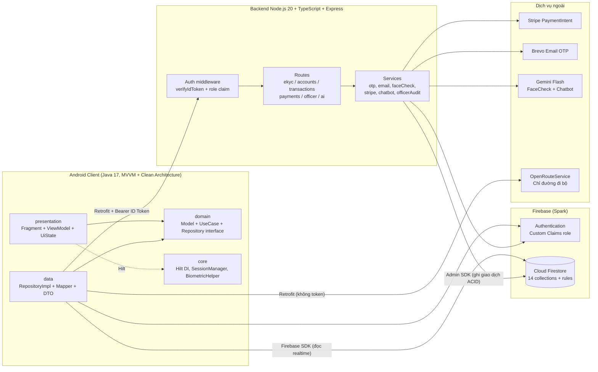
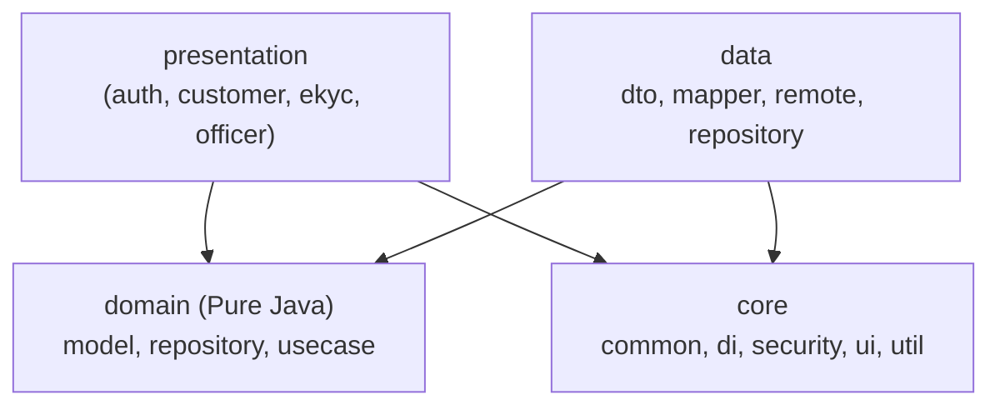
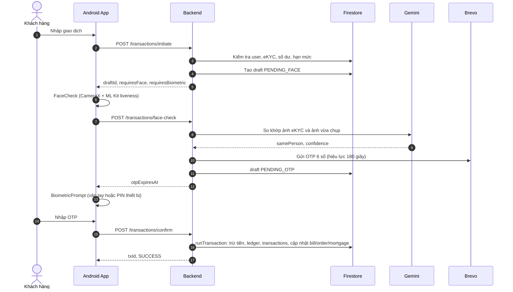
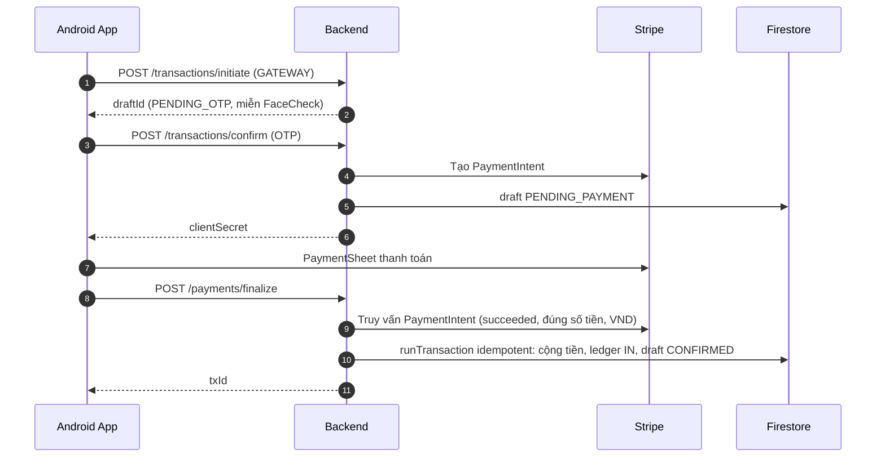
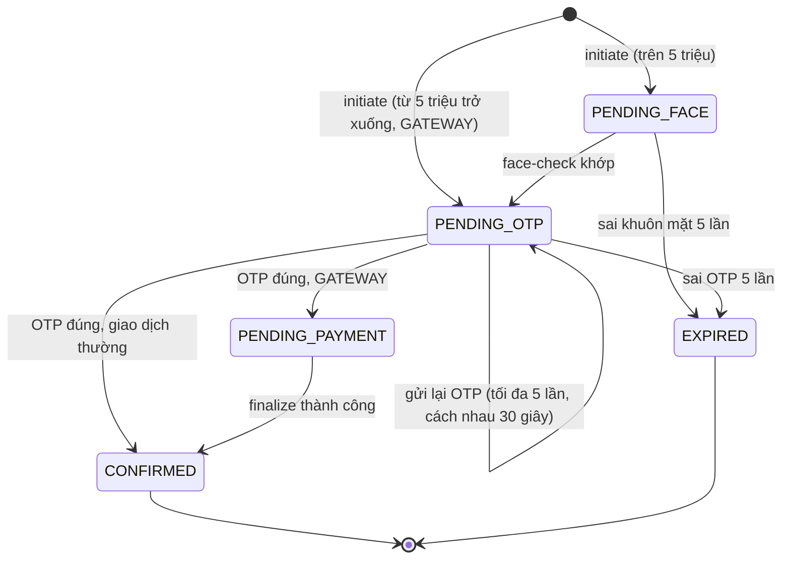

# Sơ đồ kiến trúc hệ thống NovaPay

Các sơ đồ dùng cú pháp Mermaid (xem được trên GitHub, VS Code với tiện ích Mermaid, hoặc dán vào https://mermaid.live để xuất ảnh PNG/SVG đưa vào báo cáo).

## 1. Kiến trúc tổng thể (Hybrid Cloud)

Nguyên tắc phân quyền dữ liệu: client chỉ **đọc** Firestore (theo `firestore.rules`); mọi thao tác **ghi** dữ liệu tài chính và kiểm toán đi qua Backend bằng Admin SDK.

## 2. Phân tầng Clean Architecture

Quy tắc phụ thuộc: `presentation → domain ← data`. Tầng `domain` không import `android.*`, `androidx.*`, `firebase`, `retrofit2`, `okhttp3`, `gson`.

## 3. Luồng giao dịch an toàn (chi/rút trên 5.000.000 ₫)

## 4. Luồng nạp tiền Stripe (GATEWAY)

## 5. Chuyển trạng thái của transaction_drafts

