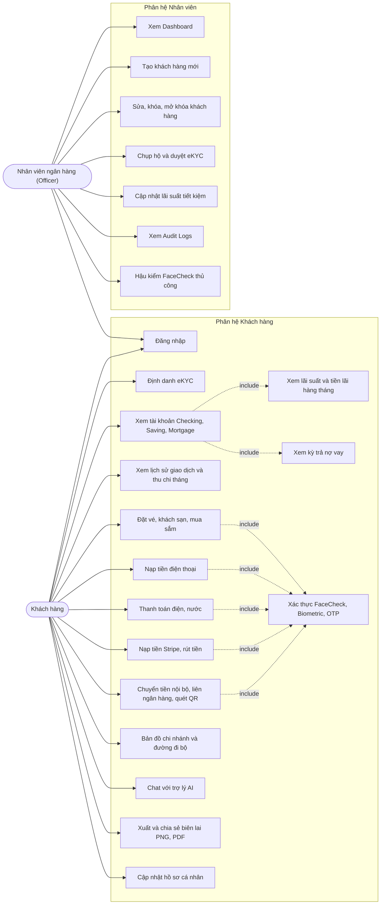

# Sơ đồ Use Case

## Đặc tả tóm tắt các use case chính

| Use case | Tác nhân | Tiền điều kiện | Kết quả |
| :--- | :--- | :--- | :--- |
| Chuyển tiền | Khách hàng | Tài khoản ACTIVE, eKYC VERIFIED, nguồn là CHECKING | Trừ tiền nguồn, cộng tiền đích (nội bộ), ghi ledger và transactions |
| Chi/rút trên 5 triệu | Khách hàng | Như trên | Bắt buộc đủ 3 lớp: FaceCheck, Biometric, OTP |
| Nạp tiền Stripe | Khách hàng | Tài khoản CHECKING ACTIVE | Cộng tiền đúng một lần sau khi Stripe báo succeeded |
| Thanh toán khoản vay | Khách hàng | Có tài khoản MORTGAGE ACTIVE | Giảm dư nợ, dời ngày đến hạn (1 tháng hoặc 14 ngày) |
| Đổi lãi suất | Officer | Custom Claim role = OFFICER | Ghi interest_rates và audit_logs, màn hình tiết kiệm cập nhật realtime |
| Khóa khách hàng | Officer | Role OFFICER | users.status = LOCKED, Firebase Auth bị vô hiệu hóa, client bị đăng xuất tức thì |
