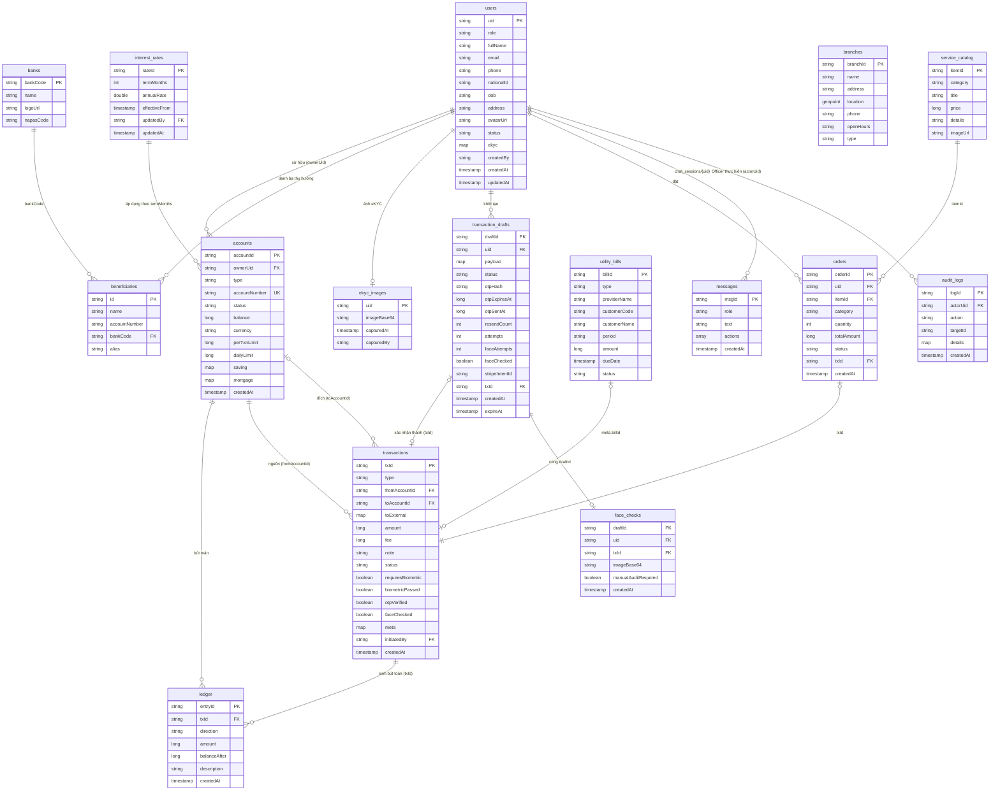

# Sơ đồ thực thể quan hệ (ER) và thiết kế cơ sở dữ liệu

Cơ sở dữ liệu là Cloud Firestore (NoSQL) gồm 14 collection (2 subcollection nằm trong `users` và `accounts`). Quan hệ giữa các collection được biểu diễn bằng trường tham chiếu (khóa ngoài logic).

## 1. Sơ đồ ER

## 2. Quy ước kiểu dữ liệu

| Kiểu nghiệp vụ | Lưu trữ | Ghi chú |
| :--- | :--- | :--- |
| Tiền tệ | `Long` (VNĐ) | Không dùng số thực, lãi tháng = floor(balance x lãi suất / 1200) |
| Thời gian | `Timestamp` | Chuyển sang `Instant` ở tầng data, tính hạn mức ngày theo Asia/Ho_Chi_Minh |
| Vị trí | `GeoPoint` | Chuyển sang `GeoLocation` ở tầng data |

## 3. Chỉ mục tổng hợp (`firestore.indexes.json`)

| Collection | Trường | Mục đích |
| :--- | :--- | :--- |
| ledger | direction, createdAt giảm dần | Lọc thu/chi theo thời gian |
| transactions | fromAccountId, status, createdAt | Tính tổng chi trong ngày cho hạn mức ngày |
| utility_bills | customerCode, status | Tra cứu hóa đơn chưa thanh toán |
| orders | uid, createdAt giảm dần | Lịch sử đơn hàng của khách |
| face_checks | manualAuditRequired, createdAt giảm dần | Officer hậu kiểm FaceCheck |

## 4. Phân quyền (`firestore.rules`)

| Collection | Đọc | Ghi |
| :--- | :--- | :--- |
| users | Chủ tài khoản, Officer | Chủ chỉ sửa phone, address, avatarUrl khi ACTIVE |
| users/beneficiaries | Chủ tài khoản | Chủ tài khoản |
| accounts, ledger | Chủ tài khoản, Officer | Chỉ Backend |
| transactions | Người gửi, người nhận nội bộ, Officer | Chỉ Backend |
| transaction_drafts | Không ai (chỉ Backend) | Chỉ Backend |
| ekyc_images | Chủ tài khoản, Officer | Chỉ Backend |
| face_checks, audit_logs | Officer | Chỉ Backend |
| banks, branches, interest_rates, service_catalog, utility_bills | Người dùng đã đăng nhập | Chỉ Backend |
| orders | Chủ đơn, Officer | Chỉ Backend |
| chat_sessions/{uid}/messages | Chủ phiên chat | Chỉ Backend |
