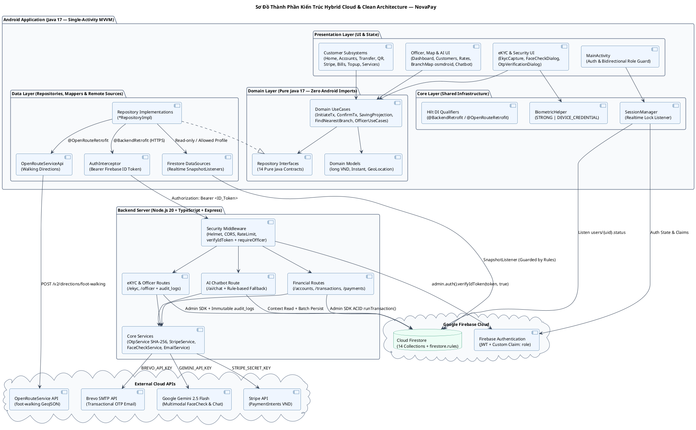
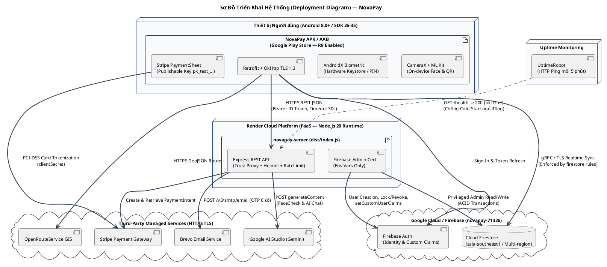
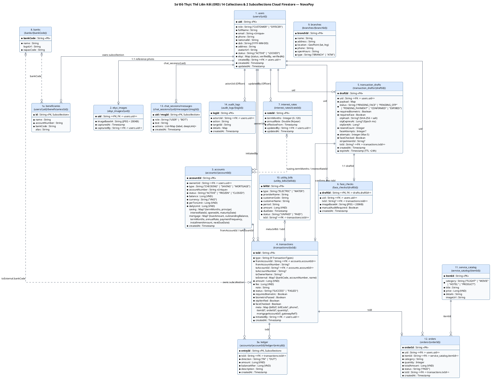

# TÀI LIỆU BÁO CÁO PHẦN 1: KIẾN TRÚC HỆ THỐNG HYBRID CLOUD & THIẾT KẾ CƠ SỞ DỮ LIỆU (ERD)

> **Dự án:** Hệ thống Ngân hàng Số **NovaPay** (`com.novabank.novapay`)  
> **Học phần:** Phát triển Ứng dụng Di động — Khoa Công nghệ Thông tin, Trường Đại học Tôn Đức Thắng (TDTU)  
> **Định dạng sơ đồ:** Chuẩn **PlantUML** (`@startuml ... @enduml`) tối ưu chèn trực tiếp vào báo cáo Microsoft Word (nền trắng `#FFFFFF`, không đổ bóng, bo góc `8px`).

---

## 1. Phân Tích Kiến Trúc Tổng Thể Hybrid Cloud

### 1.1 Bài toán kiến trúc trong ứng dụng Mobile Banking
Một ứng dụng ngân hàng di động nếu chỉ kết nối trực tiếp từ thiết bị Android vào cơ sở dữ liệu đám mây (Serverless thuần túy) sẽ đối mặt với **4 rủi ro bảo mật chí tử**:
1. **Giả mạo số dư & giao dịch phía Client:** Thiết bị người dùng (máy đã root, sửa đổi bộ nhớ hoặc dịch ngược APK) có thể tự ý cộng `balance`, bỏ qua kiểm tra hạn mức ngày (`dailyLimit`), hoặc đánh dấu hóa đơn `PAID` mà không trừ tiền.
2. **Lộ khóa bí mật bên thứ ba (API Key Leakage):** Nếu nhúng `STRIPE_SECRET_KEY`, `GEMINI_API_KEY` hoặc `BREVO_API_KEY` vào `BuildConfig` của Android, kẻ tấn công chỉ mất vài phút dùng `jadx` giải dịch APK để chiếm đoạt toàn bộ hạn mức thanh toán và AI.
3. **Thiếu tính nguyên tử liên tập hợp (Cross-Collection ACID):** Một giao dịch chuyển khoản nội bộ hoặc thanh toán khoản vay cần cập nhật đồng thời 4–5 tài liệu (`accounts` nguồn, `ledger` nguồn, `accounts` đích / `utility_bills` / `orders`, `transactions` và `transaction_drafts`).
4. **Rò rỉ thông tin định danh cá nhân (PII):** Nếu mở quyền đọc bảng `accounts` và `users` cho mọi khách hàng để tra cứu tên người nhận chuyển khoản, kẻ xấu có thể quét toàn bộ số dư, số CCCD và số điện thoại của khách hàng khác.

Để giải quyết triệt để cả 4 bài toán trên mà vẫn giữ được trải nghiệm cập nhật số dư tức thì (Realtime UI), **NovaPay** áp dụng kiến trúc **Hybrid Cloud (Đám mây Lai)** kết hợp **Clean Architecture + MVVM** trên Android (100% Java 17) và **Backend Server độc lập** (Node.js 20 + TypeScript + Express + Firebase Admin SDK).

### 1.2 Phân vai trách nhiệm trong mô hình Hybrid Cloud

| Thành phần | Công nghệ cốt lõi | Trách nhiệm kiến trúc | Lý do lựa chọn |
| :--- | :--- | :--- | :--- |
| **Android Client** | **100% Java 17**, XML + ViewBinding, Material Design 3, Dagger Hilt, Jetpack Navigation (`novapay://`), RxJava 3 + LiveData `UiState<T>`, CameraX, ML Kit, BiometricPrompt, `osmdroid`, MPAndroidChart, Stripe Android SDK | • Hiển thị giao diện 2 phân hệ (`CUSTOMER` / `OFFICER`) xử lý đủ 4 trạng thái `LOADING`, `SUCCESS`, `EMPTY`, `ERROR`. • Đọc dữ liệu thời gian thực từ Firestore cho chính chủ tài khoản. • Kiểm tra Liveness khuôn mặt tại biên (Edge AI bằng ML Kit) và quét mã QR. • Gửi yêu cầu ghi nhạy cảm qua `@BackendRetrofit` đính kèm Firebase ID Token. | Tầng `domain` thuần Java 17 giúp kiểm thử đơn vị (JUnit) siêu tốc trên JVM; tách 3 sub-graphs độc lập chống xung đột Git cho nhóm 3 thành viên. |
| **Backend Server** | **Node.js 20+**, **TypeScript 5**, Express, Helmet, CORS, Rate Limiter, **Firebase Admin SDK**, Stripe Node SDK | • Xác thực chữ ký JWT của Firebase ID Token (`verifyIdToken(token, true)`) và kiểm tra Custom Claim `role`. • Thực thi **ACID Firestore Transaction** hai pha (đọc toàn bộ trước, ghi nguyên tử sau). • Sinh mã OTP 6 số (`crypto.randomInt`), băm SHA-256 kèm salt `draftId`, so sánh hằng thời gian (`timingSafeEqual`). • Giữ kín toàn bộ khóa bí mật (`STRIPE_SECRET_KEY`, `BREVO_API_KEY`, `GEMINI_API_KEY`, `FIREBASE_PRIVATE_KEY`). | Đảm bảo nguyên tắc **Zero-Trust Client**: mọi quy tắc tài chính, hạn mức ngày theo múi giờ `Asia/Ho_Chi_Minh` (UTC+7) và nhật ký kiểm toán `audit_logs` đều do máy chủ kiểm soát tuyệt đối. |
| **Cloud Backend-as-a-Service** | **Firebase Authentication** & **Cloud Firestore** + `firestore.rules` + `firestore.indexes.json` | • Lưu trữ 14 collections + 2 subcollections. • Phát đồng bộ biến động số dư và khóa tài khoản (`status == "LOCKED"`) theo thời gian thực qua `SnapshotListener`. • Thực thi hàng rào bảo vệ thứ hai bằng `firestore.rules` (chặn 100% thao tác ghi tài chính từ Client SDK). | Đồng bộ tức thì không cần tự vận hành WebSocket, hỗ trợ Offline Persistence và truy vấn phức hợp tốc độ cao qua Composite Indexes. |
| **Hệ sinh thái Dịch vụ Ngoài** | **Stripe API**, **Brevo Transactional Email**, **Google Gemini 2.5 Flash**, **OpenRouteService** | • **Stripe:** Cổng nạp tiền thẻ quốc tế (`PaymentIntent` + `PaymentSheet`). • **Brevo:** Gửi Email OTP 2FA hiệu lực 180 giây. • **Gemini Multimodal:** Đối chiếu khuôn mặt eKYC (`> 5.000.000 ₫`) & Trợ lý ảo tài chính kèm DeepLink. • **OpenRouteService:** Định tuyến đường đi bộ ngắn nhất tới chi nhánh/ATM. | Kết hợp chuẩn thanh toán quốc tế, AI đa phương thức và bản đồ mở, đồng thời luôn có **cơ chế Fallback thông minh** (Rule-based NLP, `manualAuditRequired`, tọa độ ĐH Tôn Đức Thắng) chống gián đoạn khi bảo vệ đồ án. |

---

## 2. Sơ Đồ Thành Phần & Triển Khai Hệ Thống (Component & Deployment Diagram)

### 2.1 Sơ đồ Thành phần Kiến trúc Phân tầng (PlantUML Component Diagram)

---

### 2.2 Sơ đồ Triển khai Hạ tầng Thực tế (PlantUML Deployment Diagram)

---

## 3. Thiết Kế Cơ Sở Dữ Liệu Cloud Firestore & Sơ Đồ Thực Thể Liên Kết (ERD)

### 3.1 Sơ đồ ERD 14 Collections & 2 Subcollections (PlantUML Entity-Relationship Diagram)

Hệ thống cơ sở dữ liệu NoSQL trên Cloud Firestore của NovaPay được chuẩn hóa thành **14 collections cấp gốc (root collections)** và **2 subcollections chuyên biệt** (`users/{uid}/beneficiaries` và `accounts/{accountId}/ledger`), đảm bảo truy xuất thời gian thực tốc độ cao, không bị giới hạn kích thước tài liệu 1 MiB khi lịch sử giao dịch tăng trưởng theo thời gian.

---

### 3.2 Ma Trận Phân Quyền Bảo Mật (`firestore.rules`) & Chỉ Mục Phức Hợp (`firestore.indexes.json`)

#### A. Bảng Ma trận Phân quyền Truy cập 14 Collections

| STT | Collection / Subcollection | Quyền Đọc (`allow read`) phía Android | Quyền Ghi (`allow write`) phía Android | Cơ chế Bảo vệ & Ghi từ Backend |
| :---: | :--- | :--- | :--- | :--- |
| 1 | `users/{uid}` | Chính chủ (`uid == auth.uid`) hoặc `OFFICER` | Chỉ `update` đúng 4 khóa (`phone`, `address`, `avatarUrl`, `updatedAt`) khi `status == "ACTIVE"`, kèm kiểm tra kiểu `string`/`timestamp` & giới hạn độ dài | Tạo mới, khóa/mở khóa, duyệt eKYC bắt buộc qua `/officer/*` và `/ekyc/*` kèm `audit_logs` |
| 1a | `users/{uid}/beneficiaries/{id}` | Chính chủ (`uid == auth.uid`) hoặc `OFFICER` | Chính chủ đang `ACTIVE` (`isActiveUserDoc(uid)` kiểm tra `userDoc != null && status == "ACTIVE"`); kiểm tra nghiêm ngặt 4 khóa (`name`, `accountNumber`, `bankCode`, `alias`) và giới hạn ký tự | Đồng bộ danh bạ thụ hưởng cá nhân (đã biên dịch & triển khai trực tiếp lên Cloud Firestore) |
| 2 | `ekyc_images/{uid}` | Chính chủ hoặc `OFFICER` | **Cấm tuyệt đối (`false`)** | Server kiểm tra JPEG SOI `0xFF 0xD8` và `< 200KB` tại `POST /ekyc/submit` |
| 3 | `accounts/{accountId}` | Chính chủ (`ownerUid == auth.uid`) hoặc `OFFICER` | **Cấm tuyệt đối (`false`)** | Tra cứu tên người nhận nội bộ đi qua `GET /accounts/lookup` (ẩn số dư & CCCD) |
| 3a | `accounts/{accountId}/ledger/{entryId}` | Chủ tài khoản cha (`isAccountOwner(accountId)` kiểm tra an toàn `accDoc != null`) hoặc `OFFICER` | **Cấm tuyệt đối (`false`)** | Chỉ ghi trong ACID Transaction của `/transactions/confirm` và `/payments/finalize` |
| 4 | `transactions/{txId}` | Người khởi tạo (`initiatedBy`), chủ tài khoản nhận nội bộ (`toAccountId` không rỗng & `isAccountOwner`), hoặc `OFFICER` | **Cấm tuyệt đối (`false`)** | Bất biến sau khi hạch toán thành công |
| 5 | `transaction_drafts/{draftId}` | **Cấm tuyệt đối (`false`)** | **Cấm tuyệt đối (`false`)** | Chứa `otpHash` (SHA-256) và `stripeIntentId`; 100% chỉ Admin SDK truy cập |
| 6 | `face_checks/{draftId}` | Chỉ `OFFICER` (phục vụ hậu kiểm) | **Cấm tuyệt đối (`false`)** | Server kiểm tra `< 200KB` và lưu cờ `manualAuditRequired` |
| 7 | `interest_rates/{rateId}` | Mọi người dùng đã đăng nhập (`isSignedIn()`) | **Cấm tuyệt đối (`false`)** | Officer cập nhật qua `POST /officer/interest-rates` kèm `audit_logs` |
| 8 | `banks/{bankCode}` | Mọi người dùng đã đăng nhập | **Cấm tuyệt đối (`false`)** | Danh mục ngân hàng Napas chuẩn hóa qua `seed.ts` |
| 9 | `branches/{branchId}` | Mọi người dùng đã đăng nhập | **Cấm tuyệt đối (`false`)** | Tọa độ `GeoPoint` 10 chi nhánh & ATM TP.HCM |
| 10 | `utility_bills/{billId}` | Mọi người dùng đã đăng nhập (tra cứu cước) | **Cấm tuyệt đối (`false`)** | Cập nhật `UNPAID → PAID` nguyên tử cùng lệnh trừ tiền tại `/transactions/confirm` |
| 11 | `service_catalog/{itemId}` | Mọi người dùng đã đăng nhập | **Cấm tuyệt đối (`false`)** | Server đối chiếu lại `amount === price * quantity` chống sửa giá phía Client |
| 12 | `orders/{orderId}` | Chủ đơn hàng (`uid == auth.uid`) hoặc `OFFICER` | **Cấm tuyệt đối (`false`)** | Khởi tạo nguyên tử trong `/transactions/confirm` |
| 13 | `chat_sessions/{uid}/messages/{msgId}` | Chính chủ (`uid == auth.uid`) | **Cấm tuyệt đối (`false`)** | Ghi theo lô (`WriteBatch`) 2 chiều `USER` + `BOT` tại `POST /ai/chat` |
| 14 | `audit_logs/{logId}` | Chỉ `OFFICER` | **Cấm tuyệt đối (`false`)** | Nhật ký kiểm toán bất biến (Append-only từ Admin SDK) |

#### B. Danh sách 5 Composite Indexes tối ưu hiệu năng (`firestore.indexes.json`)
1. `ledger` (`COLLECTION`): `direction ASC` + `createdAt DESC` — phục vụ lọc sổ cái Tiền vào / Tiền ra theo tháng tại `TransactionHistoryFragment`.
2. `transactions` (`COLLECTION`): `fromAccountId ASC` + `status ASC` + `createdAt ASC` — phục vụ tính tổng hạn mức chi tiêu trong ngày (`dailyLimit`) theo múi giờ `Asia/Ho_Chi_Minh` bên trong Firestore Transaction.
3. `utility_bills` (`COLLECTION`): `customerCode ASC` + `status ASC` — phục vụ tra cứu hóa đơn Điện/Nước chưa thanh toán (`UNPAID`).
4. `orders` (`COLLECTION`): `uid ASC` + `createdAt DESC` — phục vụ hiển thị danh sách đơn đặt vé/mua sắm mới nhất của khách hàng.
5. `face_checks` (`COLLECTION`): `manualAuditRequired ASC` + `createdAt DESC` — phục vụ hàng đợi hậu kiểm khuôn mặt giao dịch `> 5.000.000 ₫` trên `OfficerDashboardFragment` và `OfficerEkycReviewFragment`.
