# TÀI LIỆU BÁO CÁO PHẦN 2: SƠ ĐỒ LỚP CHI TIẾT (PLANTUML CLASS DIAGRAMS)

> **Dự án:** Hệ thống Ngân hàng Số **NovaPay** (`com.novabank.novapay`)  
> **Học phần:** Phát triển Ứng dụng Di động — Khoa Công nghệ Thông tin, Trường Đại học Tôn Đức Thắng (TDTU)  
> **Chuẩn ký hiệu UML 2.5 sử dụng thống nhất trên toàn bộ 10 sơ đồ lớp:**
> - `--|>` **Kế thừa (Inheritance / Generalization):** ví dụ `*Fragment --|> BaseFragment`, `*DialogFragment --|> DialogFragment`, `*ViewModel --|> ViewModel`, `SingleLiveEvent --|> MutableLiveData`.
> - `..|>` **Thực thi giao diện (Interface Realization):** ví dụ `*RepositoryImpl ..|> *Repository`, `AuthInterceptor ..|> Interceptor`.
> - `*--` **Hợp thành chặt (Composition — vòng đời phụ thuộc):** ví dụ `User *-- EkycInfo`, `Account *-- SavingInfo`, `*Fragment *-- StateLayoutHelper`, `UiState *-- Status`, `*ViewModel *-- MutableLiveData`.
> - `o--` **Kết tập (Aggregation — tham chiếu tập hợp độc lập):** ví dụ `CustomerHomeFragment o-- AccountCardAdapter`, `TransferFragment o-- BeneficiaryAdapter`, `OfficerDashboardFragment o-- AuditLogAdapter`.
> - `-->` **Phụ thuộc / Tiêm phụ thuộc (Dependency / Hilt DI Injection):** `Fragment --> ViewModel --> UseCase --> Repository <-- RepositoryImpl --> Api / DataSource`.

---

## 1. Tầng Hạ Tầng Dùng Chung (`core`) & Khung Nền Tảng MVVM / Bảo Mật

```plantuml
@startuml NovaPay_01_Core_Class_Diagram
skinparam backgroundColor #FFFFFF
skinparam shadowing false
skinparam roundcorner 8
skinparam defaultFontName "Segoe UI"
skinparam defaultFontSize 10
skinparam ArrowColor #334155
skinparam ClassBorderColor #1E3A8A
skinparam ClassBackgroundColor #F8FAFC
skinparam ClassHeaderBackgroundColor #DBEAFE
skinparam PackageBorderColor #64748B

title Sơ Đồ 1: Hạ Tầng Dùng Chung (Core Infrastructure, Security, Utilities & Hilt DI) — NovaPay

package "AndroidX / OkHttp Framework" {
  abstract class AppCompatActivity
  abstract class Fragment
  class "MutableLiveData<T>" as MutableLiveData
  interface Interceptor
}

package "com.novabank.novapay.core.common" {
  class "AppResult<T>" as AppResult {
    - data : T
    - errorCode : String
    - message : String
    - success : boolean
    --
    + {static} success(data: T) : AppResult<T>
    + {static} error(code: String, msg: String) : AppResult<T>
    + isSuccess() : boolean
    + isError() : boolean
    + getData() : T
    + getErrorCode() : String
    + getMessage() : String
  }

  class "UiState<T>" as UiState {
    - status : Status
    - data : T
    - errorMessage : String
    --
    + {static} loading() : UiState<T>
    + {static} success(data: T) : UiState<T>
    + {static} empty() : UiState<T>
    + {static} error(msg: String) : UiState<T>
    + getStatus() : Status
    + getData() : T
    + getErrorMessage() : String
  }

  enum "UiState.Status" as UiStatus {
    LOADING
    SUCCESS
    EMPTY
    ERROR
  }

  class "SingleLiveEvent<T>" as SingleLiveEvent {
    - pending : AtomicBoolean
    --
    + observe(owner: LifecycleOwner, observer: Observer<T>) : void
    + setValue(value: T) : void
    + postValue(value: T) : void
  }

  class Constants {
    + {static} HIGH_VALUE_THRESHOLD_VND : long = 5000000L
    + {static} OTP_EXPIRY_SECONDS : int = 180
    + {static} OTP_MAX_ATTEMPTS : int = 5
    + {static} MAX_EKYC_IMAGE_BYTES : int = 204800
    + {static} TDTU_DEFAULT_LAT : double = 10.7326
    + {static} TDTU_DEFAULT_LNG : double = 106.6998
    + {static} ZONE_HO_CHI_MINH : String = "Asia/Ho_Chi_Minh"
  }
}

package "com.novabank.novapay.core.ui & util" {
  abstract class "BaseFragment<VB extends ViewBinding>" as BaseFragment {
    - binding : VB
    --
    # {abstract} inflateBinding(inflater: LayoutInflater, container: ViewGroup) : VB
    # {abstract} setupViews() : void
    # {abstract} observeViewModel() : void
    # getBinding() : VB
    # navigateDeepLink(uriString: String) : void
    # showSnackbar(message: String) : void
    + onDestroyView() : void
  }

  class StateLayoutHelper {
    - contentView : View
    - loadingBinding : ViewLoadingStateBinding
    - emptyBinding : ViewEmptyStateBinding
    - errorBinding : ViewErrorStateBinding
    --
    + StateLayoutHelper(content: View, loading: ViewLoadingStateBinding,\n  empty: ViewEmptyStateBinding, error: ViewErrorStateBinding, onRetry: Runnable)
    + render(state: UiState<T>) : void
  }

  class CurrencyFormatter {
    + {static} formatVnd(amount: long) : String
    + {static} formatSignedVnd(amount: long, isInflow: boolean) : String
  }

  class DateUtils {
    + {static} startOfTodayVietnam() : Instant
    + {static} formatVietnamDateTime(instant: Instant) : String
  }

  class ImageCompressor {
    - {static} INITIAL_MAX_EDGE_PX : int = 1024
    --
    + {static} compressImageProxyToBase64(proxy: ImageProxy) : String
    + {static} compressToJpegBytes(source: Bitmap, maxBytes: int) : byte[]
    + {static} toBase64(bytes: byte[]) : String
  }

  class QrHelper {
    + {static} encodeInternalTransferQr(accountNumber: String, ownerName: String) : String
    + {static} parseTransferQrPayload(raw: String) : QrTransferPayload
  }
}

package "com.novabank.novapay.core.security, di & MainActivity" {
  class SessionManager {
    - firebaseAuth : FirebaseAuth
    - firestore : FirebaseFirestore
    - accountLockedEvent : SingleLiveEvent<Boolean>
    - roleClaimLiveData : MutableLiveData<String>
    - userDocListener : ListenerRegistration
    - cachedRole : String
    - roleClaimLoaded : boolean
    - pendingDeepLink : Uri
    --
    + isSignedIn() : boolean
    + getCurrentUid() : String
    + getCachedRole() : String
    + isRoleClaimLoaded() : boolean
    + getAccountLockedEvent() : SingleLiveEvent<Boolean>
    + getRoleClaimLiveData() : LiveData<String>
    + updateCachedRole(role: String) : void
    + consumePendingDeepLinkIfAllowed(role: String, uid: String) : Uri
    + startUserSession() : void
    + signOut() : void
    + {static} isDeepLinkAllowedForRole(uri: String, role: String, uid: String) : boolean
  }

  class BiometricHelper {
    + {static} ALLOWED_AUTHENTICATORS : int
    --
    + canAuthenticate(context: Context) : boolean
    + authenticate(fragment: Fragment, title: String, subtitle: String, cb: AuthCallback) : void
  }

  class AuthInterceptor {
    - {static} TOKEN_FETCH_TIMEOUT_SECONDS : long = 10L
    --
    + intercept(chain: Chain) : Response
    - fetchCurrentIdTokenSafely() : String
  }

  class NetworkModule {
    + provideGson() : Gson
    + provideLoggingInterceptor() : HttpLoggingInterceptor
    + provideBackendRetrofit(gson: Gson, auth: AuthInterceptor, log: HttpLoggingInterceptor) : Retrofit
    + provideOpenRouteRetrofit(gson: Gson, log: HttpLoggingInterceptor) : Retrofit
  }

  class MainActivity {
    ~ sessionManager : SessionManager
    - binding : ActivityMainBinding
    - navController : NavController
    - isRedirecting : boolean
    --
    - enforceDestinationGuard(ctrl: NavController, dest: NavDestination, args: Bundle) : void
    - isCustomerOnlyDestination(dest: NavDestination) : boolean
    - isOfficerOnlyDestination(dest: NavDestination) : boolean
    - handleIncomingIntent(intent: Intent) : void
    - observeSessionLock() : void
  }
}

SingleLiveEvent --|> MutableLiveData
BaseFragment --|> Fragment
MainActivity --|> AppCompatActivity
AuthInterceptor ..|> Interceptor
UiState *-- UiStatus
StateLayoutHelper --> UiState
MainActivity --> SessionManager
SessionManager *-- SingleLiveEvent
SessionManager *-- MutableLiveData
NetworkModule --> AuthInterceptor

@enduml
```

Tầng `core` cung cấp các thành phần dùng chung xuyên suốt 25 màn hình của NovaPay: bao gói kết quả `AppResult<T>`, máy trạng thái giao diện 4 pha `UiState<T>` + `StateLayoutHelper`, kênh sự kiện một lần `SingleLiveEvent<T>`, lớp cơ sở `BaseFragment<VB>`, bộ quản lý phiên & khóa tài khoản thời gian thực `SessionManager`, xác thực sinh trắc học thiết bị `BiometricHelper`, bộ chặn đính kèm JWT `AuthInterceptor` và chốt chặn phân quyền hai chiều tại `MainActivity`.

---

## 2. Phân Hệ A: Xác Thực, Hồ Sơ, Định Danh eKYC, Tài Khoản & Sổ Cái (`nav_core`)

### 2.1 Sơ đồ Lớp Tầng `Domain` & `Data` — Phân hệ A

```plantuml
@startuml NovaPay_02A_Domain_Data_Class_Diagram
skinparam backgroundColor #FFFFFF
skinparam shadowing false
skinparam roundcorner 8
skinparam defaultFontName "Segoe UI"
skinparam defaultFontSize 10
skinparam ArrowColor #334155
skinparam ClassBorderColor #0F4C81
skinparam ClassBackgroundColor #F8FAFC
skinparam ClassHeaderBackgroundColor #DBEAFE
skinparam PackageBorderColor #64748B

title Sơ Đồ 2A: Phân Hệ A — Tầng Domain & Data (Auth, Profile, eKYC, Accounts & Ledger)

package "Domain Layer — Subsystem A (Pure Java 17)" {
  enum UserRole {
    CUSTOMER
    OFFICER
  }
  enum UserStatus {
    ACTIVE
    LOCKED
  }
  enum EkycStatus {
    UNVERIFIED
    PENDING
    VERIFIED
    REJECTED
  }
  enum AccountType {
    CHECKING
    SAVING
    MORTGAGE
  }
  enum AccountStatus {
    ACTIVE
    FROZEN
    CLOSED
  }
  enum LedgerDirection {
    IN
    OUT
  }

  class EkycInfo {
    - status : EkycStatus
    - verifiedBy : String
    - verifiedAt : Instant
    --
    + getStatus() : EkycStatus
    + isVerified() : boolean
  }

  class User {
    - uid : String
    - role : UserRole
    - fullName : String
    - email : String
    - phone : String
    - nationalId : String
    - dob : String
    - address : String
    - avatarUrl : String
    - status : UserStatus
    - ekyc : EkycInfo
    - createdBy : String
    - createdAt : Instant
    - updatedAt : Instant
    --
    + isActive() : boolean
    + isEkycVerified() : boolean
  }

  class SavingInfo {
    - termMonths : int
    - principal : long
    - interestRateId : String
    - openedAt : Instant
    - maturityDate : Instant
    --
    + {static} calculateMonthlyProfit(balance: long, annualRate: double) : long
  }

  class MortgageInfo {
    - loanAmount : long
    - outstandingBalance : long
    - termMonths : int
    - annualRate : double
    - paymentFrequency : String
    - installmentAmount : long
    - nextDueDate : Instant
  }

  class Account {
    - accountId : String
    - ownerUid : String
    - type : AccountType
    - accountNumber : String
    - status : AccountStatus
    - balance : long
    - currency : String
    - perTxnLimit : long
    - dailyLimit : long
    - saving : SavingInfo
    - mortgage : MortgageInfo
    - createdAt : Instant
    --
    + canBePaymentSource() : boolean
  }

  class SavingProjection {
    - account : Account
    - effectiveAnnualRate : double
    - monthlyProfit : long
    --
    + getMonthlyProfit() : long
  }

  class LedgerEntry {
    - entryId : String
    - accountId : String
    - txId : String
    - direction : LedgerDirection
    - amount : long
    - balanceAfter : long
    - description : String
    - createdAt : Instant
    --
    + isInflow() : boolean
  }

  class MonthlyCashflowSummary {
    - monthLabel : String
    - totalIn : long
    - totalOut : long
    --
    + getNetCashflow() : long
  }

  interface AuthRepository {
    + signIn(email: String, password: String) : Single<AppResult<UserRole>>
    + refreshRole() : Single<AppResult<UserRole>>
    + signOut() : void
    + isSignedIn() : boolean
    + getCurrentUid() : String
  }

  interface UserRepository {
    + observeMyProfile() : Observable<AppResult<User>>
    + getMyProfile() : Single<AppResult<User>>
    + getUserById(uid: String) : Single<AppResult<User>>
    + updateMyProfile(phone: String, address: String, avatarUrl: String) : Single<AppResult<Void>>
  }

  interface AccountRepository {
    + observeMyAccounts() : Observable<AppResult<List<Account>>>
    + observeAccountById(accountId: String) : Observable<AppResult<Account>>
    + getAccountById(accountId: String) : Single<AppResult<Account>>
  }

  interface EkycRepository {
    + submitEkyc(imageBase64: String, targetUid: String) : Single<AppResult<String>>
    + submitFaceCheck(draftId: String, imageBase64: String) : Single<AppResult<Long>>
  }

  interface LedgerRepository {
    + observeLedger(accId: String, dir: LedgerDirection, from: Instant, to: Instant) : Observable<AppResult<List<LedgerEntry>>>
  }

  class SignInUseCase {
    - authRepository : AuthRepository
    --
    + execute(email: String, password: String) : Single<AppResult<UserRole>>
  }
  class SignOutUseCase {
    - authRepository : AuthRepository
    --
    + execute() : void
  }
  class ObserveMyProfileUseCase {
    - userRepository : UserRepository
    --
    + execute() : Observable<AppResult<User>>
  }
  class UpdateMyProfileUseCase {
    - userRepository : UserRepository
    --
    + execute(phone: String, address: String, avatarUrl: String) : Single<AppResult<Void>>
  }
  class ObserveMyAccountsUseCase {
    - accountRepository : AccountRepository
    --
    + execute() : Observable<AppResult<List<Account>>>
  }
  class ObserveAccountDetailUseCase {
    - accountRepository : AccountRepository
    --
    + observe(accountId: String) : Observable<AppResult<Account>>
    + getOnce(accountId: String) : Single<AppResult<Account>>
  }
  class ObserveSavingProjectionUseCase {
    - accountRepository : AccountRepository
    - interestRateRepository : InterestRateRepository
    --
    + execute(accountId: String) : Observable<AppResult<SavingProjection>>
  }
  class SubmitEkycUseCase {
    - ekycRepository : EkycRepository
    --
    + execute(imageBase64: String, targetUid: String) : Single<AppResult<String>>
  }
  class SubmitFaceCheckUseCase {
    - ekycRepository : EkycRepository
    --
    + execute(draftId: String, imageBase64: String) : Single<AppResult<Long>>
  }
  class ObserveAccountLedgerUseCase {
    - ledgerRepository : LedgerRepository
    --
    + execute(accId: String, dir: LedgerDirection, from: Instant, to: Instant) : Observable<AppResult<List<LedgerEntry>>>
  }
  class ObserveMonthlyCashflowUseCase {
    - ledgerRepository : LedgerRepository
    --
    + execute() : Observable<AppResult<MonthlyCashflowSummary>>
  }
}

package "Data Layer — Subsystem A" {
  class FirebaseAuthDataSource {
    - firebaseAuth : FirebaseAuth
    - sessionManager : SessionManager
    --
    + signIn(email: String, password: String) : Single<AppResult<UserRole>>
    + refreshRole() : Single<AppResult<UserRole>>
    + signOut() : void
    + isSignedIn() : boolean
    + getCurrentUid() : String
  }

  class FirestoreUserDataSource {
    - firestore : FirebaseFirestore
    --
    + observeUser(uid: String) : Observable<AppResult<User>>
    + getUser(uid: String) : Single<AppResult<User>>
    + updateAllowedProfileFields(uid: String, phone: String, addr: String, avatar: String) : Single<AppResult<Void>>
  }

  class FirestoreAccountDataSource {
    - firestore : FirebaseFirestore
    --
    + observeAccountsByOwner(ownerUid: String) : Observable<AppResult<List<Account>>>
    + observeAccountById(accountId: String) : Observable<AppResult<Account>>
    + getAccountById(accountId: String) : Single<AppResult<Account>>
  }

  class FirestoreLedgerDataSource {
    - firestore : FirebaseFirestore
    --
    + observeLedger(accId: String, dir: LedgerDirection, from: Instant, to: Instant) : Observable<AppResult<List<LedgerEntry>>>
  }

  interface EkycApi {
    + submitEkyc(body: EkycSubmitRequestDto) : Single<EkycSubmitResponseDto>
  }

  interface FaceCheckApi {
    + verifyFace(body: FaceCheckRequestDto) : Single<FaceCheckResponseDto>
  }

  class AuthRepositoryImpl {
    - authDataSource : FirebaseAuthDataSource
    --
    + signIn(email: String, password: String) : Single<AppResult<UserRole>>
    + refreshRole() : Single<AppResult<UserRole>>
    + signOut() : void
  }

  class UserRepositoryImpl {
    - authDataSource : FirebaseAuthDataSource
    - userDataSource : FirestoreUserDataSource
    --
    + observeMyProfile() : Observable<AppResult<User>>
    + updateMyProfile(phone: String, addr: String, avatar: String) : Single<AppResult<Void>>
  }

  class AccountRepositoryImpl {
    - authDataSource : FirebaseAuthDataSource
    - accountDataSource : FirestoreAccountDataSource
    --
    + observeMyAccounts() : Observable<AppResult<List<Account>>>
    + observeAccountById(accountId: String) : Observable<AppResult<Account>>
    + getAccountById(accountId: String) : Single<AppResult<Account>>
  }

  class EkycRepositoryImpl {
    - ekycApi : EkycApi
    - faceCheckApi : FaceCheckApi
    - errorParser : ApiErrorParser
    --
    + submitEkyc(imageBase64: String, targetUid: String) : Single<AppResult<String>>
    + submitFaceCheck(draftId: String, imageBase64: String) : Single<AppResult<Long>>
  }

  class LedgerRepositoryImpl {
    - authDataSource : FirebaseAuthDataSource
    - accountDataSource : FirestoreAccountDataSource
    - ledgerDataSource : FirestoreLedgerDataSource
    --
    + observeLedger(accId: String, dir: LedgerDirection, from: Instant, to: Instant) : Observable<AppResult<List<LedgerEntry>>>
  }
}

User *-- EkycInfo
User *-- UserRole
User *-- UserStatus
EkycInfo *-- EkycStatus
Account *-- AccountType
Account *-- AccountStatus
Account *-- "0..1" SavingInfo
Account *-- "0..1" MortgageInfo
SavingProjection *-- Account
LedgerEntry *-- LedgerDirection

SignInUseCase --> AuthRepository
SignOutUseCase --> AuthRepository
ObserveMyProfileUseCase --> UserRepository
UpdateMyProfileUseCase --> UserRepository
ObserveMyAccountsUseCase --> AccountRepository
ObserveAccountDetailUseCase --> AccountRepository
ObserveSavingProjectionUseCase --> AccountRepository
SubmitEkycUseCase --> EkycRepository
SubmitFaceCheckUseCase --> EkycRepository
ObserveAccountLedgerUseCase --> LedgerRepository
ObserveMonthlyCashflowUseCase --> LedgerRepository

AuthRepositoryImpl ..|> AuthRepository
UserRepositoryImpl ..|> UserRepository
AccountRepositoryImpl ..|> AccountRepository
EkycRepositoryImpl ..|> EkycRepository
LedgerRepositoryImpl ..|> LedgerRepository

AuthRepositoryImpl --> FirebaseAuthDataSource
UserRepositoryImpl --> FirebaseAuthDataSource
UserRepositoryImpl --> FirestoreUserDataSource
AccountRepositoryImpl --> FirebaseAuthDataSource
AccountRepositoryImpl --> FirestoreAccountDataSource
EkycRepositoryImpl --> EkycApi
EkycRepositoryImpl --> FaceCheckApi
LedgerRepositoryImpl --> FirestoreAccountDataSource
LedgerRepositoryImpl --> FirestoreLedgerDataSource

@enduml
```

### 2.2 Sơ đồ Lớp Tầng `Presentation` (MVVM) — Phân hệ A

```plantuml
@startuml NovaPay_02B_Presentation_MVVM_Class_Diagram
skinparam backgroundColor #FFFFFF
skinparam shadowing false
skinparam roundcorner 8
skinparam defaultFontName "Segoe UI"
skinparam defaultFontSize 10
skinparam ArrowColor #334155
skinparam ClassBorderColor #0F4C81
skinparam ClassBackgroundColor #F8FAFC
skinparam ClassHeaderBackgroundColor #DBEAFE
skinparam PackageBorderColor #64748B

title Sơ Đồ 2B: Phân Hệ A — Tầng Presentation MVVM (Fragments, Dialogs, ViewModels, UiStates & Adapters)

package "Framework & Core Base" {
  abstract class "BaseFragment<VB>" as BaseFragA
  abstract class DialogFragment
  abstract class ViewModel
  class StateLayoutHelper
}

package "Presentation Layer — Subsystem A (10 MVVM Triads)" {
  class LoginUiState {
    - ready : boolean
    - authenticatedRole : String
  }
  class LoginViewModel {
    - signInUseCase : SignInUseCase
    - authRepository : AuthRepository
    - userRepository : UserRepository
    - sessionManager : SessionManager
    - uiState : MutableLiveData<UiState<LoginUiState>>
    - navigateDeepLinkEvent : SingleLiveEvent<String>
    --
    + checkExistingSession() : void
    + onLoginClicked(rawEmail: String, password: String) : void
    + resetToReadyForm() : void
  }
  class LoginFragment {
    - viewModel : LoginViewModel
    - stateLayoutHelper : StateLayoutHelper
    --
    # setupViews() : void
    # observeViewModel() : void
  }

  class CustomerHomeUiState {
    - user : User
    - accounts : List<Account>
    - cashflow : MonthlyCashflowSummary
    - totalLiquidAssets : long
    - balanceHidden : boolean
  }
  class AccountCardAdapter {
    - items : List<Account>
    - balanceHidden : boolean
    --
    + submitList(accounts: List<Account>, hidden: boolean) : void
  }
  class CustomerHomeViewModel {
    - observeMyProfileUseCase : ObserveMyProfileUseCase
    - observeMyAccountsUseCase : ObserveMyAccountsUseCase
    - observeMonthlyCashflowUseCase : ObserveMonthlyCashflowUseCase
    - signOutUseCase : SignOutUseCase
    - uiState : MutableLiveData<UiState<CustomerHomeUiState>>
    --
    + loadHome() : void
    + toggleBalanceVisibility() : void
    + signOut() : void
  }
  class CustomerHomeFragment {
    - viewModel : CustomerHomeViewModel
    - stateLayoutHelper : StateLayoutHelper
    - accountAdapter : AccountCardAdapter
    --
    - renderHome(data: CustomerHomeUiState) : void
    - renderCashflowChart(cashflow: MonthlyCashflowSummary) : void
    - performLogout() : void
  }

  class AccountRouterUiState {
    - accountId : String
    - accountType : AccountType
  }
  class AccountRouterViewModel {
    - observeAccountDetailUseCase : ObserveAccountDetailUseCase
    - uiState : MutableLiveData<UiState<AccountRouterUiState>>
    - routeEvent : SingleLiveEvent<AccountRouterUiState>
    --
    + resolveAccount(accountId: String) : void
  }
  class AccountRouterFragment {
    - viewModel : AccountRouterViewModel
    - stateLayoutHelper : StateLayoutHelper
    --
    - routeByAccountType(target: AccountRouterUiState) : void
  }

  class CheckingDetailUiState {
    - account : Account
  }
  class CheckingDetailViewModel {
    - observeAccountDetailUseCase : ObserveAccountDetailUseCase
    - uiState : MutableLiveData<UiState<CheckingDetailUiState>>
    --
    + observeAccount(accountId: String) : void
  }
  class CheckingDetailFragment {
    - viewModel : CheckingDetailViewModel
    - stateLayoutHelper : StateLayoutHelper
    --
    - renderCheckingDetail(account: Account) : void
  }

  class SavingDetailUiState {
    - projection : SavingProjection
  }
  class SavingDetailViewModel {
    - observeSavingProjectionUseCase : ObserveSavingProjectionUseCase
    - uiState : MutableLiveData<UiState<SavingDetailUiState>>
    --
    + observeSaving(accountId: String) : void
  }
  class SavingDetailFragment {
    - viewModel : SavingDetailViewModel
    - stateLayoutHelper : StateLayoutHelper
    --
    - renderSavingDetail(projection: SavingProjection) : void
  }

  class MortgageDetailUiState {
    - account : Account
  }
  class MortgageDetailViewModel {
    - observeAccountDetailUseCase : ObserveAccountDetailUseCase
    - uiState : MutableLiveData<UiState<MortgageDetailUiState>>
    --
    + observeMortgage(accountId: String) : void
  }
  class MortgageDetailFragment {
    - viewModel : MortgageDetailViewModel
    - stateLayoutHelper : StateLayoutHelper
    --
    - renderMortgageDetail(account: Account) : void
  }

  class TransactionHistoryUiState {
    - entries : List<LedgerEntry>
    - directionFilter : LedgerDirection
    - monthOnlyRange : boolean
  }
  class LedgerAdapter {
    - items : List<LedgerEntry>
    --
    + submitList(entries: List<LedgerEntry>) : void
  }
  class TransactionHistoryViewModel {
    - observeAccountLedgerUseCase : ObserveAccountLedgerUseCase
    - uiState : MutableLiveData<UiState<TransactionHistoryUiState>>
    --
    + initialize(monthOnly: boolean) : void
    + setDirectionFilter(dir: LedgerDirection) : void
    + setMonthOnlyRange(monthOnly: boolean) : void
    + reload() : void
  }
  class TransactionHistoryFragment {
    - viewModel : TransactionHistoryViewModel
    - stateLayoutHelper : StateLayoutHelper
    - ledgerAdapter : LedgerAdapter
    --
    # setupViews() : void
    # observeViewModel() : void
  }

  class ProfileUiState {
    - user : User
    - saving : boolean
  }
  class ProfileViewModel {
    - observeMyProfileUseCase : ObserveMyProfileUseCase
    - updateMyProfileUseCase : UpdateMyProfileUseCase
    - signOutUseCase : SignOutUseCase
    - uiState : MutableLiveData<UiState<ProfileUiState>>
    --
    + loadProfile() : void
    + saveProfile(phone: String, address: String, avatarUrl: String) : void
    + signOut() : void
  }
  class ProfileFragment {
    - viewModel : ProfileViewModel
    - stateLayoutHelper : StateLayoutHelper
    --
    - renderProfile(user: User, isSaving: boolean) : void
  }

  class FaceLivenessEvaluator {
    + {static} MIN_EYE_OPEN_PROBABILITY : float = 0.7f
    + {static} MAX_HEAD_ANGLE_DEGREES : float = 15.0f
    --
    + {static} evaluateFaces(faces: List<Face>) : LivenessVerdict
    + {static} toGuideMessageRes(verdict: LivenessVerdict) : int
  }

  class EkycCaptureUiState {
    - cameraActive : boolean
    - livenessPassed : boolean
    - guideMessageRes : int
  }
  class EkycCaptureViewModel {
    - submitEkycUseCase : SubmitEkycUseCase
    - uiState : MutableLiveData<UiState<EkycCaptureUiState>>
    - submitSuccessEvent : SingleLiveEvent<String>
    --
    + onLivenessUpdated(verdict: LivenessVerdict) : void
    + submitCapturedBase64(imageBase64: String, targetUid: String) : void
  }
  class EkycCaptureFragment {
    - viewModel : EkycCaptureViewModel
    - stateLayoutHelper : StateLayoutHelper
    --
    - startFrontCamera() : void
    - captureAndSubmit() : void
  }

  class FaceCheckUiState {
    - livenessPassed : boolean
    - guideMessageRes : int
    - inlineError : String
  }
  class FaceCheckViewModel {
    - submitFaceCheckUseCase : SubmitFaceCheckUseCase
    - uiState : MutableLiveData<UiState<FaceCheckUiState>>
    - faceCheckPassedEvent : SingleLiveEvent<Long>
    --
    + onLivenessUpdated(verdict: LivenessVerdict) : void
    + verifyFace(draftId: String, imageBase64: String) : void
    + {static} isTerminalErrorCode(errorCode: String) : boolean
  }
  class FaceCheckDialogFragment {
    - viewModel : FaceCheckViewModel
    - stateLayoutHelper : StateLayoutHelper
    --
    - startCameraAndAnalyzer() : void
    - publishResultAndDismiss(passed: boolean, otpExp: long, err: String) : void
  }
}

LoginFragment --|> BaseFragA
CustomerHomeFragment --|> BaseFragA
AccountRouterFragment --|> BaseFragA
CheckingDetailFragment --|> BaseFragA
SavingDetailFragment --|> BaseFragA
MortgageDetailFragment --|> BaseFragA
TransactionHistoryFragment --|> BaseFragA
ProfileFragment --|> BaseFragA
EkycCaptureFragment --|> BaseFragA
FaceCheckDialogFragment --|> DialogFragment

LoginViewModel --|> ViewModel
CustomerHomeViewModel --|> ViewModel
AccountRouterViewModel --|> ViewModel
CheckingDetailViewModel --|> ViewModel
SavingDetailViewModel --|> ViewModel
MortgageDetailViewModel --|> ViewModel
TransactionHistoryViewModel --|> ViewModel
ProfileViewModel --|> ViewModel
EkycCaptureViewModel --|> ViewModel
FaceCheckViewModel --|> ViewModel

LoginFragment *-- StateLayoutHelper
CustomerHomeFragment *-- StateLayoutHelper
CustomerHomeFragment o-- AccountCardAdapter
TransactionHistoryFragment *-- StateLayoutHelper
TransactionHistoryFragment o-- LedgerAdapter
ProfileFragment *-- StateLayoutHelper
EkycCaptureFragment *-- StateLayoutHelper
FaceCheckDialogFragment *-- StateLayoutHelper

LoginFragment --> LoginViewModel
LoginViewModel *-- LoginUiState
CustomerHomeFragment --> CustomerHomeViewModel
CustomerHomeViewModel *-- CustomerHomeUiState
AccountRouterFragment --> AccountRouterViewModel
AccountRouterViewModel *-- AccountRouterUiState
CheckingDetailFragment --> CheckingDetailViewModel
CheckingDetailViewModel *-- CheckingDetailUiState
SavingDetailFragment --> SavingDetailViewModel
SavingDetailViewModel *-- SavingDetailUiState
MortgageDetailFragment --> MortgageDetailViewModel
MortgageDetailViewModel *-- MortgageDetailUiState
TransactionHistoryFragment --> TransactionHistoryViewModel
TransactionHistoryViewModel *-- TransactionHistoryUiState
ProfileFragment --> ProfileViewModel
ProfileViewModel *-- ProfileUiState
EkycCaptureFragment --> EkycCaptureViewModel
EkycCaptureViewModel *-- EkycCaptureUiState
EkycCaptureFragment --> FaceLivenessEvaluator
FaceCheckDialogFragment --> FaceCheckViewModel
FaceCheckViewModel *-- FaceCheckUiState
FaceCheckDialogFragment --> FaceLivenessEvaluator

@enduml
```

---

## 3. Phân Hệ B: Chuyển Tiền, Quét QR, Stripe Gateway, OTP 2FA & Tiện Ích (`nav_money`)

### 3.1 Sơ đồ Lớp Tầng `Domain` & `Data` — Phân hệ B

```plantuml
@startuml NovaPay_03A_Domain_Data_Class_Diagram
skinparam backgroundColor #FFFFFF
skinparam shadowing false
skinparam roundcorner 8
skinparam defaultFontName "Segoe UI"
skinparam defaultFontSize 10
skinparam ArrowColor #334155
skinparam ClassBorderColor #065F46
skinparam ClassBackgroundColor #F8FAFC
skinparam ClassHeaderBackgroundColor #D1FAE5
skinparam PackageBorderColor #64748B

title Sơ Đồ 3A: Phân Hệ B — Tầng Domain & Data (Transfers, QR, Stripe Gateway, OTP 2FA & Utilities)

package "Domain Layer — Subsystem B (Pure Java 17)" {
  enum TransactionType {
    TRANSFER_INTERNAL
    TRANSFER_INTERBANK
    DEPOSIT
    WITHDRAW
    BILL
    TOPUP
    SERVICE_PAYMENT
    MORTGAGE_PAYMENT
    GATEWAY
  }

  class AccountLookupResult {
    - accountId : String
    - accountNumber : String
    - ownerName : String
  }

  class ExternalRecipient {
    - bankCode : String
    - accountNumber : String
    - name : String
  }

  class TransactionMeta {
    - billId : String
    - billCode : String
    - phone : String
    - itemId : String
    - orderId : String
    - quantity : Integer
    - mortgageAccountId : String
    - gatewayRef : String
    --
    + {static} empty() : TransactionMeta
    + {static} forBill(billId: String, code: String) : TransactionMeta
    + {static} forTopup(phone: String) : TransactionMeta
    + {static} forServiceQuantity(itemId: String, qty: int) : TransactionMeta
    + {static} forMortgage(mortAccId: String) : TransactionMeta
  }

  class TransactionInitiateRequest {
    - type : TransactionType
    - fromAccountId : String
    - toAccountId : String
    - toExternal : ExternalRecipient
    - amount : long
    - note : String
    - meta : TransactionMeta
  }

  class TransactionDraft {
    - draftId : String
    - requiresBiometric : boolean
    - requiresFace : boolean
    - otpExpiresAt : Instant
  }

  class TransactionConfirmResult {
    - txId : String
    - status : String
    - clientSecret : String
  }

  class PaymentFinalizeResult {
    - txId : String
    - status : String
  }

  class Transaction {
    - txId : String
    - type : TransactionType
    - fromAccountId : String
    - fromAccountNumber : String
    - toAccountId : String
    - toAccountNumber : String
    - toOwnerName : String
    - toExternal : ExternalRecipient
    - amount : long
    - fee : long
    - note : String
    - status : TransactionStatus
    - requiresBiometric : boolean
    - biometricPassed : boolean
    - otpVerified : boolean
    - faceChecked : boolean
    - meta : TransactionMeta
    - initiatedBy : String
    - createdAt : Instant
  }

  class Bank {
    - bankCode : String
    - name : String
    - logoUrl : String
    - napasCode : String
  }

  class Beneficiary {
    - id : String
    - name : String
    - accountNumber : String
    - bankCode : String
    - alias : String
    --
    + isInternal() : boolean
  }

  class UtilityBill {
    - billId : String
    - type : UtilityBillType
    - providerName : String
    - customerCode : String
    - customerName : String
    - period : String
    - amount : long
    - dueDate : Instant
    - status : UtilityBillStatus
  }

  class ServiceItem {
    - itemId : String
    - category : ServiceCategory
    - title : String
    - price : long
    - details : String
    - imageUrl : String
  }

  class Order {
    - orderId : String
    - uid : String
    - itemId : String
    - category : ServiceCategory
    - quantity : int
    - totalAmount : long
    - status : String
    - txId : String
    - createdAt : Instant
  }

  interface TransactionRepository {
    + lookupInternalAccount(accNum: String) : Single<AppResult<AccountLookupResult>>
    + initiateTransaction(req: TransactionInitiateRequest) : Single<AppResult<TransactionDraft>>
    + confirmTransaction(draftId: String, otp: String, bioPassed: boolean) : Single<AppResult<TransactionConfirmResult>>
    + resendOtp(draftId: String) : Single<AppResult<Instant>>
    + finalizeStripePayment(draftId: String) : Single<AppResult<PaymentFinalizeResult>>
    + getTransactionById(txId: String) : Single<AppResult<Transaction>>
    + checkServerHealth() : Single<AppResult<Boolean>>
  }

  interface SourceAccountRepository {
    + observeActiveCheckingAccounts() : Observable<AppResult<List<Account>>>
    + getActiveCheckingAccounts() : Single<AppResult<List<Account>>>
    + getActiveMortgageAccounts() : Single<AppResult<List<Account>>>
  }

  interface BankRepository {
    + getSupportedBanks() : Single<AppResult<List<Bank>>>
  }

  interface BeneficiaryRepository {
    + observeBeneficiaries() : Observable<AppResult<List<Beneficiary>>>
    + saveBeneficiary(b: Beneficiary) : Single<AppResult<Beneficiary>>
    + deleteBeneficiary(id: String) : Single<AppResult<Boolean>>
  }

  interface UtilityRepository {
    + lookupUnpaidBills(code: String, type: UtilityBillType) : Single<AppResult<List<UtilityBill>>>
    + getServiceCatalog(category: ServiceCategory) : Single<AppResult<List<ServiceItem>>>
    + observeMyOrders() : Observable<AppResult<List<Order>>>
  }

  class LookupInternalAccountUseCase {
    - transactionRepository : TransactionRepository
    --
    + execute(accountNumber: String) : Single<AppResult<AccountLookupResult>>
  }
  class InitiateTransactionUseCase {
    - transactionRepository : TransactionRepository
    --
    + execute(req: TransactionInitiateRequest, fromAcc: Account) : Single<AppResult<TransactionDraft>>
  }
  class ConfirmTransactionUseCase {
    - transactionRepository : TransactionRepository
    --
    + execute(draftId: String, otp: String, bioPassed: boolean) : Single<AppResult<TransactionConfirmResult>>
  }
  class ResendOtpUseCase {
    - transactionRepository : TransactionRepository
    --
    + execute(draftId: String) : Single<AppResult<Instant>>
  }
  class FinalizeStripePaymentUseCase {
    - transactionRepository : TransactionRepository
    --
    + execute(draftId: String) : Single<AppResult<PaymentFinalizeResult>>
  }
  class GetTransactionReceiptUseCase {
    - transactionRepository : TransactionRepository
    --
    + execute(txId: String) : Single<AppResult<Transaction>>
  }
  class GetActiveCheckingAccountsUseCase {
    - sourceAccountRepository : SourceAccountRepository
    --
    + observe() : Observable<AppResult<List<Account>>>
    + getOnce() : Single<AppResult<List<Account>>>
  }
  class GetMortgageAccountUseCase {
    - sourceAccountRepository : SourceAccountRepository
    --
    + getActiveMortgages() : Single<AppResult<List<Account>>>
    + getMortgageById(accountId: String) : Single<AppResult<Account>>
  }
  class GetSupportedBanksUseCase {
    - bankRepository : BankRepository
    --
    + execute() : Single<AppResult<List<Bank>>>
  }
  class ObserveBeneficiariesUseCase {
    - beneficiaryRepository : BeneficiaryRepository
    --
    + execute() : Observable<AppResult<List<Beneficiary>>>
  }
  class SaveBeneficiaryUseCase {
    - beneficiaryRepository : BeneficiaryRepository
    --
    + execute(b: Beneficiary) : Single<AppResult<Beneficiary>>
  }
  class DeleteBeneficiaryUseCase {
    - beneficiaryRepository : BeneficiaryRepository
    --
    + execute(id: String) : Single<AppResult<Boolean>>
  }
  class LookupUtilityBillsUseCase {
    - utilityRepository : UtilityRepository
    --
    + execute(code: String, type: UtilityBillType) : Single<AppResult<List<UtilityBill>>>
  }
  class GetServiceCatalogUseCase {
    - utilityRepository : UtilityRepository
    --
    + execute(category: ServiceCategory) : Single<AppResult<List<ServiceItem>>>
  }
  class ObserveMyOrdersUseCase {
    - utilityRepository : UtilityRepository
    --
    + execute() : Observable<AppResult<List<Order>>>
  }
}

package "Data Layer — Subsystem B" {
  interface AccountLookupApi {
    + lookupAccount(accountNumber: String) : Single<AccountLookupResponseDto>
  }
  interface TransactionApi {
    + initiate(body: InitiateTransactionRequestDto) : Single<InitiateTransactionResponseDto>
    + confirm(body: ConfirmTransactionRequestDto) : Single<ConfirmTransactionResponseDto>
    + resendOtp(body: DraftRequestDto) : Single<ResendOtpResponseDto>
    + health() : Single<HealthResponseDto>
  }
  interface PaymentApi {
    + finalizePayment(body: DraftRequestDto) : Single<FinalizePaymentResponseDto>
  }

  class MoneyFirestoreDataSource {
    - firebaseAuth : FirebaseAuth
    - firestore : FirebaseFirestore
    --
    + observeMyAccounts() : Observable<AppResult<List<Account>>>
    + getTransactionById(txId: String) : Single<AppResult<Transaction>>
    + getSupportedBanks() : Single<AppResult<List<Bank>>>
    + observeBeneficiaries() : Observable<AppResult<List<Beneficiary>>>
    + saveBeneficiary(b: Beneficiary) : Single<AppResult<Beneficiary>>
    + deleteBeneficiary(id: String) : Single<AppResult<Boolean>>
    + lookupUnpaidBills(code: String, type: UtilityBillType) : Single<AppResult<List<UtilityBill>>>
    + getServiceCatalog(cat: ServiceCategory) : Single<AppResult<List<ServiceItem>>>
    + observeMyOrders() : Observable<AppResult<List<Order>>>
  }

  class TransactionRepositoryImpl {
    - accountLookupApi : AccountLookupApi
    - transactionApi : TransactionApi
    - paymentApi : PaymentApi
    - receiptLoader : Function<String, Single<AppResult<Transaction>>>
    - errorParser : ApiErrorParser
    --
    + lookupInternalAccount(accNum: String) : Single<AppResult<AccountLookupResult>>
    + initiateTransaction(req: TransactionInitiateRequest) : Single<AppResult<TransactionDraft>>
    + confirmTransaction(draftId: String, otp: String, bio: boolean) : Single<AppResult<TransactionConfirmResult>>
    + resendOtp(draftId: String) : Single<AppResult<Instant>>
    + finalizeStripePayment(draftId: String) : Single<AppResult<PaymentFinalizeResult>>
    + getTransactionById(txId: String) : Single<AppResult<Transaction>>
    + checkServerHealth() : Single<AppResult<Boolean>>
  }

  class SourceAccountRepositoryImpl {
    - optionalAccountRepository : Optional<AccountRepository>
    - firestoreDataSource : MoneyFirestoreDataSource
    --
    + observeActiveCheckingAccounts() : Observable<AppResult<List<Account>>>
    + getActiveCheckingAccounts() : Single<AppResult<List<Account>>>
    + getActiveMortgageAccounts() : Single<AppResult<List<Account>>>
  }

  class BankRepositoryImpl {
    - firestoreDataSource : MoneyFirestoreDataSource
    --
    + getSupportedBanks() : Single<AppResult<List<Bank>>>
  }

  class BeneficiaryRepositoryImpl {
    - firestoreDataSource : MoneyFirestoreDataSource
    --
    + observeBeneficiaries() : Observable<AppResult<List<Beneficiary>>>
    + saveBeneficiary(b: Beneficiary) : Single<AppResult<Beneficiary>>
    + deleteBeneficiary(id: String) : Single<AppResult<Boolean>>
  }

  class UtilityRepositoryImpl {
    - firestoreDataSource : MoneyFirestoreDataSource
    --
    + lookupUnpaidBills(code: String, type: UtilityBillType) : Single<AppResult<List<UtilityBill>>>
    + getServiceCatalog(cat: ServiceCategory) : Single<AppResult<List<ServiceItem>>>
    + observeMyOrders() : Observable<AppResult<List<Order>>>
  }
}

Transaction *-- TransactionType
Transaction *-- TransactionMeta
Transaction o-- "0..1" ExternalRecipient
TransactionInitiateRequest *-- TransactionType
TransactionInitiateRequest *-- TransactionMeta
TransactionInitiateRequest o-- "0..1" ExternalRecipient

LookupInternalAccountUseCase --> TransactionRepository
InitiateTransactionUseCase --> TransactionRepository
ConfirmTransactionUseCase --> TransactionRepository
ResendOtpUseCase --> TransactionRepository
FinalizeStripePaymentUseCase --> TransactionRepository
GetTransactionReceiptUseCase --> TransactionRepository
GetActiveCheckingAccountsUseCase --> SourceAccountRepository
GetMortgageAccountUseCase --> SourceAccountRepository
GetSupportedBanksUseCase --> BankRepository
ObserveBeneficiariesUseCase --> BeneficiaryRepository
SaveBeneficiaryUseCase --> BeneficiaryRepository
DeleteBeneficiaryUseCase --> BeneficiaryRepository
LookupUtilityBillsUseCase --> UtilityRepository
GetServiceCatalogUseCase --> UtilityRepository
ObserveMyOrdersUseCase --> UtilityRepository

TransactionRepositoryImpl ..|> TransactionRepository
SourceAccountRepositoryImpl ..|> SourceAccountRepository
BankRepositoryImpl ..|> BankRepository
BeneficiaryRepositoryImpl ..|> BeneficiaryRepository
UtilityRepositoryImpl ..|> UtilityRepository

TransactionRepositoryImpl --> AccountLookupApi
TransactionRepositoryImpl --> TransactionApi
TransactionRepositoryImpl --> PaymentApi
TransactionRepositoryImpl --> MoneyFirestoreDataSource
SourceAccountRepositoryImpl --> MoneyFirestoreDataSource
BankRepositoryImpl --> MoneyFirestoreDataSource
BeneficiaryRepositoryImpl --> MoneyFirestoreDataSource
UtilityRepositoryImpl --> MoneyFirestoreDataSource

@enduml
```

### 3.2 Sơ đồ Lớp Tầng `Presentation` (MVVM) — Phân hệ B

```plantuml
@startuml NovaPay_03B_Presentation_MVVM_Class_Diagram
skinparam backgroundColor #FFFFFF
skinparam shadowing false
skinparam roundcorner 8
skinparam defaultFontName "Segoe UI"
skinparam defaultFontSize 10
skinparam ArrowColor #334155
skinparam ClassBorderColor #065F46
skinparam ClassBackgroundColor #F8FAFC
skinparam ClassHeaderBackgroundColor #D1FAE5
skinparam PackageBorderColor #64748B

title Sơ Đồ 3B: Phân Hệ B — Tầng Presentation MVVM (8 Màn Hình & Hộp Thoại Giao Dịch Tài Chính)

package "Framework & Core Base" {
  abstract class "BaseFragment<VB>" as BaseFragB
  abstract class DialogFragment
  abstract class ViewModel
  class StateLayoutHelper
}

package "Presentation Layer — Subsystem B (8 MVVM Triads)" {
  class TransferUiState {
    - checkingAccounts : List<Account>
    - selectedSourceIndex : int
    - banks : List<Bank>
    - beneficiaries : List<Beneficiary>
    - interbankMode : boolean
    - lookupResult : AccountLookupResult
  }
  class BeneficiaryAdapter {
    - items : List<Beneficiary>
    --
    + submitList(list: List<Beneficiary>) : void
  }
  class TransferViewModel {
    - getActiveCheckingAccountsUseCase : GetActiveCheckingAccountsUseCase
    - getSupportedBanksUseCase : GetSupportedBanksUseCase
    - observeBeneficiariesUseCase : ObserveBeneficiariesUseCase
    - saveBeneficiaryUseCase : SaveBeneficiaryUseCase
    - deleteBeneficiaryUseCase : DeleteBeneficiaryUseCase
    - lookupInternalAccountUseCase : LookupInternalAccountUseCase
    - initiateTransactionUseCase : InitiateTransactionUseCase
    - uiState : MutableLiveData<UiState<TransferUiState>>
    --
    + loadInitialData() : void
    + lookupInternalRecipient(accountNumber: String) : void
    + initiateTransfer(...) : void
    + persistPendingBeneficiaryIfNeeded() : void
  }
  class TransferFragment {
    - viewModel : TransferViewModel
    - stateLayoutHelper : StateLayoutHelper
    - beneficiaryAdapter : BeneficiaryAdapter
    --
    - openOtpDialog(draft: TransactionDraft) : void
    - navigateToReceipt(txId: String) : void
  }

  class QrScannerUiState {
    - cameraReady : boolean
  }
  class QrScannerViewModel {
    - uiState : MutableLiveData<UiState<QrScannerUiState>>
    - decodedEvent : SingleLiveEvent<QrTransferPayload>
    --
    + onCameraScanRaw(rawValue: String) : void
    + onManualSubmit(rawValue: String) : void
  }
  class QrScannerFragment {
    - viewModel : QrScannerViewModel
    - stateLayoutHelper : StateLayoutHelper
    --
    - startQrCameraAnalyzer() : void
  }

  class ReceiptUiState {
    - transaction : Transaction
  }
  class ReceiptViewModel {
    - getTransactionReceiptUseCase : GetTransactionReceiptUseCase
    - uiState : MutableLiveData<UiState<ReceiptUiState>>
    --
    + loadReceipt(txId: String) : void
  }
  class ReceiptFragment {
    - viewModel : ReceiptViewModel
    - stateLayoutHelper : StateLayoutHelper
    --
    - exportAndShareReceiptPng() : void
    - exportAndShareReceiptPdf() : void
  }

  class DepositWithdrawUiState {
    - mode : DepositWithdrawUiState.Mode
    - checkingAccounts : List<Account>
    - selectedCheckingIndex : int
    - mortgageAccounts : List<Account>
    - selectedMortgageIndex : int
  }
  class StripeGatewayHelper {
    - paymentSheet : PaymentSheet
    - activeDraftId : String
    --
    + presentPaymentSheet(ctx: Context, pubKey: String, merchant: String, draftId: String, secret: String) : boolean
  }
  class DepositWithdrawViewModel {
    - getActiveCheckingAccountsUseCase : GetActiveCheckingAccountsUseCase
    - getMortgageAccountUseCase : GetMortgageAccountUseCase
    - initiateTransactionUseCase : InitiateTransactionUseCase
    - finalizeStripePaymentUseCase : FinalizeStripePaymentUseCase
    - uiState : MutableLiveData<UiState<DepositWithdrawUiState>>
    --
    + submitAction(amountVnd: long, dest: String, note: String, noMortErr: String, badDestErr: String) : void
    + finalizeStripeDeposit(draftId: String) : void
  }
  class DepositWithdrawFragment {
    - viewModel : DepositWithdrawViewModel
    - stateLayoutHelper : StateLayoutHelper
    - stripeGatewayHelper : StripeGatewayHelper
    --
    - onStripeSheetCompleted(draftId: String) : void
  }

  class OtpVerificationUiState {
    - step : SecurityStep
    - secondsRemaining : long
    - biometricPassed : boolean
  }
  class OtpVerificationViewModel {
    - confirmTransactionUseCase : ConfirmTransactionUseCase
    - resendOtpUseCase : ResendOtpUseCase
    - uiState : MutableLiveData<UiState<OtpVerificationUiState>>
    --
    + initialize(draftId: String, reqBio: boolean, reqFace: boolean, otpExpMs: long) : void
    + onFaceCheckResult(passed: boolean, otpExpiresMs: long, failMsg: String) : void
    + onBiometricSucceeded() : void
    + confirmOtp(otpCode: String) : void
    + resendOtp() : void
  }
  class OtpVerificationDialogFragment {
    - viewModel : OtpVerificationViewModel
    - biometricHelper : BiometricHelper
    --
    - launchFaceCheckDialog(draftId: String) : void
    - launchBiometricPrompt() : void
  }

  class UtilityBillUiState {
    - checkingAccounts : List<Account>
    - bills : List<UtilityBill>
    - filterType : UtilityBillType
    - hasSearched : boolean
  }
  class UtilityBillAdapter {
    - items : List<UtilityBill>
    --
    + submitList(bills: List<UtilityBill>) : void
  }
  class UtilityBillViewModel {
    - getActiveCheckingAccountsUseCase : GetActiveCheckingAccountsUseCase
    - lookupUtilityBillsUseCase : LookupUtilityBillsUseCase
    - initiateTransactionUseCase : InitiateTransactionUseCase
    - uiState : MutableLiveData<UiState<UtilityBillUiState>>
    --
    + loadAccounts() : void
    + searchBills(customerCode: String) : void
    + initiateBillPayment(bill: UtilityBill, note: String) : void
  }
  class UtilityBillFragment {
    - viewModel : UtilityBillViewModel
    - stateLayoutHelper : StateLayoutHelper
    - billAdapter : UtilityBillAdapter
    --
    # setupViews() : void
    # observeViewModel() : void
  }

  class PhoneTopupUiState {
    - checkingAccounts : List<Account>
    - selectedCarrier : String
    - selectedAmountVnd : long
  }
  class PhoneTopupViewModel {
    - getActiveCheckingAccountsUseCase : GetActiveCheckingAccountsUseCase
    - initiateTransactionUseCase : InitiateTransactionUseCase
    - uiState : MutableLiveData<UiState<PhoneTopupUiState>>
    --
    + selectCarrier(carrier: String) : void
    + selectDenomination(amountVnd: long) : void
    + submitTopup(rawPhone: String, note: String, err: String) : void
  }
  class PhoneTopupFragment {
    - viewModel : PhoneTopupViewModel
    - stateLayoutHelper : StateLayoutHelper
    --
    # setupViews() : void
    # observeViewModel() : void
  }

  class ServiceBookingUiState {
    - checkingAccounts : List<Account>
    - activeCategory : ServiceCategory
    - catalogItems : List<ServiceItem>
    - myOrders : List<Order>
    - selectedItem : ServiceItem
    - quantity : int
  }
  class ServiceCatalogAdapter {
    + submitList(items: List<ServiceItem>) : void
  }
  class MyOrderAdapter {
    + submitList(orders: List<Order>) : void
  }
  class ServiceBookingViewModel {
    - getActiveCheckingAccountsUseCase : GetActiveCheckingAccountsUseCase
    - getServiceCatalogUseCase : GetServiceCatalogUseCase
    - observeMyOrdersUseCase : ObserveMyOrdersUseCase
    - initiateTransactionUseCase : InitiateTransactionUseCase
    - uiState : MutableLiveData<UiState<ServiceBookingUiState>>
    --
    + loadInitialData() : void
    + onTabSelected(tabPosition: int) : void
    + changeQuantity(delta: int) : void
    + submitServiceBooking(note: String) : void
  }
  class ServiceBookingFragment {
    - viewModel : ServiceBookingViewModel
    - stateLayoutHelper : StateLayoutHelper
    - catalogAdapter : ServiceCatalogAdapter
    - myOrderAdapter : MyOrderAdapter
    --
    # setupViews() : void
    # observeViewModel() : void
  }
}

TransferFragment --|> BaseFragB
QrScannerFragment --|> BaseFragB
ReceiptFragment --|> BaseFragB
DepositWithdrawFragment --|> BaseFragB
OtpVerificationDialogFragment --|> DialogFragment
UtilityBillFragment --|> BaseFragB
PhoneTopupFragment --|> BaseFragB
ServiceBookingFragment --|> BaseFragB

TransferViewModel --|> ViewModel
QrScannerViewModel --|> ViewModel
ReceiptViewModel --|> ViewModel
DepositWithdrawViewModel --|> ViewModel
OtpVerificationViewModel --|> ViewModel
UtilityBillViewModel --|> ViewModel
PhoneTopupViewModel --|> ViewModel
ServiceBookingViewModel --|> ViewModel

TransferFragment *-- StateLayoutHelper
TransferFragment o-- BeneficiaryAdapter
DepositWithdrawFragment *-- StateLayoutHelper
DepositWithdrawFragment *-- StripeGatewayHelper
UtilityBillFragment *-- StateLayoutHelper
UtilityBillFragment o-- UtilityBillAdapter
PhoneTopupFragment *-- StateLayoutHelper
ServiceBookingFragment *-- StateLayoutHelper
ServiceBookingFragment o-- ServiceCatalogAdapter
ServiceBookingFragment o-- MyOrderAdapter

TransferFragment --> TransferViewModel
TransferViewModel *-- TransferUiState
QrScannerFragment --> QrScannerViewModel
QrScannerViewModel *-- QrScannerUiState
ReceiptFragment --> ReceiptViewModel
ReceiptViewModel *-- ReceiptUiState
DepositWithdrawFragment --> DepositWithdrawViewModel
DepositWithdrawViewModel *-- DepositWithdrawUiState
OtpVerificationDialogFragment --> OtpVerificationViewModel
OtpVerificationViewModel *-- OtpVerificationUiState
UtilityBillFragment --> UtilityBillViewModel
UtilityBillViewModel *-- UtilityBillUiState
PhoneTopupFragment --> PhoneTopupViewModel
PhoneTopupViewModel *-- PhoneTopupUiState
ServiceBookingFragment --> ServiceBookingViewModel
ServiceBookingViewModel *-- ServiceBookingUiState

@enduml
```

---

## 4. Phân Hệ C: Quản Trị Nhân Viên Ngân Hàng (`Officer`), Bản Đồ (`osmdroid`) & AI Chatbot (`nav_officer_map_ai`)

### 4.1 Sơ đồ Lớp Tầng `Domain` & `Data` — Phân hệ C (Đầy đủ 16 UseCases chuẩn Clean Architecture)

```plantuml
@startuml NovaPay_04A_Domain_Data_Class_Diagram
skinparam backgroundColor #FFFFFF
skinparam shadowing false
skinparam roundcorner 8
skinparam defaultFontName "Segoe UI"
skinparam defaultFontSize 10
skinparam ArrowColor #334155
skinparam ClassBorderColor #5B21B6
skinparam ClassBackgroundColor #F8FAFC
skinparam ClassHeaderBackgroundColor #EDE9FE
skinparam PackageBorderColor #64748B

title Sơ Đồ 4A: Phân Hệ C — Tầng Domain (Models, Repositories, 16 UseCases) & Data

package "Domain Layer — Subsystem C (Pure Java 17)" {
  class AuditLog {
    - logId : String
    - actorUid : String
    - action : String
    - targetId : String
    - detailsSummary : String
    - createdAt : Instant
  }

  class FaceCheckAudit {
    - draftId : String
    - uid : String
    - txId : String
    - imageBase64 : String
    - manualAuditRequired : boolean
    - createdAt : Instant
  }

  class CustomerProfile {
    - uid : String
    - fullName : String
    - email : String
    - phone : String
    - nationalId : String
    - dob : String
    - address : String
    - status : String
    - ekycStatus : String
    - createdAt : Instant
    --
    + isLocked() : boolean
    + isEkycPending() : boolean
    + isEkycVerified() : boolean
  }

  class EkycReviewCandidate {
    - customer : CustomerProfile
    - ekycImageBase64 : String
    - manualAuditItem : FaceCheckAudit
  }

  class OfficerDashboardSummary {
    - officerEmail : String
    - totalCustomers : int
    - pendingEkycCount : int
    - dailyTransactionsCount : int
    - manualFaceAuditCount : int
    - pendingFaceAudits : List<FaceCheckAudit>
    - recentAuditLogs : List<AuditLog>
  }

  class InterestRate {
    + {static} MAX_TERM_MONTHS : int = 120
    - rateId : String
    - termMonths : int
    - annualRate : double
    - effectiveFrom : Instant
    - updatedBy : String
    - updatedAt : Instant
    --
    + {static} isValidTermAndRate(termMonths: int, annualRate: double) : boolean
  }

  class GeoLocation {
    - lat : double
    - lng : double
    --
    + distanceMetersTo(other: GeoLocation) : double
    + isBeyondRadius(center: GeoLocation, maxMeters: double) : boolean
  }

  class Branch {
    - branchId : String
    - name : String
    - address : String
    - location : GeoLocation
    - phone : String
    - openHours : String
    - type : BranchType
  }

  class WalkingRoute {
    - distanceMeters : double
    - durationSeconds : double
    - points : List<GeoLocation>
    - straightLineFallback : boolean
    --
    + {static} straightLine(origin: GeoLocation, dest: GeoLocation) : WalkingRoute
  }

  class ChatAction {
    - label : String
    - deepLink : String
    --
    + hasValidDeepLink() : boolean
  }

  class ChatMessage {
    - messageId : String
    - role : ChatRole
    - text : String
    - actions : List<ChatAction>
    - createdAt : Instant
  }

  class ChatReply {
    - reply : String
    - actions : List<ChatAction>
  }

  interface OfficerRepository {
    + getDashboardSummary() : Single<AppResult<OfficerDashboardSummary>>
    + observeCustomers() : Observable<AppResult<List<CustomerProfile>>>
    + createCustomer(...) : Single<AppResult<String>>
    + updateCustomerProfile(uid: String, name: String, phone: String, addr: String) : Single<AppResult<Boolean>>
    + updateCustomerStatus(uid: String, nextStatus: String) : Single<AppResult<Boolean>>
    + getEkycReviewCandidates() : Single<AppResult<List<EkycReviewCandidate>>>
    + getEkycImageBase64(uid: String) : Single<AppResult<String>>
    + reviewEkyc(uid: String, decision: String) : Single<AppResult<String>>
    + signOut() : Completable
  }

  interface InterestRateRepository {
    + observeInterestRates() : Observable<AppResult<List<InterestRate>>>
    + observeRateForTerm(termMonths: int) : Observable<AppResult<InterestRate>>
    + saveInterestRate(termMonths: int, annualRate: double) : Single<AppResult<String>>
  }

  interface BranchRepository {
    + getAllBranches() : Single<AppResult<List<Branch>>>
    + getWalkingRoute(origin: GeoLocation, dest: GeoLocation, apiKey: String) : Single<AppResult<WalkingRoute>>
  }

  interface ChatRepository {
    + observeChatMessages() : Observable<AppResult<List<ChatMessage>>>
    + sendChatMessage(message: String) : Single<AppResult<ChatReply>>
  }

  class GetOfficerDashboardUseCase {
    - officerRepository : OfficerRepository
    --
    + execute() : Single<AppResult<OfficerDashboardSummary>>
  }
  class OfficerSignOutUseCase {
    - officerRepository : OfficerRepository
    --
    + execute() : Completable
  }
  class ObserveCustomersUseCase {
    - officerRepository : OfficerRepository
    --
    + execute() : Observable<AppResult<List<CustomerProfile>>>
    + filter(customers: List<CustomerProfile>, query: String) : List<CustomerProfile>
  }
  class CreateCustomerUseCase {
    - officerRepository : OfficerRepository
    --
    + execute(...) : Single<AppResult<String>>
  }
  class UpdateCustomerUseCase {
    - officerRepository : OfficerRepository
    --
    + execute(uid: String, name: String, phone: String, addr: String) : Single<AppResult<Boolean>>
  }
  class ToggleCustomerLockUseCase {
    - officerRepository : OfficerRepository
    --
    + execute(customer: CustomerProfile) : Single<AppResult<Boolean>>
  }
  class GetEkycReviewCandidatesUseCase {
    - officerRepository : OfficerRepository
    --
    + execute() : Single<AppResult<List<EkycReviewCandidate>>>
  }
  class GetEkycImageUseCase {
    - officerRepository : OfficerRepository
    --
    + execute(uid: String) : Single<AppResult<String>>
  }
  class ReviewEkycUseCase {
    - officerRepository : OfficerRepository
    --
    + execute(uid: String, decision: String) : Single<AppResult<String>>
  }
  class ObserveInterestRatesUseCase {
    - interestRateRepository : InterestRateRepository
    --
    + execute() : Observable<AppResult<List<InterestRate>>>
  }
  class SaveInterestRateUseCase {
    - interestRateRepository : InterestRateRepository
    --
    + execute(termMonths: int, annualRate: double) : Single<AppResult<String>>
  }
  class GetAllBranchesUseCase {
    - branchRepository : BranchRepository
    --
    + execute() : Single<AppResult<List<Branch>>>
  }
  class FindNearestBranchUseCase {
    + findNearest(userLocation: GeoLocation, branches: List<Branch>) : Branch
  }
  class GetWalkingRouteUseCase {
    - branchRepository : BranchRepository
    --
    + execute(origin: GeoLocation, dest: GeoLocation, apiKey: String) : Single<AppResult<WalkingRoute>>
  }
  class ObserveChatMessagesUseCase {
    - chatRepository : ChatRepository
    --
    + execute() : Observable<AppResult<List<ChatMessage>>>
  }
  class SendChatMessageUseCase {
    - chatRepository : ChatRepository
    --
    + execute(message: String) : Single<AppResult<ChatReply>>
  }
}

package "Data Layer — Subsystem C" {
  interface OfficerApi {
    + createCustomer(body: CreateCustomerRequestDto) : Single<CreateCustomerResponseDto>
    + updateCustomer(uid: String, body: UpdateCustomerRequestDto) : Single<OkResponseDto>
    + saveInterestRate(body: SaveInterestRateRequestDto) : Single<SaveInterestRateResponseDto>
    + reviewEkyc(body: EkycReviewRequestDto) : Single<EkycReviewResponseDto>
  }

  interface AiApi {
    + sendChatMessage(body: ChatRequestDto) : Single<ChatResponseDto>
  }

  interface OpenRouteServiceApi {
    + getWalkingDirections(apiKey: String, body: OpenRouteDirectionsRequestDto) : Single<OpenRouteDirectionsResponseDto>
  }

  class FirestoreInterestRateDataSource {
    - firestore : FirebaseFirestore
    --
    + observeAllRates() : Observable<AppResult<List<InterestRate>>>
    + observeRateForTerm(termMonths: int) : Observable<AppResult<InterestRate>>
  }

  class OfficerRepositoryImpl {
    - firestore : FirebaseFirestore
    - firebaseAuth : FirebaseAuth
    - sessionManager : SessionManager
    - officerApi : OfficerApi
    - apiErrorParser : ApiErrorParser
    --
    + getDashboardSummary() : Single<AppResult<OfficerDashboardSummary>>
    + observeCustomers() : Observable<AppResult<List<CustomerProfile>>>
    + createCustomer(...) : Single<AppResult<String>>
    + updateCustomerProfile(...) : Single<AppResult<Boolean>>
    + updateCustomerStatus(uid: String, status: String) : Single<AppResult<Boolean>>
    + getEkycReviewCandidates() : Single<AppResult<List<EkycReviewCandidate>>>
    + reviewEkyc(uid: String, decision: String) : Single<AppResult<String>>
    + signOut() : Completable
  }

  class InterestRateRepositoryImpl {
    - interestRateDataSource : FirestoreInterestRateDataSource
    - firestore : FirebaseFirestore
    - officerApi : OfficerApi
    - apiErrorParser : ApiErrorParser
    --
    + observeInterestRates() : Observable<AppResult<List<InterestRate>>>
    + observeRateForTerm(termMonths: int) : Observable<AppResult<InterestRate>>
    + saveInterestRate(termMonths: int, annualRate: double) : Single<AppResult<String>>
  }

  class BranchRepositoryImpl {
    - firestore : FirebaseFirestore
    - openRouteServiceApi : OpenRouteServiceApi
    --
    + getAllBranches() : Single<AppResult<List<Branch>>>
    + getWalkingRoute(origin: GeoLocation, dest: GeoLocation, apiKey: String) : Single<AppResult<WalkingRoute>>
  }

  class ChatRepositoryImpl {
    - firestore : FirebaseFirestore
    - firebaseAuth : FirebaseAuth
    - aiApi : AiApi
    - apiErrorParser : ApiErrorParser
    --
    + observeChatMessages() : Observable<AppResult<List<ChatMessage>>>
    + sendChatMessage(message: String) : Single<AppResult<ChatReply>>
  }
}

OfficerDashboardSummary *-- "0..*" FaceCheckAudit
OfficerDashboardSummary *-- "0..*" AuditLog
EkycReviewCandidate *-- CustomerProfile
EkycReviewCandidate o-- "0..1" FaceCheckAudit
Branch *-- GeoLocation
WalkingRoute *-- "2..*" GeoLocation
ChatMessage *-- "0..*" ChatAction
ChatReply *-- "0..*" ChatAction

GetOfficerDashboardUseCase --> OfficerRepository
OfficerSignOutUseCase --> OfficerRepository
ObserveCustomersUseCase --> OfficerRepository
CreateCustomerUseCase --> OfficerRepository
UpdateCustomerUseCase --> OfficerRepository
ToggleCustomerLockUseCase --> OfficerRepository
GetEkycReviewCandidatesUseCase --> OfficerRepository
GetEkycImageUseCase --> OfficerRepository
ReviewEkycUseCase --> OfficerRepository
ObserveInterestRatesUseCase --> InterestRateRepository
SaveInterestRateUseCase --> InterestRateRepository
GetAllBranchesUseCase --> BranchRepository
GetWalkingRouteUseCase --> BranchRepository
FindNearestBranchUseCase --> Branch
ObserveChatMessagesUseCase --> ChatRepository
SendChatMessageUseCase --> ChatRepository

OfficerRepositoryImpl ..|> OfficerRepository
InterestRateRepositoryImpl ..|> InterestRateRepository
BranchRepositoryImpl ..|> BranchRepository
ChatRepositoryImpl ..|> ChatRepository

OfficerRepositoryImpl --> OfficerApi
InterestRateRepositoryImpl --> OfficerApi
InterestRateRepositoryImpl --> FirestoreInterestRateDataSource
BranchRepositoryImpl --> OpenRouteServiceApi
ChatRepositoryImpl --> AiApi

@enduml
```

### 4.2 Sơ đồ Lớp Tầng `Presentation` (MVVM) — Phân hệ C

```plantuml
@startuml NovaPay_04B_Presentation_MVVM_Class_Diagram
skinparam backgroundColor #FFFFFF
skinparam shadowing false
skinparam roundcorner 8
skinparam defaultFontName "Segoe UI"
skinparam defaultFontSize 10
skinparam ArrowColor #334155
skinparam ClassBorderColor #5B21B6
skinparam ClassBackgroundColor #F8FAFC
skinparam ClassHeaderBackgroundColor #EDE9FE
skinparam PackageBorderColor #64748B

title Sơ Đồ 4B: Phân Hệ C — Tầng Presentation MVVM (7 Màn Hình Officer, Bản Đồ osmdroid & AI Chatbot)

package "Framework & Core Base" {
  abstract class "BaseFragment<VB>" as BaseFragC
  abstract class ViewModel
  class StateLayoutHelper
}

package "Presentation Layer — Subsystem C (7 MVVM Triads)" {
  class OfficerDashboardUiState {
    - summary : OfficerDashboardSummary
  }
  class FaceCheckAuditAdapter {
    + submitList(items: List<FaceCheckAudit>) : void
  }
  class AuditLogAdapter {
    + submitList(logs: List<AuditLog>) : void
  }
  class OfficerDashboardViewModel {
    - getOfficerDashboardUseCase : GetOfficerDashboardUseCase
    - officerSignOutUseCase : OfficerSignOutUseCase
    - uiState : MutableLiveData<UiState<OfficerDashboardUiState>>
    - loggedOutEvent : SingleLiveEvent<Boolean>
    --
    + loadDashboard() : void
    + onLogoutConfirmed() : void
  }
  class OfficerDashboardFragment {
    - viewModel : OfficerDashboardViewModel
    - stateLayoutHelper : StateLayoutHelper
    - faceAuditAdapter : FaceCheckAuditAdapter
    - auditLogAdapter : AuditLogAdapter
    --
    - renderDashboard(data: OfficerDashboardUiState) : void
    - confirmLogout() : void
    - resetToRootLogin() : void
  }

  class CustomerManagementUiState {
    - customers : List<CustomerProfile>
    - searchQuery : String
  }
  class CustomerAdapter {
    + submitList(customers: List<CustomerProfile>) : void
  }
  class CustomerManagementViewModel {
    - observeCustomersUseCase : ObserveCustomersUseCase
    - updateCustomerUseCase : UpdateCustomerUseCase
    - toggleCustomerLockUseCase : ToggleCustomerLockUseCase
    - uiState : MutableLiveData<UiState<CustomerManagementUiState>>
    --
    + loadCustomers() : void
    + onSearchQueryChanged(query: String) : void
    + toggleCustomerLock(customer: CustomerProfile, lockedRes: int, unlockedRes: int) : void
    + updateCustomerDetails(uid: String, name: String, phone: String, addr: String, okRes: int) : void
  }
  class CustomerManagementFragment {
    - viewModel : CustomerManagementViewModel
    - stateLayoutHelper : StateLayoutHelper
    - customerAdapter : CustomerAdapter
    --
    - showEditCustomerDialog(customer: CustomerProfile) : void
    - openCounterEkyc(customer: CustomerProfile) : void
  }

  class CreateCustomerUiState {
    - fullNameErrorRes : Integer
    - emailErrorRes : Integer
    - phoneErrorRes : Integer
    - nationalIdErrorRes : Integer
    - dobErrorRes : Integer
    - addressErrorRes : Integer
    - passwordErrorRes : Integer
    - createdUid : String
  }
  class CreateCustomerViewModel {
    - createCustomerUseCase : CreateCustomerUseCase
    - uiState : MutableLiveData<UiState<CreateCustomerUiState>>
    - createdSuccessUidEvent : SingleLiveEvent<String>
    --
    + submitCreateCustomer(name: String, email: String, phone: String, cccd: String, dob: String, addr: String, pwd: String) : void
    + restoreFormAfterError() : void
  }
  class CreateCustomerFragment {
    - viewModel : CreateCustomerViewModel
    - stateLayoutHelper : StateLayoutHelper
    --
    # setupViews() : void
    # observeViewModel() : void
  }

  class OfficerEkycReviewUiState {
    - candidates : List<EkycReviewCandidate>
    - filterMode : FilterMode
  }
  class EkycReviewAdapter {
    + submitList(candidates: List<EkycReviewCandidate>) : void
  }
  class OfficerEkycReviewViewModel {
    - getEkycReviewCandidatesUseCase : GetEkycReviewCandidatesUseCase
    - reviewEkycUseCase : ReviewEkycUseCase
    - uiState : MutableLiveData<UiState<OfficerEkycReviewUiState>>
    --
    + setFilterMode(mode: FilterMode) : void
    + loadPendingEkyc() : void
    + reviewEkyc(uid: String, decision: String, okRes: int, rejRes: int) : void
  }
  class OfficerEkycReviewFragment {
    - viewModel : OfficerEkycReviewViewModel
    - stateLayoutHelper : StateLayoutHelper
    - reviewAdapter : EkycReviewAdapter
    --
    # setupViews() : void
    # observeViewModel() : void
  }

  class InterestRateManagementUiState {
    - rates : List<InterestRate>
  }
  class InterestRateAdapter {
    + submitList(rates: List<InterestRate>) : void
  }
  class InterestRateManagementViewModel {
    - observeInterestRatesUseCase : ObserveInterestRatesUseCase
    - saveInterestRateUseCase : SaveInterestRateUseCase
    - uiState : MutableLiveData<UiState<InterestRateManagementUiState>>
    --
    + loadInterestRates() : void
    + saveInterestRate(termRaw: String, rateRaw: String, okRes: int) : void
  }
  class InterestRateManagementFragment {
    - viewModel : InterestRateManagementViewModel
    - stateLayoutHelper : StateLayoutHelper
    - rateAdapter : InterestRateAdapter
    --
    # setupViews() : void
    # observeViewModel() : void
  }

  class BranchMapUiState {
    - branches : List<Branch>
    - userLocation : GeoLocation
    - usingTdtuFallback : boolean
    - selectedBranch : Branch
    - nearestBranch : Branch
    - routeDistanceMeters : double
    - routeDurationSeconds : double
    - routePoints : List<GeoLocation>
  }
  class BranchMapViewModel {
    - getAllBranchesUseCase : GetAllBranchesUseCase
    - findNearestBranchUseCase : FindNearestBranchUseCase
    - getWalkingRouteUseCase : GetWalkingRouteUseCase
    - uiState : MutableLiveData<UiState<BranchMapUiState>>
    --
    + loadBranches() : void
    + onUserLocationResolved(loc: GeoLocation, isFallback: boolean) : void
    + selectBranch(branch: Branch) : void
  }
  class BranchMapFragment {
    - {static} TDTU_ANCHOR : GeoLocation
    - viewModel : BranchMapViewModel
    - stateLayoutHelper : StateLayoutHelper
    --
    - fetchCurrentLocationWithTimeout() : void
    - applyTdtuFallback(showNotice: boolean) : void
    - renderMap(state: BranchMapUiState) : void
  }

  class ChatbotUiState {
    - messages : List<ChatMessage>
  }
  class ChatMessageAdapter {
    + submitList(messages: List<ChatMessage>) : void
  }
  class ChatbotViewModel {
    - observeChatMessagesUseCase : ObserveChatMessagesUseCase
    - sendChatMessageUseCase : SendChatMessageUseCase
    - uiState : MutableLiveData<UiState<ChatbotUiState>>
    - sendingMessage : MutableLiveData<Boolean>
    --
    + loadMessages() : void
    + sendMessage(rawText: String) : void
  }
  class ChatbotFragment {
    - viewModel : ChatbotViewModel
    - stateLayoutHelper : StateLayoutHelper
    - messageAdapter : ChatMessageAdapter
    --
    # setupViews() : void
    # observeViewModel() : void
  }
}

OfficerDashboardFragment --|> BaseFragC
CustomerManagementFragment --|> BaseFragC
CreateCustomerFragment --|> BaseFragC
OfficerEkycReviewFragment --|> BaseFragC
InterestRateManagementFragment --|> BaseFragC
BranchMapFragment --|> BaseFragC
ChatbotFragment --|> BaseFragC

OfficerDashboardViewModel --|> ViewModel
CustomerManagementViewModel --|> ViewModel
CreateCustomerViewModel --|> ViewModel
OfficerEkycReviewViewModel --|> ViewModel
InterestRateManagementViewModel --|> ViewModel
BranchMapViewModel --|> ViewModel
ChatbotViewModel --|> ViewModel

OfficerDashboardFragment *-- StateLayoutHelper
OfficerDashboardFragment o-- FaceCheckAuditAdapter
OfficerDashboardFragment o-- AuditLogAdapter
CustomerManagementFragment *-- StateLayoutHelper
CustomerManagementFragment o-- CustomerAdapter
CreateCustomerFragment *-- StateLayoutHelper
OfficerEkycReviewFragment *-- StateLayoutHelper
OfficerEkycReviewFragment o-- EkycReviewAdapter
InterestRateManagementFragment *-- StateLayoutHelper
InterestRateManagementFragment o-- InterestRateAdapter
BranchMapFragment *-- StateLayoutHelper
ChatbotFragment *-- StateLayoutHelper
ChatbotFragment o-- ChatMessageAdapter

OfficerDashboardFragment --> OfficerDashboardViewModel
OfficerDashboardViewModel *-- OfficerDashboardUiState
CustomerManagementFragment --> CustomerManagementViewModel
CustomerManagementViewModel *-- CustomerManagementUiState
CreateCustomerFragment --> CreateCustomerViewModel
CreateCustomerViewModel *-- CreateCustomerUiState
OfficerEkycReviewFragment --> OfficerEkycReviewViewModel
OfficerEkycReviewViewModel *-- OfficerEkycReviewUiState
InterestRateManagementFragment --> InterestRateManagementViewModel
InterestRateManagementViewModel *-- InterestRateManagementUiState
BranchMapFragment --> BranchMapViewModel
BranchMapViewModel *-- BranchMapUiState
ChatbotFragment --> ChatbotViewModel
ChatbotViewModel *-- ChatbotUiState

@enduml
```

---

## 5. Sơ Đồ Lớp & Mô-đun Backend Server (`server/src` — Node.js 20 + TypeScript)

```plantuml
@startuml NovaPay_05_Backend_Server_Class_Diagram
skinparam backgroundColor #FFFFFF
skinparam shadowing false
skinparam roundcorner 8
skinparam defaultFontName "Segoe UI"
skinparam defaultFontSize 11
skinparam ArrowColor #334155
skinparam ClassBorderColor #7C2D12
skinparam ClassBackgroundColor #F8FAFC
skinparam ClassHeaderBackgroundColor #FFEDD5
skinparam PackageBorderColor #64748B

title Sơ Đồ 5: Kiến Trúc Lớp & Dịch Vụ Backend Server (Node.js 20 + TypeScript + Express)

package "Middleware & Config (server/src/middleware, config.ts)" {
  class AppConfig {
    + port : number
    + firebaseProjectId : string
    + firebaseClientEmail : string
    + firebasePrivateKey : string
    + brevoApiKey : string
    + stripeSecretKey : string
    + geminiApiKey : string
    + geminiModel : string
    --
    + {static} initFirebaseAdmin() : void
    + {static} isFirebaseReady() : boolean
    + {static} normalizePrivateKey(raw: string) : string
  }

  class AuthMiddleware {
    + {static} requireAuth(req: AuthenticatedRequest, res: Response, next: NextFunction) : Promise<void>
    + {static} requireOfficer(req: AuthenticatedRequest, res: Response, next: NextFunction) : void
    + {static} sendApiError(res: Response, status: number, code: string, msg: string) : void
  }

  class RateLimiter {
    - hits : Map<string, HitEntry>
    --
    + {static} createRateLimiter(options: RateLimitOptions) : RequestHandler
  }
}

package "Domain Services (server/src/services)" {
  interface OtpService {
    + generateOtpCode() : string
    + hashOtp(otp: string, salt?: string) : string
    + verifyOtpHash(otp: string, expectedHash: string, salt?: string) : boolean
    + computeOtpExpiryEpochMs(nowMs?: number) : number
    + isOtpExpired(otpExpiresAt: number, nowMs?: number) : boolean
  }

  interface EmailService {
    + sendOtpEmail(params: SendOtpEmailParams) : Promise<void>
  }

  interface FaceCheckService {
    + verifyFaceMatch(ekycBase64: string, liveBase64: string) : Promise<FaceCheckResult>
  }

  interface StripeService {
    + createPaymentIntent(params: CreatePaymentIntentParams) : Promise<CreatePaymentIntentResult>
    + retrievePaymentIntent(id: string) : Promise<RetrievedPaymentIntent>
  }

  class OfficerAuditService {
    + {static} validateCreateCustomerPayload(body: unknown) : ValidationResult<CreateCustomerInput>
    + {static} validateUpdateCustomerPayload(uid: unknown, body: unknown) : ValidationResult<UpdateCustomerInput>
    + {static} validateUpsertInterestRatePayload(body: unknown) : ValidationResult<UpsertInterestRateInput>
    + {static} createCustomerWithAudit(actorUid: string, input: CreateCustomerInput) : Promise<CreateCustomerResponse>
    + {static} updateCustomerWithAudit(actorUid: string, input: UpdateCustomerInput) : Promise<OkResponse>
    + {static} upsertInterestRateWithAudit(actorUid: string, input: UpsertInterestRateInput) : Promise<RateIdResponse>
  }

  class ChatbotService {
    + {static} ALLOWED_CHAT_DEEPLINKS : Set<string>
    + {static} validateChatMessageInput(body: unknown) : ChatInputValidation
    + {static} getCustomerFinancialContext(db: Firestore, uid: string) : Promise<CustomerFinancialContext>
    + {static} generateChatReply(msg: string, ctx: CustomerFinancialContext) : Promise<ChatReply>
    + {static} buildRuleBasedReply(msg: string, ctx: CustomerFinancialContext) : ChatReply
    + {static} handleChatAndPersist(uid: string, msg: string) : Promise<ChatReply>
  }
}

package "Express Routers (server/src/routes)" {
  class AccountsRouter {
    + GET_lookup(accountNumber: string) : AccountLookupJson
  }
  class TransactionsRouter {
    + POST_initiate(body: InitiatePayload) : DraftResponse
    + POST_faceCheck(draftId: string, imageBase64: string) : FaceCheckResponse
    + POST_resendOtp(draftId: string) : ResendOtpResponse
    + POST_confirm(draftId: string, otp: string, biometricPassed: boolean) : ConfirmResponse
    + {static} getHoChiMinhDayBounds(nowMs: number) : DayBounds
    + {static} computeMortgageAfterPayment(m: MortgageState, amount: number) : MortgageUpdate
  }
  class PaymentsRouter {
    + POST_finalize(draftId: string) : FinalizeResponse
  }
  class EkycRouter {
    + POST_submit(imageBase64: string, targetUid?: string) : SubmitResponse
    + POST_review(uid: string, decision: string) : ReviewResponse
  }
  class OfficerRouter {
    + POST_customers(body: CreateCustomerInput) : CreateCustomerResponse
    + PATCH_customerByUid(uid: string, body: UpdateCustomerInput) : OkResponse
    + POST_interestRates(body: UpsertInterestRateInput) : RateIdResponse
  }
  class AiRouter {
    + POST_chat(message: string) : ChatReply
  }
}

AccountsRouter --> AuthMiddleware
AccountsRouter --> RateLimiter
TransactionsRouter --> AuthMiddleware
TransactionsRouter --> RateLimiter
TransactionsRouter --> OtpService
TransactionsRouter --> EmailService
TransactionsRouter --> FaceCheckService
TransactionsRouter --> StripeService
PaymentsRouter --> AuthMiddleware
PaymentsRouter --> RateLimiter
PaymentsRouter --> StripeService
EkycRouter --> AuthMiddleware
EkycRouter --> RateLimiter
OfficerRouter --> AuthMiddleware
OfficerRouter --> RateLimiter
OfficerRouter --> OfficerAuditService
AiRouter --> AuthMiddleware
AiRouter --> RateLimiter
AiRouter --> ChatbotService

EmailService --> AppConfig
FaceCheckService --> AppConfig
StripeService --> AppConfig
ChatbotService --> AppConfig

@enduml
```

---

## 6. Phân Hệ Nâng Cấp Chuẩn iBanking Thương Mại (Thông Báo Biến Động, Tiết Kiệm Trực Tuyến, Bảo Mật PIN/Hạn Mức & Sao Kê PDF)

Nhằm nâng tầm ứng dụng đạt chuẩn **iBanking thương mại hoàn chỉnh**, NovaPay bổ sung đồng bộ từ tầng `domain` → `data` → `core` → `presentation` và các dịch vụ Backend mới (`NotificationsService`, `PinService`, `SavingsRouter`, `SecurityRouter`) được thể hiện chi tiết qua **2 sơ đồ lớp mở rộng** (Sơ đồ 9 và Sơ đồ 10) dưới đây.

### 6.1 Sơ đồ 9: Tầng `domain` & `data` cho Thông Báo, Tiết Kiệm Trực Tuyến, Bảo Mật & Lọc Sao Kê (`NovaPay_06A_iBanking_Domain_Data_Class_Diagram`)

```plantuml
@startuml NovaPay_06A_iBanking_Domain_Data_Class_Diagram
skinparam backgroundColor #FFFFFF
skinparam shadowing false
skinparam roundcorner 8
skinparam defaultFontName "Segoe UI"
skinparam defaultFontSize 10
skinparam ArrowColor #334155
skinparam ClassBorderColor #047857
skinparam ClassBackgroundColor #F8FAFC
skinparam ClassHeaderBackgroundColor #D1FAE5
skinparam PackageBorderColor #64748B

title Sơ Đồ 9: Tầng Domain & Data Mở Rộng (Thông Báo Biến Động, Tiết Kiệm Trực Tuyến, Bảo Mật PIN/Hạn Mức & Sao Kê)

package "com.novabank.novapay.domain.model" {
  enum NotificationCategory {
    BALANCE
    SECURITY
    SAVING
    EKYC
    OTHER
    --
    + {static} fromString(raw: String) : NotificationCategory
  }

  class AppNotification {
    - notifId : String
    - category : NotificationCategory
    - direction : String
    - title : String
    - body : String
    - amount : Long
    - balanceAfter : Long
    - accountNumber : String
    - txId : String
    - deepLink : String
    - read : boolean
    - createdAt : Instant
    --
    + isInflow() : boolean
    + isOutflow() : boolean
  }

  class SavingCalculator {
    + {static} DEFAULT_DEMAND_ANNUAL_RATE : double = 0.5
    + {static} HO_CHI_MINH_ZONE : ZoneId
    --
    + {static} calculateMonthlyProfit(principal: long, annualRate: double) : long
    + {static} calculateMaturityInterest(principal: long, annualRate: double, termMonths: int) : long
    + {static} calculateEarlyInterest(principal: long, demandRate: double, daysHeld: long) : long
    + {static} previewSettlement(acc: Account, rate: double, demandRate: double, now: Instant) : SavingSettlementPreview
    + {static} estimateMaturityDate(openedAt: Instant, termMonths: int) : Instant
  }

  class SavingSettlementPreview {
    - principalAmount : long
    - interestAmount : long
    - totalPayoutAmount : long
    - earlySettlement : boolean
    - appliedAnnualRate : double
    - daysHeld : long
  }

  class OpenSavingResult {
    - savingAccountId : String
    - accountNumber : String
    - txId : String
    - annualRate : double
    - maturityDate : Instant
  }

  class SettleSavingResult {
    - txId : String
    - principalAmount : long
    - interestAmount : long
    - totalPayoutAmount : long
    - earlySettlement : boolean
    - appliedAnnualRate : double
  }

  class SecurityStatus {
    - hasTransactionPin : boolean
    - pinLockedUntil : Instant
    --
    + hasTransactionPin() : boolean
    + isPinLockedNow(now: Instant) : boolean
  }

  class AccountControlResult {
    - status : AccountStatus
    - perTxnLimit : long
    - dailyLimit : long
  }

  class UserSecurityInfo {
    - hasPin : boolean
    - pinUpdatedAt : Instant
  }
}

package "com.novabank.novapay.domain.repository & usecase" {
  interface NotificationRepository {
    + observeNotifications() : Observable<AppResult<List<AppNotification>>>
    + observeUnreadCount() : Observable<AppResult<Integer>>
    + markAsRead(notifId: String) : Single<AppResult<Boolean>>
    + markAllAsRead() : Single<AppResult<Boolean>>
  }

  interface SavingsRepository {
    + openSavingAccount(fromCheckingId: String, termMonths: int, principal: long, pinOrNull: String) : Single<AppResult<OpenSavingResult>>
    + settleSavingAccount(savingId: String, toCheckingId: String, pinOrNull: String) : Single<AppResult<SettleSavingResult>>
  }

  interface SecurityRepository {
    + getSecurityStatus() : Single<AppResult<SecurityStatus>>
    + setTransactionPin(currentPinOrNull: String, newPin: String) : Single<AppResult<SecurityStatus>>
    + updateCheckingControls(accountId: String, statusOrNull: AccountStatus, perTxnOrNull: Long, dailyOrNull: Long, pinOrNull: String) : Single<AppResult<AccountControlResult>>
  }

  class ObserveNotificationsUseCase
  class ObserveUnreadNotificationCountUseCase
  class MarkNotificationReadUseCase
  class MarkAllNotificationsReadUseCase
  class OpenSavingAccountUseCase {
    + {static} MIN_PRINCIPAL_VND : long = 1_000_000L
    + execute(...) : Single<AppResult<OpenSavingResult>>
  }
  class SettleSavingAccountUseCase
  class GetSecurityStatusUseCase
  class SetTransactionPinUseCase
  class UpdateCheckingControlsUseCase {
    + {static} buildPatch(...) : ControlsPatch
    + execute(...) : Single<AppResult<AccountControlResult>>
  }
  class ChangePasswordUseCase
  class SendPasswordResetEmailUseCase

  class LedgerFilterHelper {
    + {static} filterByKeyword(source: List<LedgerEntry>, rawKeyword: String) : List<LedgerEntry>
    + {static} computeSummary(entries: List<LedgerEntry>) : Summary
  }
}

package "com.novabank.novapay.data (DTOs, Mappers, APIs & Repositories)" {
  interface SavingsApi {
    + openSaving(body: OpenSavingRequestDto) : Single<OpenSavingResponseDto>
    + settleSaving(accountId: String, body: SettleSavingRequestDto) : Single<SettleSavingResponseDto>
  }

  interface SecurityApi {
    + getSecurityStatus() : Single<SecurityStatusResponseDto>
    + setTransactionPin(body: SetTransactionPinRequestDto) : Single<SetTransactionPinResponseDto>
    + updateAccountControls(accountId: String, body: UpdateAccountControlsRequestDto) : Single<UpdateAccountControlsResponseDto>
  }

  class FirestoreNotificationDataSource {
    + observeNotifications(uid: String) : Observable<AppResult<List<AppNotification>>>
    + markAsRead(uid: String, notifId: String) : Single<AppResult<Boolean>>
    + markAllAsRead(uid: String) : Single<AppResult<Boolean>>
  }

  class NotificationMapper {
    + {static} fromSnapshot(snapshot: DocumentSnapshot) : AppNotification
    + {static} fromMap(notifId: String, data: Map<String, Object>) : AppNotification
  }
  class SavingsMapper {
    + {static} toDomain(dto: OpenSavingResponseDto) : OpenSavingResult
    + {static} toDomain(dto: SettleSavingResponseDto) : SettleSavingResult
  }
  class SecurityMapper {
    + {static} toDomain(dto: SecurityStatusResponseDto) : SecurityStatus
    + {static} toDomain(dto: SetTransactionPinResponseDto) : SecurityStatus
    + {static} toDomain(dto: UpdateAccountControlsResponseDto) : AccountControlResult
  }

  class NotificationRepositoryImpl
  class SavingsRepositoryImpl
  class SecurityRepositoryImpl
}

AppNotification *-- NotificationCategory
SavingCalculator --> SavingSettlementPreview

ObserveNotificationsUseCase --> NotificationRepository
ObserveUnreadNotificationCountUseCase --> NotificationRepository
MarkNotificationReadUseCase --> NotificationRepository
MarkAllNotificationsReadUseCase --> NotificationRepository
OpenSavingAccountUseCase --> SavingsRepository
SettleSavingAccountUseCase --> SavingsRepository
GetSecurityStatusUseCase --> SecurityRepository
SetTransactionPinUseCase --> SecurityRepository
UpdateCheckingControlsUseCase --> SecurityRepository

NotificationRepositoryImpl ..|> NotificationRepository
SavingsRepositoryImpl ..|> SavingsRepository
SecurityRepositoryImpl ..|> SecurityRepository

NotificationRepositoryImpl --> FirestoreNotificationDataSource
FirestoreNotificationDataSource --> NotificationMapper
SavingsRepositoryImpl --> SavingsApi
SavingsRepositoryImpl --> SavingsMapper
SecurityRepositoryImpl --> SecurityApi
SecurityRepositoryImpl --> SecurityMapper

@enduml
```

### 6.2 Sơ đồ 10: Tầng `core`, `presentation` (MVVM) & Dịch vụ Backend Mở Rộng (`NovaPay_06B_iBanking_Presentation_Core_Server_Class_Diagram`)

```plantuml
@startuml NovaPay_06B_iBanking_Presentation_Core_Server_Class_Diagram
skinparam backgroundColor #FFFFFF
skinparam shadowing false
skinparam roundcorner 8
skinparam defaultFontName "Segoe UI"
skinparam defaultFontSize 10
skinparam ArrowColor #334155
skinparam ClassBorderColor #1E3A8A
skinparam ClassBackgroundColor #F8FAFC
skinparam ClassHeaderBackgroundColor #DBEAFE
skinparam PackageBorderColor #64748B

title Sơ Đồ 10: Tầng Core, Presentation MVVM & Backend Node.js Mở Rộng (Thông Báo, Tiết Kiệm, Bảo Mật, Sao Kê PDF)

package "com.novabank.novapay.core (Realtime Alerts, Quick Login & PDF)" {
  class BalanceAlertSubscriber {
    - baselinePrimed : boolean
    - seenIds : Set<String>
    --
    + start(uid: String) : void
    + stop() : void
  }

  class SystemNotificationHelper {
    + ensureChannel() : void
    + showNotification(notification: AppNotification) : void
    + {static} resolveTargetDeepLink(notification: AppNotification) : String
  }

  class BiometricQuickLoginStore {
    + isEnabled() : boolean
    + isEnabledForEmail(email: String) : boolean
    + {static} matchesEnrolledEmail(enrolled: String, candidate: String) : boolean
    + saveCredentials(email: String, password: String) : boolean
    + readCredentials() : Credentials
    + clear() : void
  }

  class StatementPdfExporter {
    + {static} exportStatementPdf(context: Context, accountNumber: String, rangeLabel: String, entries: List<LedgerEntry>, summary: Summary) : File
  }
}

package "com.novabank.novapay.presentation.customer (New MVVM Screens)" {
  class NotificationCenterFragment
  class NotificationCenterViewModel {
    + loadNotifications() : void
    + setCategoryFilter(categoryOrNull: NotificationCategory) : void
    + markAsRead(notifId: String) : void
    + markAllAsRead() : void
    + getUiState() : LiveData<UiState<NotificationCenterUiState>>
  }
  class NotificationCenterUiState {
    - items : List<AppNotification>
    - selectedCategory : NotificationCategory
    - unreadCount : int
  }
  class NotificationAdapter {
    + submitList(notifications: List<AppNotification>) : void
  }

  class OpenSavingFragment
  class OpenSavingViewModel {
    + load() : void
    + selectCheckingAccount(accountId: String) : void
    + selectTermMonths(termMonths: int) : void
    + updatePrincipalAmount(amount: long) : void
    + submitOpenSaving(pin: String) : void
    + getUiState() : LiveData<UiState<OpenSavingUiState>>
  }
  class OpenSavingUiState {
    - checkingAccounts : List<Account>
    - termRates : List<InterestRate>
    - principalAmount : long
    - monthlyInterest : long
    - totalMaturityInterest : long
    - hasTransactionPin : boolean
  }

  class SecuritySettingsFragment
  class SecuritySettingsViewModel {
    + load() : void
    + selectCheckingAccount(accountId: String) : void
    + changePassword(current: String, next: String) : void
    + saveTransactionPin(currentPin: String, newPin: String) : void
    + updateCheckingControls(status: AccountStatus, perTxn: Long, daily: Long, pin: String) : void
    + getUiState() : LiveData<UiState<SecuritySettingsUiState>>
  }
  class SecuritySettingsUiState {
    - user : User
    - securityStatus : SecurityStatus
    - checkingAccounts : List<Account>
    - selectedCheckingAccount : Account
    - busy : boolean
  }
}

package "NovaPay Backend Server (server/src — iBanking Extensions)" {
  class NotificationsService {
    + {static} buildNotificationDoc(payload: NotificationPayload) : NotificationDocument
    + {static} buildBalanceNotificationDoc(params: BalanceNotificationParams) : NotificationDocument
    + {static} enqueueUserNotification(tx, db, uid, payload) : string
    + {static} enqueueTransactionNotifications(tx, db, params) : SenderRecipientNotifIds
    + {static} createUserNotification(db, uid, payload) : Promise<string>
  }

  class PinService {
    + {static} PIN_MAX_ATTEMPTS : number = 5
    + {static} PIN_LOCKOUT_MS : number = 900000
    --
    + isValidPinFormat(pin: unknown) : boolean
    + hashPin(pin: string, uid: string) : string
    + verifyPinHash(pin: string, uid: string, expectedHash: string) : boolean
    + getPinStatus(db, uid, nowMs) : Promise<PinStatusResult>
    + setOrChangePin(db, uid, params, nowMs) : Promise<SetPinResult>
    + verifyTransactionPin(db, uid, pin, nowMs) : Promise<PinVerificationResult>
  }

  class SavingsRouter {
    + POST_open(fromCheckingAccountId, termMonths, principalAmount, pin) : OpenSavingResponse
    + POST_settle(savingAccountId, toCheckingAccountId, pin) : SettleSavingResponse
    + {static} addCalendarMonthsHoChiMinh(baseMs: number, months: number) : Date
    + {static} computeSavingsSettlementAmounts(params) : SettlementAmounts
  }

  class SecurityRouter {
    + GET_status() : PinStatusResult
    + POST_pinSet(currentPin?, newPin) : OkPinResponse
    + PATCH_accountControls(accountId, status?, perTxnLimit?, dailyLimit?, pin?) : AccountControlResponse
  }
}

NotificationCenterFragment --> NotificationCenterViewModel
NotificationCenterFragment o-- NotificationAdapter
NotificationCenterViewModel *-- NotificationCenterUiState

OpenSavingFragment --> OpenSavingViewModel
OpenSavingViewModel *-- OpenSavingUiState

SecuritySettingsFragment --> SecuritySettingsViewModel
SecuritySettingsViewModel *-- SecuritySettingsUiState

BalanceAlertSubscriber --> SystemNotificationHelper
BalanceAlertSubscriber --> NotificationRepository

SavingsRouter --> PinService : "TOCTOU-safe tx.get(user_secrets)"
SavingsRouter --> NotificationsService : "enqueueUserNotification (SAVING)"
SecurityRouter --> PinService
SecurityRouter --> NotificationsService : "enqueueUserNotification (SECURITY)"
TransactionsRouter --> NotificationsService : "enqueueTransactionNotifications (OUT / IN)"
PaymentsRouter --> NotificationsService : "enqueueUserNotification (BALANCE IN)"
EkycRouter --> NotificationsService : "createUserNotification (EKYC)"

@enduml
```

