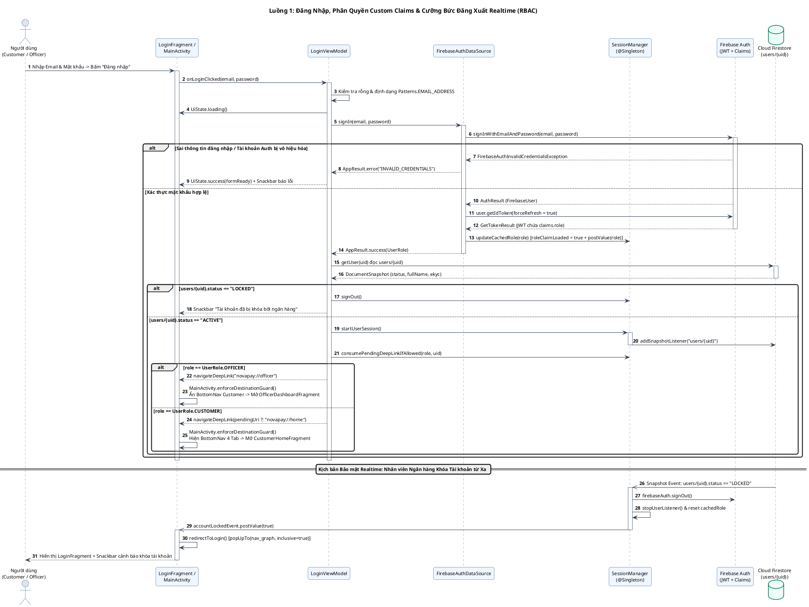
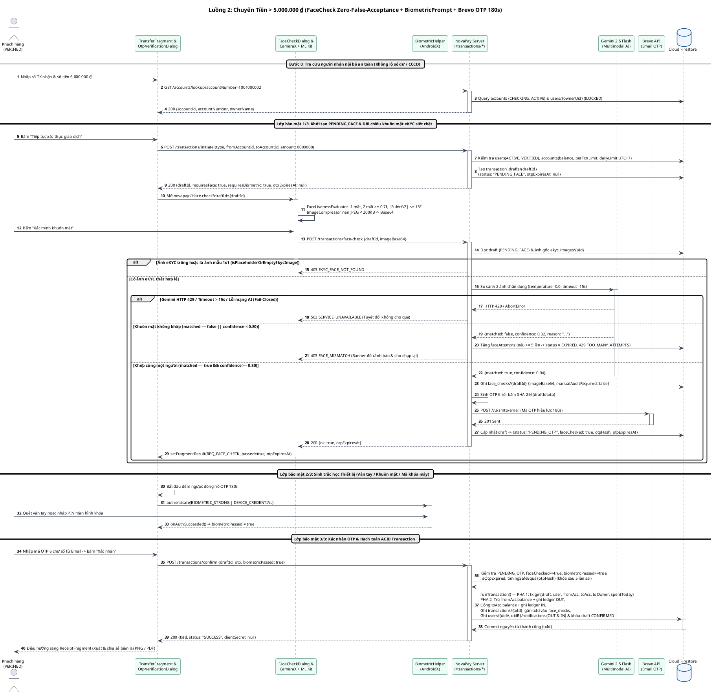
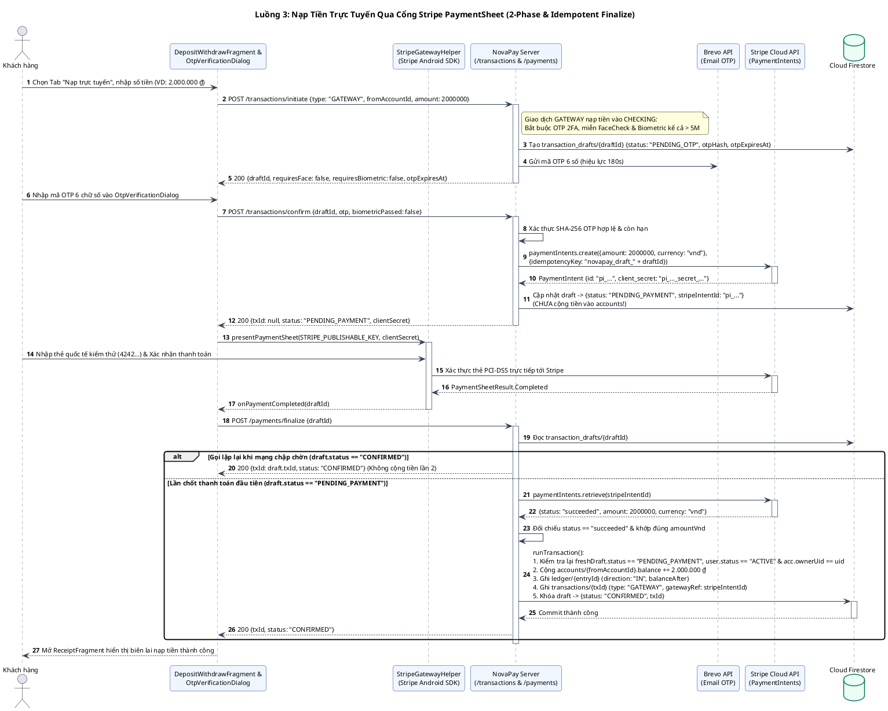
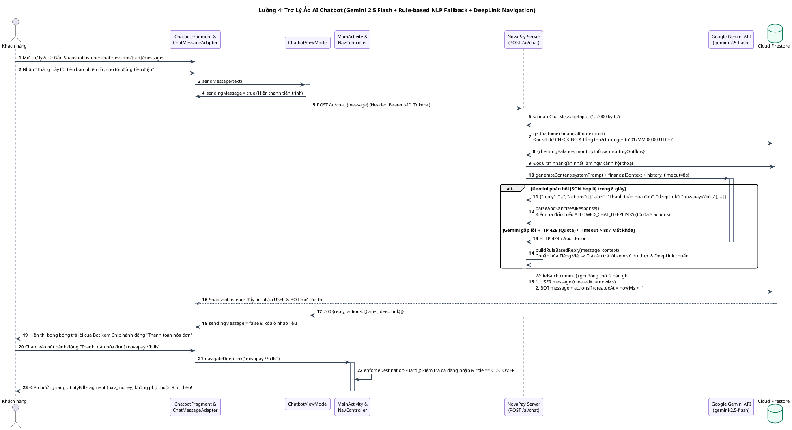
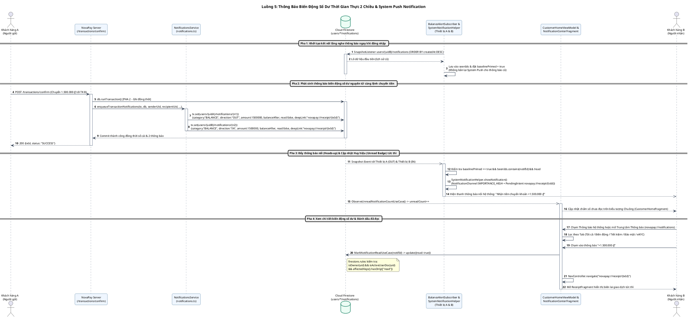

# TÀI LIỆU BÁO CÁO PHẦN 3: SƠ ĐỒ TUẦN TỰ NGHIỆP VỤ TRỌNG TÂM (PLANTUML SEQUENCE DIAGRAMS)

> **Dự án:** Hệ thống Ngân hàng Số **NovaPay** (`com.novabank.novapay`)  
> **Định dạng sơ đồ:** 100% mã nguồn **PlantUML Sequence Diagram** (`@startuml ... @enduml`) tái hiện chính xác từng lớp mã nguồn Java 17, API Endpoint Node.js/TypeScript, quy tắc `firestore.rules` và giao dịch nguyên tử Cloud Firestore.

---

## 1. Luồng 1: Đăng Nhập, Phân Quyền Custom Claims (`CUSTOMER` / `OFFICER`) & Khóa Tài Khoản Tức Thì

### Điểm nhấn kiến trúc ăn điểm:
- Phân quyền vai trò dựa trên **Firebase Custom Claim `role`** được ký số bên trong JWT ID Token (`user.getIdToken(true)`), kết hợp kiểm tra kép trạng thái `users/{uid}.status` trước khi vào màn hình chính.
- `SessionManager` gắn `SnapshotListener` thời gian thực vào `users/{uid}` trong suốt phiên làm việc; ngay khi `OFFICER` khóa tài khoản trên máy khác (`PATCH /officer/customers/:uid` → cập nhật Firestore + `revokeRefreshTokens`), thiết bị của khách hàng tự động `signOut()` và chuyển về `LoginFragment` trong dưới 1 giây.

---

## 2. Luồng 2: Chuyển Tiền Giá Trị Cao (`> 5.000.000 ₫`) — Xác Thực 3 Lớp (`FaceCheck` Siết Chặt + `Biometric` + `OTP Brevo`)

### Điểm nhấn kiến trúc ăn điểm:
- **Trì hoãn phát hành OTP thông minh:** Khi số tiền chi/rút `> 5.000.000 ₫`, `POST /transactions/initiate` tạo bản nháp ở trạng thái `"PENDING_FACE"` với `otpExpiresAt: null` (**chưa gửi Email OTP**), giúp khách hàng không bị trôi mất thời gian 180 giây trong lúc cân chỉnh khuôn mặt trước camera và tránh tốn hạn mức gửi mail nếu khuôn mặt không khớp.
- **Đối chiếu khuôn mặt nghiêm ngặt (Zero-False-Acceptance & Fail-Closed):** Trước khi gọi AI, Server kiểm tra `ekyc_images/{uid}`; nếu trống hoặc chỉ là ảnh mẫu 1x1 pixel (`SAMPLE_SEED_PLACEHOLDER_BASE64`), Server từ chối ngay bằng `403 EKYC_FACE_NOT_FOUND`. Trên Android, CameraX + ML Kit kiểm tra Liveness (1 khuôn mặt, mở cả 2 mắt `>= 0.7`, góc nghiêng `<= 15°`), nén JPEG `< 200KB` gửi lên Backend để **Gemini 2.5 Flash** (`temperature: 0.0`) thẩm định cấu trúc khuôn mặt: chỉ đạt khi `matched == true && confidence >= 0.80`; sai người trả `403 FACE_MISMATCH` kèm cảnh báo đỏ (tối đa 5 lần thử); nếu Gemini quá tải (HTTP 429) hoặc timeout (`> 15s`), áp dụng **Fail-Closed (`503 SERVICE_UNAVAILABLE`)** — tuyệt đối không tự cho qua để đảm bảo an toàn sinh trắc học.
- **Giao dịch nguyên tử 2 pha (Two-Phase Firestore ACID Transaction):** Toàn bộ lệnh `tx.get(...)` được gom vào Pha 1 (kiểm tra lại số dư, trạng thái `ACTIVE`, chủ tài khoản nhận không bị `LOCKED`, hạn mức ngày theo múi giờ `Asia/Ho_Chi_Minh`) trước khi thực thi Pha 2 ghi đồng thời tài liệu kế toán và bản ghi **thông báo biến động số dư (`notifications`)** hai chiều.

---

## 3. Luồng 3: Nạp Tiền Quốc Tế Qua Stripe `PaymentSheet` & Chốt Chặn Idempotency

### Điểm nhấn kiến trúc ăn điểm:
- **Không cộng tiền sớm:** Tại `POST /transactions/confirm`, dù người dùng đã nhập đúng mã OTP 2FA, Server **tuyệt đối chưa cộng số dư**, mà chỉ khởi tạo `Stripe PaymentIntent` (tiền tệ `vnd` không nhân 100 — zero-decimal currency, kèm `idempotencyKey: novapay_draft_{draftId}`), chuyển bản nháp sang `"PENDING_PAYMENT"` và trả `clientSecret` cho Android mở `PaymentSheet`.
- **Chống cộng tiền đúp (Idempotent Finalization):** Tại `POST /payments/finalize`, Server truy vấn ngược trực tiếp lên máy chủ Stripe (`paymentIntents.retrieve`) để xác minh `status === "succeeded"` và đối chiếu đúng số tiền VNĐ trước khi mở Firestore Transaction kiểm tra khóa `draft.status !== "CONFIRMED"`. Mọi thao tác bấm thử lại khi mạng chập chờn đều trả về cùng một `txId` mà không bao giờ cộng tiền hai lần.

---

## 4. Luồng 4: Trợ Lý Ảo Tài Chính Gemini Điều Hướng DeepLink `novapay://` & Cơ Chế Dự Phòng NLP

### Điểm nhấn kiến trúc ăn điểm:
- **Bảo mật khóa API tuyệt đối & Cá nhân hóa theo ngữ cảnh thực:** Android không giữ `GEMINI_API_KEY`. Khi gọi `POST /ai/chat`, Backend tự động tổng hợp ngữ cảnh tài chính thời gian thực của chính khách hàng đó (`checkingBalance`, `monthlyInflow`, `monthlyOutflow` tính theo đầu tháng `Asia/Ho_Chi_Minh`) và nạp 6 tin nhắn gần nhất vào `Gemini 2.5 Flash`.
- **Chống Prompt Injection qua Whitelist DeepLink:** Phản hồi JSON của AI được lọc qua `parseAndSanitizeAiResponse`, chỉ giữ lại tối đa 3 nút hành động có URI nằm trong tập hợp cho phép `ALLOWED_CHAT_DEEPLINKS` (`novapay://home`, `novapay://transfer`, `novapay://bills`, `novapay://topup`, `novapay://services`, `novapay://transactions?range=month`, `novapay://branches`, `novapay://profile`, `novapay://ekyc`).
- **Độ sẵn sàng 100% khi chấm thi:** Nếu Gemini API hết hạn mức miễn phí (HTTP 429) hoặc phản hồi chậm quá 8 giây (`AbortController`), hệ thống tự động chuyển mượt sang bộ phân tích ý định Tiếng Việt có dấu/không dấu (`buildRuleBasedReply`), trả lời chính xác số dư thực tế kèm đúng nút điều hướng DeepLink.

---

## 5. Luồng 5: Thông Báo Biến Động Số Dư Thời Gian Thực 2 Chiều & System Push Notification

### Điểm nhấn kiến trúc ăn điểm:
- **Phát sinh nguyên tử ngay trong giao dịch kế toán:** Mọi lệnh chuyển tiền, thanh toán, nạp Stripe, mở/tất toán tiết kiệm hay duyệt eKYC đều gọi `NotificationsService.enqueueTransactionNotifications()` (hoặc `enqueueUserNotification()`) **bên trong cùng `db.runTransaction()`**. Nhờ vậy không bao giờ xảy ra tình trạng tiền đã trừ/cộng nhưng mất thông báo biến động số dư.
- **Chống nổ thông báo lịch sử khi mở ứng dụng (`BalanceAlertSubscriber`):** Khi khách hàng đăng nhập, `SessionManager` kích hoạt `BalanceAlertSubscriber.start(uid)` gắn `SnapshotListener` vào `users/{uid}/notifications`. Ở lần đồng bộ đầu tiên (`baselinePrimed == false`), bộ lắng nghe chỉ ghi nhận toàn bộ `notifId` đã có vào tập `seenIds` rồi bật `baselinePrimed = true`. Từ các sự kiện tiếp theo, mọi thông báo mới chưa đọc (`!isRead()`) mới được kích hoạt qua `SystemNotificationHelper` (Notification Channel mức `IMPORTANCE_HIGH` có thể hiện banner ngay cả khi đang ở màn hình khác).
- **Đánh dấu đã đọc an toàn bởi Security Rules:** Khi người dùng chạm vào thông báo hệ thống hoặc một mục trong `NotificationCenterFragment`, ứng dụng gọi `MarkNotificationReadUseCase` (`update({ read: true })` được bảo vệ bởi `isOwner(uid) && isActiveUserDoc(uid)`) và điều hướng thẳng tới `ReceiptFragment` thông qua DeepLink `novapay://receipt/{txId}`.

