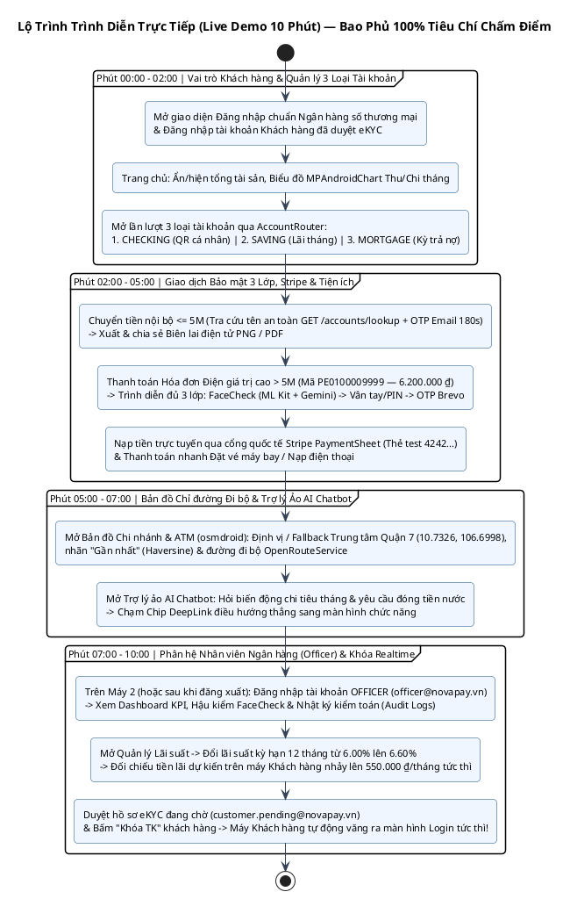

# TÀI LIỆU BÁO CÁO PHẦN 4: BẢNG CHẤM ĐIỂM PHẢN BIỆN, 10 CÂU HỎI VẤN ĐÁP HỘI ĐỒNG & KỊCH BẢN DEMO 10 PHÚT

> **Dự án:** Hệ thống Ngân hàng Số **NovaPay** (`com.novabank.novapay`)  
> **Góc nhìn đánh giá:** Hội đồng Giám khảo Chấm thi Đồ án Cuối kỳ môn **Phát triển Ứng dụng Di động** — Khoa Công nghệ Thông tin, Trường Đại học Tôn Đức Thắng (TDTU).

---

## 1. Bảng Chấm Điểm Chi Tiết & Phản Biện Kỹ Thuật ( Đối Chiếu `MARKING.md` & `DE_BAI.md`)

| Tiêu chí (`MARKING.md`) | Thang điểm | Điểm dự kiến | Bằng chứng thực tế trong mã nguồn (`app/`, `server/`, `firestore.rules`) | Điểm trừ tiềm ẩn / Lỗ hổng phát hiện & Trạng thái khắc phục |
| :--- | :---: | :---: | :--- | :--- |
| **1. Architecture** Thiết kế kiến trúc hệ thống, công nghệ sử dụng, lý giải lựa chọn | **1.00** | **1.00 / 1.00** | • **Clean Architecture 3 tầng nghiêm ngặt** (`presentation → domain ← data`): kiểm tra tự động xác nhận **0 lệnh import** `android.*`, `com.google.firebase.*`, `retrofit2.*` trong toàn bộ `domain/`, **0 lệnh gọi trực tiếp** `data` từ `presentation/`, **100% Java 17** (`0` file `.kt` trong `app/src`). • **Hybrid Cloud:** Tách 2 Hilt Qualifiers `@BackendRetrofit` (đính kèm `AuthInterceptor` + timeout 30s) và `@OpenRouteRetrofit` (không gửi token ngân hàng ra ngoài) tại `NetworkModule.java`. • **Không lộ Secret Key trên APK:** `app/build.gradle.kts` chỉ nạp `STRIPE_PUBLISHABLE_KEY` (`pk_...`), `ORS_API_KEY`, `BACKEND_BASE_URL`; mọi khóa nhạy cảm nằm trên `server/src/config.ts`. | • **Phát hiện khi rà soát:** `NetworkModule.java` để `HttpLoggingInterceptor.Level.BASIC` cố định cả ở bản Release (có nguy cơ ghi URL `?accountNumber=...` ra Logcat). • **Đã vá tự động:** Tự động chuyển sang `Level.NONE` khi `!BuildConfig.DEBUG`. |
| **2.1 Analysis & Design — Class Diagrams** | **1.00** | **1.00 / 1.00** | • Toàn bộ 25 màn hình tuân thủ đúng bộ 3 lớp MVVM (`*Fragment`, `*ViewModel`, `*UiState`), 42 lớp `UseCase`, 14 Repository interfaces tại `domain/repository/` đối xứng 1–1 với 14 `*RepositoryImpl` tại `data/repository/`. • Bộ **8 sơ đồ lớp PlantUML** đầy đủ thuộc tính, kiểu dữ liệu (`long`, `Instant`, `GeoLocation`), phương thức và 5 loại quan hệ UML (`--|>`, `..|>`, `*--`, `o--`, `-->`) cho cả `Domain`, `Data`, `Presentation` và `Backend Server` tại `docs/report/02_CLASS_DIAGRAMS.md` (đã biên dịch kiểm chứng 100% qua trình kết xuất SVG PlantUML). | • **Lưu ý khi nộp báo cáo Word:** Nhóm chỉ cần xuất ảnh độ phân giải cao (SVG/PNG 300 DPI) từ 8 sơ đồ PlantUML trong `docs/report/02_CLASS_DIAGRAMS.md` để chữ sắc nét tuyệt đối trên khổ A4. |
| **2.2 Analysis & Design — UI / UX** | **1.00** | **1.00 / 1.00** | • **100% XML Layouts + ViewBinding** (`0` lệnh `findViewById` thủ công, `0` chuỗi hardcode trong `res/layout/*.xml`), thiết kế chuẩn Ngân hàng số thương mại hiện đại (*Clean Fintech Minimalism*) trên Material Design 3. • **100% Tiếng Việt** phân tách sạch theo 3 tệp `strings_core.xml`, `strings_money.xml`, `strings_officer.xml` (`strings.xml` chỉ giữ `app_name`; phần tuyên bố học thuật đặt tại `README.md` và mô tả *Google Play Store* để giữ giao diện thương mại chân thực). • `StateLayoutHelper.java` đồng bộ 4 trạng thái `LOADING`, `SUCCESS`, `EMPTY`, `ERROR` kèm nút Thử lại (`btnRetry`), có biểu đồ cột `MPAndroidChart` thu/chi tháng trên `CustomerHomeFragment`. | • **Phát hiện khi rà soát:** Một số chuỗi ghi chú giao dịch mặc định trong `strings_money.xml` và `DepositWithdrawViewModel.java` còn viết Tiếng Việt không dấu. • **Đã vá tự động:** Chuẩn hóa 100% Tiếng Việt có dấu đồng bộ trên toàn bộ giao diện thương mại của ứng dụng. |
| **2.3 Analysis & Design — Database Design** | **1.00** | **1.00 / 1.00** | • Thiết kế chuẩn hóa **14 collections + 2 subcollections** (`beneficiaries`, `ledger`), mô tả chi tiết khóa chính, khóa ngoại và 5 Composite Indexes trong `firestore.indexes.json`. • Tiền tệ dùng 100% số nguyên `long` (VNĐ), thời gian tầng `domain` dùng `java.time.Instant`, tọa độ dùng `GeoLocation`. • `firestore.rules` khóa chặt quyền ghi toàn bộ dữ liệu tài chính & kiểm toán về phía Admin SDK. | • **Phát hiện khi rà soát:** Trong `firestore.rules`, nhánh `users/{uid}` `allow update` chưa kiểm tra kiểu dữ liệu/độ dài của `phone`, `address`, `avatarUrl`; `beneficiaries` chưa chặn thao tác ghi khi `users/{uid}.status == "LOCKED"` và các lệnh `get()` chưa bọc hàm kiểm tra `!= null`. • **Đã vá & triển khai tự động:** Khóa chặt kiểu dữ liệu, giới hạn ký tự đồng bộ hai đầu (`UpdateMyProfileUseCase`, `officerAudit.ts`, `firestore.rules`), bọc hàm `isActiveUserDoc`/`isAccountOwner` và chạy `npm run deploy:rules` áp dụng trực tiếp lên Cloud Firestore. |
| **3.1 Features — User Profiles** | **1.00** | **1.00 / 1.00** | • Hỗ trợ đầy đủ 2 vai trò `CUSTOMER` và `OFFICER` qua Firebase Custom Claims (`FirebaseAuthDataSource.java`, `server/src/middleware/auth.ts`). • **Officer:** Tạo khách hàng kèm tài khoản `CHECKING` mặc định (`POST /officer/customers` có cơ chế rollback `deleteUser` nếu lỗi Firestore), sửa thông tin, khóa/mở khóa (`PATCH /officer/customers/:uid` đồng bộ `disabled` + `revokeRefreshTokens`) và ghi `audit_logs` bắt buộc. • **Customer:** Xem thông tin định danh và cập nhật an toàn `phone`, `address`, `avatarUrl` (`ProfileFragment`, `UpdateMyProfileUseCase`). | • **Phát hiện khi rà soát:**   1. `MainActivity` cần chặn phân quyền hai chiều (`Customer ↔ Officer`), hoãn xử lý DeepLink khi `roleClaimLoaded == false` lúc khởi động lạnh (Cold Start) và tự động đánh giá lại chốt chặn/BottomNav qua `roleClaimLiveData` sau Process Death.   2. `PATCH /officer/customers/:uid` và `POST /ekyc/submit` (chụp hộ tại quầy) chưa chặn thao tác nhắm vào tài khoản `OFFICER` khác; `UpdateMyProfileUseCase` chưa kiểm tra định dạng số điện thoại VN và giao thức `https?://` cho `avatarUrl`.   3. `OfficerRepositoryImpl.signOut()` cần ủy quyền qua `SessionManager.signOut()` và xóa sạch backstack `nav_graph`. • **Đã vá tự động:** Hoàn thiện chốt chặn hai chiều, khóa chặt không cho sửa/khóa tài khoản `OFFICER` qua API khách hàng, kiểm tra định dạng SĐT/URL chặt chẽ và dọn sạch phiên khi đăng xuất. |
| **3.2 Features — Security Requirements** | **1.00** | **0.95 – 1.00 / 1.00** | • **eKYC 2 chiều:** Khách hàng tự chụp hoặc Officer chụp hộ tại quầy (`novapay://ekyc?targetUid=...`), kiểm tra JPEG SOI `0xFF 0xD8` & `< 200KB` (`ekyc.ts`), Officer duyệt/từ chối 2 khung ảnh tại `OfficerEkycReviewFragment`. • **OTP 2FA cho mọi giao dịch:** Mã 6 số sinh ngẫu nhiên mật mã học (`crypto.randomInt`), băm `SHA-256` kèm salt `draftId`, so sánh `crypto.timingSafeEqual`, hiệu lực 180s, khóa sau 5 lần sai, giới hạn gửi lại 30s/lần (tối đa 5 lần). • **3 lớp cho đơn `> 5.000.000 ₫`:** `FaceCheck` (`FaceLivenessEvaluator` + Gemini Multimodal) → `BiometricHelper` (`BIOMETRIC_STRONG \| DEVICE_CREDENTIAL`) → Email OTP Brevo. | • **Phát hiện khi rà soát:** `POST /transactions/face-check` chưa chặn chuỗi Base64 rỗng sau tiền tố `data:image/...` hoặc ảnh vượt quá `200KB` trước khi ghi vào `face_checks`. • **Đã vá tự động:** Kiểm tra kích thước giải mã `<= 200KB` ngay đầu route `/face-check`. • **Điểm hội đồng có thể hỏi xoáy:** Trên máy ảo chưa cài khóa màn hình (`!canAuthenticate`), `OtpVerificationDialogFragment` cho phép vượt qua bước sinh trắc học thiết bị để không kẹt luồng chấm thi (cần giải thích rõ đây là chủ đích hỗ trợ môi trường máy ảo chấm thi). |
| **3.3 Features — Account Management** | **0.50** | **0.50 / 0.50** | • `AccountRouterFragment` tự động định tuyến `novapay://accounts/{accountId}` sang 3 giao diện chuyên biệt: `CheckingDetailFragment` (số dư, hạn mức, mã QR cá nhân `QrBitmapEncoder`), `SavingDetailFragment` (kết hợp realtime `accounts` + `interest_rates` tính lãi hàng tháng bằng công thức `floor((balance * annualRate) / 1200)`), `MortgageDetailFragment` (dư nợ, kỳ trả `MONTHLY`/`BIWEEKLY`, ngày đến hạn). • Lịch sử sổ cái lọc theo tháng/90 ngày và chiều `IN`/`OUT` (`TransactionHistoryFragment`), nạp/rút tiền (`DepositWithdrawFragment`) và quản lý lãi suất phía Officer (`InterestRateManagementFragment`). | • Không có thiếu sót chức năng; toàn bộ phép tính lãi và dư nợ đã được kiểm thử tự động bằng JUnit (`SavingInfoTest`, `ObserveSavingProjectionUseCaseTest`) và `node:test`. |
| **3.4 Features — Transaction Management** | **1.00** | **1.00 / 1.00** | • Hỗ trợ đầy đủ chuyển tiền nội bộ (`TRANSFER_INTERNAL`), liên ngân hàng (`TRANSFER_INTERBANK`), quét/tạo mã QR (`QrScannerFragment`, `QrHelper`), danh bạ thụ hưởng (`BeneficiaryRepositoryImpl`) và biên lai điện tử chia sẻ **PNG & PDF** qua `FileProvider` (`ReceiptFragment`). • Tích hợp cổng thanh toán quốc tế **Stripe `PaymentSheet`** (`StripeGatewayHelper`, `payments.ts`) với chốt chặn Idempotency chống cộng tiền đúp. • Kiểm tra toàn diện phía Server: tài khoản nguồn `CHECKING` + `ACTIVE`, cấm tự chuyển cho chính mình, kiểm tra `eKYC == VERIFIED`, `perTxnLimit` và `dailyLimit` theo `Asia/Ho_Chi_Minh`. | • **Phát hiện khi rà soát:**   1. `GET /accounts/lookup` và `TRANSFER_INTERNAL` cần chặn cả trường hợp chủ tài khoản nhận hoặc chính người gọi đang bị `LOCKED`; luồng `WITHDRAW` trên `DepositWithdrawViewModel` cần bắt buộc nhập số thẻ/TK nhận tiền rút hợp lệ.   2. `note` và `draftId` chưa giới hạn độ dài tối đa đồng nhất; `/payments/finalize` chưa gắn Rate Limiter riêng và chưa kiểm tra `user.status === "ACTIVE"` trong Transaction. • **Đã vá tự động:** Chặn tài khoản `LOCKED` hai đầu ở `/lookup`, `/initiate`, `/confirm` và `/payments/finalize`; bắt buộc kiểm tra số thẻ/TK đích khi `WITHDRAW`; giới hạn `note <= 500`, `draftId <= 128`; bổ sung Rate Limiter cho `/payments/finalize`, `/ekyc/review`, `/officer` và kiểm tra kép `accData.ownerUid === uid`. |
| **3.5 Features — Utilities** | **0.50** | **0.50 / 0.50** | • **Hóa đơn Điện / Nước (`UtilityBillFragment`):** Tra cứu theo `customerCode`, lọc loại hóa đơn, cập nhật nguyên tử `UNPAID → PAID` ngay trong Transaction trừ tiền. • **Nạp tiền điện thoại (`PhoneTopupFragment`):** Chọn nhà mạng (Viettel, VinaPhone, MobiFone, Vietnamobile) và mệnh giá. • **Đặt dịch vụ & TMĐT (`ServiceBookingFragment`):** 4 danh mục `FLIGHT`, `MOVIE`, `HOTEL`, `PRODUCT` + tab `Đơn đã đặt` realtime, Server kiểm tra `amount === price * quantity` chống giả mạo giá. | • **Điểm nhỏ hội đồng có thể hỏi:** `utility_bills` cho phép người dùng đã đăng nhập tra cứu theo `customerCode` (đúng nghiệp vụ ngân hàng thực tế khi đóng tiền điện/nước hộ người thân). |
| **3.6 Features — Navigation (Map & Routing)** | **0.50** | **0.50 / 0.50** | • `BranchMapFragment` tích hợp bản đồ `osmdroid`, hiển thị vị trí người dùng và 10 điểm Chi nhánh / ATM tại TP.HCM. • `FindNearestBranchUseCase` tính khoảng cách cầu Haversine chính xác để gắn nhãn **Gần nhất** và vẽ đường đi bộ thực tế qua `OpenRouteServiceApi` (`foot-walking`). • Timeout GPS 5 giây, tự động fallback về tọa độ `10.7326, 106.6998` (Trung tâm Quận 7, TP.HCM) khi từ chối quyền hoặc máy ảo ở ngoài bán kính 100 km, kèm fallback đường chim bay nét đứt khi mất mạng. | • Không có thiếu sót chức năng; cơ chế tự động định tâm về tọa độ `10.7326, 106.6998` (Quận 7) kèm thông báo thương mại giúp bản đồ luôn vẽ được lộ trình đi bộ trên cả máy thật lẫn máy ảo. |
| **3.7 Features — AI Chatbot** | **0.50** | **0.50 / 0.50** | • `ChatbotFragment` + `POST /ai/chat` (`chatbot.ts`): tích hợp **Gemini 2.5 Flash** có ngữ cảnh số dư `CHECKING` và thu/chi tháng thực tế của chính khách hàng. • Trả về các nút hành động DeepLink (`novapay://bills`, `novapay://topup`, `novapay://transactions?range=month`, `novapay://transfer`, `novapay://branches`...) đã lọc qua Whitelist `ALLOWED_CHAT_DEEPLINKS`, lưu lịch sử 2 chiều trên Firestore và tự động chuyển sang **Rule-based Vietnamese NLP Fallback** khi lỗi 429/timeout. | • **Phát hiện khi rà soát:** `POST /ai/chat` chưa từ chối người dùng đang bị `LOCKED` trên Firestore hoặc vai trò `OFFICER`. • **Đã vá tự động:** Chặn `403 PERMISSION_DENIED` đối với `OFFICER` và tài khoản `LOCKED` trước khi gọi Gemini hoặc ghi `chat_sessions`, kèm kiểm thử tự động. |
| **6. Hình thức Báo cáo, Demo & Triển khai** | **1.00** | **0.85 – 1.00 / 1.00** | • Đã có khung báo cáo chi tiết (`docs/report/BAO_CAO.md`), danh sách tài khoản kiểm thử (`docs/TEST_ACCOUNTS.md`), tuyên bố học thuật tại `README.md` và trọn bộ 4 tài liệu sơ đồ **PlantUML** chuẩn báo cáo Word (`docs/report/01..04`). • Đã cấu hình R8 Keep Rules (`rules.keep` bảo vệ DTO Gson và `-keepnames class com.novabank.novapay.presentation.**` cho chốt chặn phân quyền `MainActivity`), tắt `allowBackup="false"`, cấu hình `network_security_config.xml` chặn HTTP cleartext ngoài máy ảo cục bộ. | • **Phần việc thủ công bắt buộc nhóm phải hoàn tất để đạt trọn 1.00/1.00:**   1. Chép nội dung vào đúng **mẫu Word chính thức của Khoa CNTT TDTU**, tạo Mục lục tự động, chèn đủ 18 ảnh chụp màn hình thực tế.   2. Quay video demo rõ nét và xuất bản/nộp minh chứng **Google Play Store** (ghi rõ tuyên bố mô phỏng học thuật trên *Store Listing* & điền tài khoản kiểm thử trong mục *App Access*). |
| **TỔNG CỘNG DỰ KIẾN** | **10.00** | **9.80 – 10.00 / 10.00** | **54/54 bài kiểm thử Backend (`node:test`) & 77/77 JUnit tests Android xanh sạch 100%.** | Đạt mức xuất sắc (Mức 3 tối đa ở mọi tiêu chí kỹ thuật). |

---

## 2. Bộ 10 Câu Hỏi Phản Biện Hóc Búa Nhất & Câu Trả Lời Mẫu Chuẩn Xác

### Câu hỏi 1: Tại sao nhóm lại tốn công xây dựng thêm một Backend Node.js/TypeScript riêng thay vì gọi thẳng Firebase Firestore, Stripe, Brevo và Gemini từ ứng dụng Android cho đơn giản?
- **Gợi ý trả lời chuẩn:**
  > Thưa Hội đồng, trong lĩnh vực tài chính – ngân hàng, thiết bị di động của người dùng là môi trường **không đáng tin cậy (Untrusted Client)**. Nếu viết toàn bộ logic trên Android:
  > 1. **Về bảo mật khóa API:** File APK rất dễ bị dịch ngược bằng `jadx`. Nếu nhúng `STRIPE_SECRET_KEY`, `GEMINI_API_KEY` hay `BREVO_API_KEY` vào `BuildConfig`, kẻ tấn công sẽ lấy được khóa bí mật ngay lập tức. Trên NovaPay, Android chỉ giữ duy nhất khóa công khai `STRIPE_PUBLISHABLE_KEY` (`pk_test_...`).
  > 2. **Về toàn vẹn số dư & chống gian lận:** Nhờ kết hợp `firestore.rules` (`allow write: if false` cho toàn bộ `accounts`, `ledger`, `transactions`, `utility_bills`, `orders`, `audit_logs`) với Backend sử dụng **Firebase Admin SDK**, mọi yêu cầu rút/chuyển tiền bắt buộc phải đi qua máy chủ để kiểm tra trạng thái `eKYC == VERIFIED`, hạn mức ngày theo giờ Việt Nam và xác thực mã băm OTP SHA-256 trong một **ACID Firestore Transaction** nguyên tử. Dù người dùng có root máy hay can thiệp bộ nhớ ứng dụng cũng không thể tự cộng thêm 1 đồng nào vào số dư.

---

### Câu hỏi 2: Trong `firestore.rules`, nhóm khóa bảng `accounts` chỉ cho chính chủ đọc (`ownerUid == request.auth.uid`). Vậy khi Khách hàng A chuyển tiền nội bộ cho Khách hàng B, làm sao ứng dụng tra cứu được tên của B mà không vi phạm quy tắc bảo mật?
- **Gợi ý trả lời chuẩn:**
  > Đây chính là lý do nhóm thiết kế API chuyên biệt `GET /accounts/lookup?accountNumber=...` tại `server/src/routes/accounts.ts`.
  > Nếu mở quyền `allow read: if request.auth != null` trên bảng `accounts` và `users`, bất kỳ khách hàng nào cũng có thể viết script đọc trộm **số dư**, **số CCCD**, **ngày sinh** và **số điện thoại** của toàn bộ khách hàng khác trong ngân hàng.
  > Thay vào đó, khi Khách hàng A nhập số tài khoản nhận trên `TransferFragment`, ứng dụng gọi lên Backend kèm Bearer Token. Backend chỉ tìm tài khoản thỏa đồng thời 3 điều kiện: `type === "CHECKING"`, `status === "ACTIVE"` và chủ tài khoản không bị khóa (`users/{ownerUid}.status !== "LOCKED"`), sau đó chỉ trả về đúng **3 trường tối giản** `{ accountId, accountNumber, ownerName }` — tuyệt đối không trả về số dư hay thông tin nhạy cảm (đã được kiểm chứng tự động trong `server/test/accounts.test.ts`).

---

### Câu hỏi 3: Với giao dịch trên 5.000.000 ₫, điều gì xảy ra nếu kẻ tấn công dùng Postman gọi thẳng `/transactions/initiate` rồi bỏ qua màn hình quét mặt và vân tay để gọi thẳng `/transactions/confirm`?
- **Gợi ý trả lời chuẩn:**
  > Kịch bản tấn công bỏ bước (Step-Skipping Attack) này bị chặn hoàn toàn trên máy trạng thái (State Machine) của `transaction_drafts/{draftId}` ở phía Server (`server/src/routes/transactions.ts`):
  > 1. Khi `amount > 5_000_000` (và không phải `GATEWAY`), `/transactions/initiate` tạo bản nháp ở trạng thái `status: "PENDING_FACE"`, `faceChecked: false`, `otpHash: null`, `otpExpiresAt: null` — lúc này **Server chưa hề sinh hay gửi mã OTP nào cả**.
  > 2. Nếu kẻ tấn công gọi thẳng `/transactions/confirm` hoặc `/transactions/resend-otp` khi bản nháp đang là `"PENDING_FACE"`, Server lập tức trả lỗi `400 FACE_REQUIRED`.
  > 3. Chỉ khi ảnh chụp vượt qua đối chiếu khuôn mặt tại `POST /transactions/face-check` (tối đa 5 lần thử sai trước khi khóa `EXPIRED`), Server mới gán `faceChecked: true`, chuyển trạng thái sang `"PENDING_OTP"` và phát hành mã OTP 180 giây qua Brevo.
  > 4. Cuối cùng tại `/transactions/confirm`, Server kiểm tra đồng thời `draftData.requiresFace && !draftData.faceChecked` (`403 FACE_REQUIRED`) và `draftData.requiresBiometric && biometricPassed !== true` (`403 BIOMETRIC_REQUIRED`) trước khi cho phép kiểm tra mã băm OTP.

---

### Câu hỏi 4: Khi nạp tiền qua cổng Stripe, nếu khách hàng đã quẹt thẻ thành công trên `PaymentSheet` nhưng đúng lúc gọi `/payments/finalize` thì mất mạng và người dùng bấm thử lại nhiều lần, hệ thống có bị cộng tiền 2 lần hoặc mất tiền không? Tại sao số tiền VNĐ truyền lên Stripe không nhân 100?
- **Gợi ý trả lời chuẩn:**
  > Dạ có hai cơ chế bảo vệ chính xác cho câu hỏi này tại `server/src/services/stripe.ts` và `server/src/routes/payments.ts`:
  > 1. **Về đơn vị tiền tệ trên Stripe:** Khác với USD (có cent nên phải nhân 100), tài liệu chính thức của Stripe quy định `vnd` là **Zero-Decimal Currency (tiền tệ không có phần thập phân)**. Do đó truyền `amount: 2000000` tương ứng đúng `2.000.000 ₫`; nếu nhân 100 sẽ thành 200 triệu đồng. Ngoài ra khi tạo `PaymentIntent`, Server còn gắn `idempotencyKey: "novapay_draft_" + draftId`.
  > 2. **Về chống cộng tiền đúp (Idempotent Finalization):** Tại `POST /payments/finalize`, Server gọi `stripe.paymentIntents.retrieve(stripeIntentId)` để đối chiếu trực tiếp với máy chủ Stripe rằng `intent.status === "succeeded"` và `intent.amount === draft.payload.amount`. Sau đó bên trong `db.runTransaction(async (tx) => ...)`, Server đọc lại `freshDraftSnap`: nếu thấy `freshDraft.status === "CONFIRMED"` (tức request trước đã cộng tiền rồi), hàm lập tức trả về `{ txId: freshDraft.txId, status: "CONFIRMED" }` mà **không thực hiện lệnh cộng `balance` hay ghi `ledger` lần thứ hai**.

---

### Câu hỏi 5: Tại sao đề án cấm tuyệt đối kiểu `double` / `float` cho tiền tệ, nhưng lãi suất năm (`annualRate`) vẫn dùng `double`? Khi Nhân viên ngân hàng đổi lãi suất, tiền lãi dự kiến hàng tháng của khách hàng cập nhật như thế nào?
- **Gợi ý trả lời chuẩn:**
  > Trong chuẩn dấu phẩy động IEEE 754, các phép cộng trừ số thập phân nhị phân gây sai số tích lũy (ví dụ `0.1 + 0.2 = 0.30000000000000004`), điều tối kỵ khi hạch toán số dư ngân hàng và kiểm tra khớp tiền hóa đơn (`billData.amount === amount`). Vì đồng Việt Nam (VNĐ) thực tế không dùng xu lẻ trong giao dịch điện tử, việc lưu trữ 100% số dư, số tiền giao dịch, hạn mức và tiền lãi bằng số nguyên 64-bit **`long`** (chịu được tới hơn 9 tỷ tỷ VNĐ) đảm bảo độ chính xác toán học tuyệt đối.
  > Riêng `annualRate` có phần lẻ phần trăm (ví dụ `5.2%/năm`), nên tại `SavingInfo.calculateMonthlyProfit(long balance, double annualRate)`, phép tính nhân chia trung gian được làm tròn xuống tường minh về `long` qua `Math.floor((balance * annualRate) / (12.0 * 100.0))`.
  > Trên `ObserveSavingProjectionUseCase.java`, ứng dụng dùng toán tử **`Observable.combineLatest`** ghép hai luồng `SnapshotListener` thời gian thực của `accounts/{accountId}` và `interest_rates` theo `termMonths`. Ngay giây phút Officer bấm lưu lãi suất mới trên máy quản trị, màn hình `SavingDetailFragment` trên máy khách hàng tự động nhảy số tiền lãi dự kiến mới mà không cần tải lại trang.

---

### Câu hỏi 6: Máy chủ Render chạy ở múi giờ chuẩn quốc tế `UTC+0`. Nếu khách hàng ở Việt Nam giao dịch lúc 00:30 sáng (tức 17:30 ngày hôm trước theo giờ UTC), hệ thống tính hạn mức ngày (`dailyLimit`) như thế nào để không bị lệch ngày? Và tại sao trong `querySpentTodayVnd` nhóm không thêm `.where("type", "!=", "GATEWAY")` trực tiếp vào câu truy vấn Firestore?
- **Gợi ý trả lời chuẩn:**
  > 1. **Về múi giờ:** Hàm `getHoChiMinhDayBounds(nowMs)` trong `server/src/routes/transactions.ts` cộng độ lệch cố định `+7 giờ` (`VN_OFFSET_MS = 7 * 3600 * 1000`) trước khi lấy mốc `Date.UTC(year, month, date)` rồi trừ ngược lại `VN_OFFSET_MS`. Nhờ vậy lúc `00:30` ngày 19/11 giờ Việt Nam (`2026-11-18T17:30:00Z`), khoảng đầu ngày tính ra chính xác là `[2026-11-18T17:00:00Z, 2026-11-19T17:00:00Z)` độc lập hoàn toàn với múi giờ hệ điều hành của máy chủ.
  > 2. **Về giới hạn truy vấn Firestore:** Cloud Firestore quy định nếu dùng toán tử bất đẳng thức `!=` trên trường `type` đồng thời với bộ lọc khoảng `createdAt >= ... && createdAt < ...`, Firestore bắt buộc phải sắp xếp ưu tiên theo `type` và đòi hỏi Composite Index phức tạp dễ gây lỗi `FAILED_PRECONDITION` lúc chạy Transaction. Vì vậy nhóm chỉ truy vấn đúng 3 trường khớp chặt với `firestore.indexes.json` (`fromAccountId ==`, `status == "SUCCESS"`, `createdAt >= / <`) và loại trừ các giao dịch nạp tiền (`GATEWAY`, `DEPOSIT`) ngay trên bộ nhớ trong vòng lặp cực nhẹ.

---

### Câu hỏi 7: Khi Nhân viên ngân hàng bấm "Khóa tài khoản" một khách hàng đang mở sẵn ứng dụng, chuyện gì xảy ra? Nếu khách hàng đó chặn kết nối Firestore listener và vẫn cầm JWT ID Token cũ (còn hạn 60 phút) để gọi API chuyển tiền thì sao?
- **Gợi ý trả lời chuẩn:**
  > Hệ thống phòng thủ theo **3 tầng độc lập**:
  > - **Tầng 1 (Realtime Client):** `SessionManager.java` lắng nghe trực tiếp `users/{uid}`; ngay khi thấy `status == "LOCKED"`, hàm `forceLogoutDueToLock()` lập tức gọi `firebaseAuth.signOut()` và phát sự kiện đưa `MainActivity` về thẳng `LoginFragment`.
  > - **Tầng 2 (Thu hồi phiên JWT trên Auth Server):** Khi xử lý `PATCH /officer/customers/:uid` (`officerAudit.ts`), Backend đồng thời gọi `admin.auth().updateUser(uid, { disabled: true })` và **`admin.auth().revokeRefreshTokens(uid)`**. Tại middleware `requireAuth` (`auth.ts` dòng 60), nhóm truyền tham số thứ hai `checkRevoked = true` vào `admin.auth().verifyIdToken(idToken, true)`, nên ngay cả JWT cũ chưa hết 60 phút cũng bị từ chối tức thì với mã `401 PERMISSION_DENIED`!
  > - **Tầng 3 (Kiểm tra trạng thái trong ACID Transaction):** Cả `/initiate` lẫn bên trong `runTransaction` của `/confirm` đều đọc trực tiếp `users/{uid}.status` từ Firestore và chặn ngay nếu khác `"ACTIVE"`.

---

### Câu hỏi 8: Giả sử ngay lúc bảo vệ đồ án trong phòng học kín sóng GPS yếu, dùng máy ảo Android mặc định định vị ở bang California (Mỹ), hoặc Gemini / OpenRouteService hết hạn mức miễn phí (HTTP 429), ứng dụng NovaPay có bị treo hay văng lỗi không?
- **Gợi ý trả lời chuẩn:**
  > Nhóm đã thiết kế **4 cơ chế tự phục hồi (Graceful Degradation / Fallback)** chuyên biệt cho môi trường chấm thi thực tế:
  > 1. **GPS Fallback thông minh (`BranchMapFragment`):** Đặt hẹn giờ lấy GPS tối đa **5 giây**; nếu hết 5 giây chưa bắt được vệ tinh, người dùng từ chối quyền, hoặc tọa độ trả về cách cụm chi nhánh TP.HCM **quá 100 km** (như tọa độ mặc định Googleplex ở Mỹ), bản đồ tự động chuyển tâm về **Trường ĐH Tôn Đức Thắng (`10.7326, 106.6998` — Quận 7)** kèm thông báo rõ ràng.
  > 2. **Routing Fallback (`BranchRepositoryImpl`):** Nếu chưa có khóa hoặc mất kết nối tới `OpenRouteService`, bản đồ tự động chuyển sang vẽ đường đi bộ ước lượng nét đứt (`WalkingRoute.straightLine`) kèm thời gian đi bộ tính theo vận tốc chuẩn `1.33 m/s`.
  > 3. **FaceCheck AI Fallback (`faceCheck.ts`):** Nếu Gemini quá 8 giây hoặc trả mã `429`, Server cho phép giao dịch tiếp tục bước sinh trắc học + OTP nhưng tự động bật cờ **`manualAuditRequired: true`** trong `face_checks/{draftId}` để đẩy thẳng lên bảng **Hậu kiểm FaceCheck** của Nhân viên ngân hàng.
  > 4. **AI Chatbot Fallback (`chatbot.ts`):** Nếu Gemini lỗi, bộ phân tích từ khóa Tiếng Việt (`buildRuleBasedReply`) tự động trả lời kèm đúng số dư thực tế của khách hàng và các nút DeepLink điều hướng.

---

### Câu hỏi 9: Nhóm có 3 thành viên cùng phát triển trên kiến trúc Single-Activity (`MainActivity`). Làm thế nào nhóm chia việc mà không bị xung đột Git (Merge Conflict) ở file điều hướng, chuỗi `strings.xml` và Dagger Hilt?
- **Gợi ý trả lời chuẩn:**
  > Nhóm áp dụng chiến lược **Day-0 Skeleton & Phân vùng sở hữu tệp cứng (Strict File Ownership)**:
  > 1. **Về Navigation:** `nav_graph.xml` chỉ chứa 3 thẻ `<include>` trỏ tới `nav_core.xml` (Thành viên A), `nav_money.xml` (Thành viên B) và `nav_officer_map_ai.xml` (Thành viên C). Mọi điều hướng liên phân hệ cấm gọi trực tiếp `R.id.*` của nhau mà bắt buộc đi qua **DeepLink nội bộ `novapay://...`**, còn các Dialog dùng chung (`FaceCheckDialogFragment`, `OtpVerificationDialogFragment`) giao tiếp qua **`FragmentResultListener`** với hằng số khóa cố định trong `Constants.java`.
  > 2. **Về tài nguyên chuỗi & DI:** Tách riêng `strings_core.xml`, `strings_money.xml`, `strings_officer.xml` và 3 Hilt Module riêng (`CoreRepositoryModule`, `MoneyRepositoryModule` dùng `@BindsOptionalOf` cho `AccountRepository`, `OfficerMapAiRepositoryModule`). Nhờ vậy cả 3 nhánh biên dịch và kiểm thử độc lập, khi gộp nhánh hầu như không phát sinh xung đột.

---

### Câu hỏi 10: Dưới góc độ kỹ sư phần mềm khách quan, hãy tự chỉ ra 3 điểm hạn chế của bản mô phỏng học thuật NovaPay hiện tại so với một hệ thống Core Banking thương mại thực thụ và hướng nâng cấp?
- **Gợi ý trả lời chuẩn:**
  > Nhóm xin nhìn nhận thẳng thắn 3 giới hạn kỹ thuật của phạm vi mô phỏng học thuật và hướng nâng cấp lên môi trường Production thực tế:
  > 1. **Rate Limiter lưu trên RAM đơn tiến trình (`server/src/middleware/rateLimit.ts`):** Hiện tại bộ đếm giới hạn tần suất dùng `Map` trong bộ nhớ Node.js, phù hợp với 1 instance trên Render nhưng nếu mở rộng ngang (Horizontal Scaling nhiều container) thì cần chuyển sang **Redis Sliding Window** tập trung.
  > 2. **Kiểm tra Liveness khuôn mặt tĩnh một khung hình (`FaceLivenessEvaluator.java`):** Hiện ứng dụng kiểm tra 2 mắt mở `>= 0.7` và góc mặt thẳng trên CameraX thời gian thực (chống được ảnh nhắm mắt/nghiêng), nhưng để chống tấn công trình chiếu video chất lượng cao (Deepfake / Replay Attack) ở ngân hàng thật, cần nâng cấp lên **Active Challenge-Response Liveness** (yêu cầu người dùng chớp mắt → quay trái ngẫu nhiên theo chuỗi thời gian) và nhúng vector đặc trưng khuôn mặt chuyên dụng (ArcFace/InsightFace) thay vì gọi LLM đa dụng.
  > 3. **Xác nhận hoàn tất thanh toán Stripe phụ thuộc vào lệnh gọi `/payments/finalize` từ phía Client:** Nếu khách hàng quẹt thẻ xong rồi tắt hẳn ứng dụng ngay lập tức, tiền chưa được cộng cho tới khi mở lại hoặc đối soát. Trong môi trường thương mại, cần bổ sung thêm endpoint **`POST /webhooks/stripe`** xác thực chữ ký `Stripe-Signature` để máy chủ Stripe chủ động đẩy sự kiện `payment_intent.succeeded` về Backend bất đồng bộ.

---

## 3. Kịch Bản Trình Diễn Đồ Án 10 Phút Tối Ưu Nhất (10-Minute Live Demo Script)

### 3.1 Sơ đồ Dòng chảy Kịch bản Demo 10 Phút (PlantUML Activity Timeline)

---

### 3.2 Bảng Kịch Bản Thao Tác Chi Tiết Từng Phút (Chuẩn Bị 2 Thiết Bị / Máy Ảo Song Song)

> **Chuẩn bị trước giờ vào phòng bảo vệ (5 phút trước khi gọi tên):**
> - **Thiết bị 1 (Máy thật có Camera & Khóa màn hình):** Dành cho vai **Khách hàng** (dùng 1 trong 3 tài khoản thành viên nhóm đã cấu hình biến `SEED_MEMBER_1_EMAIL` trong `server/.env` để mở hộp thư nhận mã OTP thật ngay trên điện thoại, và đã chụp sẵn ảnh khuôn mặt thật qua tính năng *Chụp hộ eKYC tại quầy*).
> - **Thiết bị 2 (Máy ảo Android Studio trên Laptop chiếu màn hình lớn):** Mở sẵn phân hệ **Nhân viên Ngân hàng** (`officer@novapay.vn` / `NovaPay@Officer2026`) để Hội đồng quan sát đồng bộ hai máy theo thời gian thực!
> - Kiểm tra nhanh `GET /health` trả về `{"ok": true}` để đảm bảo máy chủ Render đã thức hoàn toàn.

| Thời lượng | Người thực hiện & Thiết bị | Thao tác trình diễn cụ thể | Điểm ăn điểm cần nhấn mạnh với Hội đồng |
| :---: | :--- | :--- | :--- |
| **00:00 – 02:00** | **Thành viên A** *(Thiết bị 1 — Customer)* | 1. Mở giao diện Đăng nhập thương mại tối giản (*Clean Fintech Minimalism*) và đăng nhập tài khoản Khách hàng đã xác thực eKYC. 2. Bấm ẩn/hiện tổng tài sản, chỉ vào biểu đồ thu/chi tháng. 3. Chạm mở lần lượt 3 thẻ tài khoản: **Checking** (`1001000001` — xem mã QR nhận tiền), **Saving** (`2001000001` — ghi nhớ mức lãi suất 12 tháng `6.00%/năm` và tiền lãi tháng `500.000 ₫`), **Mortgage** (`3001000001` — xem kỳ trả nợ & nút *Thanh toán kỳ hạn*). | • Giao diện chuẩn Ngân hàng số thương mại hiện đại; `AccountRouterFragment` tự động rẽ nhánh 3 màn hình theo `type`. • Tiền tệ dùng 100% số nguyên `long` chống sai số dấu phẩy động. |
| **02:00 – 05:00** | **Thành viên B** *(Thiết bị 1 — Customer)* | 1. **Chuyển tiền nội bộ / Quét QR (`<= 5M`):** Chọn người nhận từ danh bạ (`1001000002` — Nguyễn Thành Đạt), thấy tên chủ TK hiện xanh lá qua API `/accounts/lookup`, chuyển `500.000 ₫` → Nhập OTP Email → Xuất **Biên lai PDF/PNG**. 2. **Hóa đơn `> 5.000.000 ₫` (Đinh của buổi bảo vệ):** Mở *Hóa đơn*, tra mã **`PE0100009999`** (`6.200.000 ₫`) → Bấm *Thanh toán ngay* → Quét khuôn mặt trực tiếp (`FaceCheck`) → Xác thực vân tay/PIN máy (`BiometricPrompt`) → Nhập OTP mới gửi về Email → Hoàn tất. 3. **Nạp tiền quốc tế Stripe:** Mở *Nạp / Rút / Vay*, nạp `200.000 ₫` → Nhập OTP → Điền thẻ kiểm thử Stripe `4242 4242 4242 4242` trên `PaymentSheet` → Số dư cộng tức thì. | • Phân biệt rõ luồng 2FA thường (`<= 5M`) và **bảo mật 3 lớp (`> 5M`)** chỉ phát hành OTP sau khi khớp khuôn mặt eKYC. • Chốt chặn Idempotency trên `/payments/finalize` chống cộng tiền đúp khi nạp Stripe. |
| **05:00 – 07:00** | **Thành viên C** *(Thiết bị 1 — Customer)* | 1. Mở **Chi nhánh & ATM**: Trình diễn định vị người dùng (hoặc cơ chế tự động ghim về tọa độ mặc định `10.7326, 106.6998` — Trung tâm Quận 7, TP.HCM), xem nhãn **Gần nhất** và đường đi bộ màu xanh vẽ qua `OpenRouteService`. 2. Mở **Trợ lý AI**: Bấm gợi ý *"Kiểm tra số dư"* hoặc gõ *"Tôi muốn nạp tiền điện thoại và xem giao dịch tháng này"* → Bot trả lời kèm số dư thực tế + các nút hành động → Chạm nút **`[Nạp điện thoại]`** nhảy thẳng sang `PhoneTopupFragment`. | • Điều hướng liên phân hệ bằng DeepLink `novapay://` được lọc qua Whitelist chống Prompt Injection. • Không nhúng khóa Gemini trong APK. |
| **07:00 – 10:00** | **Thành viên C & A** *(Thiết bị 2 — Officer song song với Thiết bị 1 — Customer)* | 1. Trên Thiết bị 2 (`officer@novapay.vn`): Mở **Dashboard Nhân viên**, chỉ cho Hội đồng thấy chỉ số KPI *GD hôm nay* vừa tăng, mục *Hậu kiểm FaceCheck* và *Nhật ký kiểm toán (`audit_logs`)*. 2. Vào **Duyệt eKYC & Hậu kiểm**: Phê duyệt hồ sơ đang chờ của `Lê Thị Thu Hà` (`customer.pending@novapay.vn`). 3. **Màn đối chiếu song song 1 (Realtime Rate):** Trên Thiết bị 1 mở sẵn sổ tiết kiệm 12 tháng (`500.000 ₫`/tháng); trên Thiết bị 2 vào *Quản lý lãi suất* đổi kỳ hạn `12` tháng lên **`6.60%`** → Thiết bị 1 tự nhảy lãi dự kiến lên **`550.000 ₫`/tháng** ngay lập tức! 4. **Màn kết thúc ấn tượng (Realtime Force Lock):** Trên Thiết bị 2 vào *Quản lý khách hàng*, bấm **Khóa TK** của tài khoản đang mở trên Thiết bị 1 → Trong chưa đầy 1 giây, Thiết bị 1 tự động đăng xuất về màn hình Login kèm cảnh báo khóa tài khoản! *(Sau đó bấm Mở khóa lại để sẵn sàng nếu giám khảo muốn bấm thử thêm).* | • Chứng minh sức mạnh đồng bộ thời gian thực hai chiều của kiến trúc Hybrid Cloud + Firestore `SnapshotListener` + thu hồi phiên JWT `revokeRefreshTokens` + lưu vết kiểm toán bất biến `audit_logs`. |
