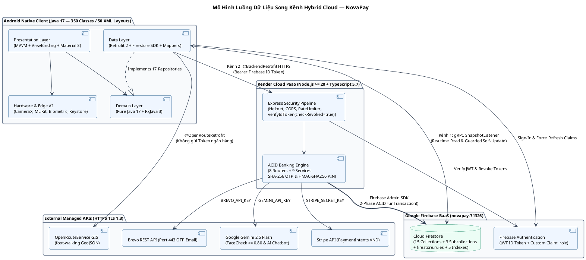

# TÀI LIỆU BÁO CÁO PHẦN 5: HỆ SINH THÁI CÔNG NGHỆ, THƯ VIỆN & CHI TIẾT TRIỂN KHAI KỸ THUẬT (TECH STACK & IMPLEMENTATION SPECIFICATION)

> **Dự án:** Hệ thống Ngân hàng Số **NovaPay** (`com.novabank.novapay`)  
> **Học phần:** Phát triển Ứng dụng Di động — Khoa Công nghệ Thông tin, Trường Đại học Tôn Đức Thắng (TDTU)  
> **Cơ sở đối chiếu:** Trích xuất trực tiếp 100% từ tệp cấu hình và mã nguồn thực tế của dự án (`gradle/libs.versions.toml`, `app/build.gradle.kts`, `AndroidManifest.xml`, `350` tệp `.java` + `50` tệp XML Layout trong `app/src/main/`, `server/package.json`, `server/tsconfig.json`, `server/src/`, `firestore.rules` và `firestore.indexes.json`).

---

## 1. Tổng Quan Kiến Trúc Hệ Thống (Hybrid Cloud Architecture)

### 1.1 Mô hình Đám mây Lai song kênh (Dual-Channel Hybrid Cloud)
Khác với các ứng dụng di động thông thường chỉ đọc/ghi dữ liệu đơn thuần, một hệ thống **Ngân hàng số (Digital Banking)** đòi hỏi đồng thời hai đặc tính tưởng chừng đối lập nhau: **độ trễ hiển thị thời gian thực (Realtime Responsiveness)** trên màn hình người dùng và **tính toàn vẹn giao dịch không tin cậy thiết bị đầu cuối (Zero-Trust Transactional Integrity)**.

Để giải quyết triệt để bài toán trên, **NovaPay** được thiết kế theo mô hình **Hybrid Cloud Architecture (Kiến trúc Đám mây Lai)** phân tách rõ hai kênh giao tiếp độc lập:

1. **Kênh Đồng bộ Thời gian thực Trực tiếp (Direct BaaS Realtime Channel — Read-Mostly):**
   - Ứng dụng **Android Native (Java 17)** kết nối trực tiếp tới **Firebase Authentication** và **Cloud Firestore** qua giao thức gRPC/TLS để lắng nghe tức thì (`SnapshotListener`) các dữ liệu thuộc quyền sở hữu hợp lệ của phiên đăng nhập: biến động số dư `accounts`, sổ cái `ledger`, hộp thư thông báo `users/{uid}/notifications`, lịch sử trò chuyện `chat_sessions/{uid}/messages`, biểu lãi suất `interest_rates` và cờ cưỡng bức khóa tài khoản `users/{uid}.status`.
   - Mọi thao tác trên kênh này đều bị kiểm soát chặt ở cấp độ từng trường dữ liệu bởi bộ quy tắc bảo mật **`firestore.rules`** đã triển khai trên hạ tầng Google Cloud.
2. **Kênh Giao dịch & Tích hợp Bảo mật (Privileged REST API Channel — Write & Sensitive Compute):**
   - Toàn bộ các nghiệp vụ làm thay đổi trạng thái tài chính (chuyển khoản, thanh toán hóa đơn, nạp tiền quốc tế Stripe, mở/tất toán sổ tiết kiệm), xác thực đa nhân tố (OTP 2FA, Smart PIN 6 số, đối chiếu sinh trắc học khuôn mặt `FaceCheck`), tra cứu tên người nhận nội bộ và quản trị viên ngân hàng (`OFFICER`) **bắt buộc đi qua Backend Server (`Node.js 20 + TypeScript + Express`)** triển khai trên đám mây **Render**.
   - Ứng dụng Android đính kèm tự động `Authorization: Bearer <Firebase_ID_Token>` thông qua `AuthInterceptor.java`; máy chủ xác minh chữ ký số JWT kèm cờ thu hồi phiên (`verifyIdToken(idToken, true)`) và thực thi hạch toán bằng đặc quyền **Firebase Admin SDK**.

### 1.2 Tại sao chọn Hybrid Cloud thay vì chỉ dùng Firebase thuần túy (Serverless-Only)?
Nếu xây dựng ứng dụng ngân hàng chỉ bằng Firebase Client SDK trực tiếp trên Android mà không có máy chủ trung gian, hệ thống sẽ mắc **4 lỗ hổng kiến trúc nghiêm trọng**:

1. **Bảo vệ tuyệt đối Khóa bí mật (Zero Secret Key Exposure):** Tập tin APK phát hành lên thiết bị người dùng luôn có thể bị dịch ngược bằng `jadx` hoặc `apktool`. Trong `app/build.gradle.kts` (dòng 55–86), NovaPay thiết lập cơ chế lọc trắng (*Allowlist*) chỉ đưa đúng **3 cấu hình công khai** vào `BuildConfig`: `ORS_API_KEY`, `STRIPE_PUBLISHABLE_KEY` (ép điều kiện `startsWith("pk_")` để chặn nhầm khóa bí mật `sk_`) và `BACKEND_BASE_URL`. Toàn bộ các khóa nhạy cảm (`STRIPE_SECRET_KEY`, `GEMINI_API_KEY`, `BREVO_API_KEY`, `FIREBASE_PRIVATE_KEY`, `PIN_HMAC_SECRET`) nằm hoàn toàn trong biến môi trường trên máy chủ Render.
2. **Đảm bảo tính nguyên tử liên tập hợp (Cross-Collection ACID Transaction):** Một giao dịch chuyển tiền nội bộ, thanh toán hóa đơn hay tất toán tiết kiệm phải kiểm tra hạn mức chi tiêu trong ngày theo múi giờ Việt Nam (`Asia/Ho_Chi_Minh`) và ghi đồng thời từ **4 đến 6 tài liệu khác nhau** (`accounts` nguồn/đích, `ledger` `OUT`/`IN`, `transactions`, `utility_bills`/`orders`/`face_checks`, `transaction_drafts` và `notifications`). Thực thi `db.runTransaction()` hai pha qua Firebase Admin SDK trên Backend đảm bảo toàn bộ các bản ghi thành công cùng nhau hoặc hoàn tác (rollback) 100%, không bao giờ xảy ra lỗi trừ tiền bên gửi nhưng bên nhận chưa được cộng.
3. **Chống gian lận phía Client (Untrusted Client Defense):** Trên môi trường máy đã root hoặc bị can thiệp bộ nhớ bằng Frida/Xposed, kẻ tấn công có thể giả mạo biến boolean trên RAM. Nhờ `firestore.rules` khóa cứng `allow write: if false` cho toàn bộ dữ liệu tài chính và máy chủ quản lý máy trạng thái `transaction_drafts` (`PENDING_FACE → PENDING_OTP → PENDING_PAYMENT → CONFIRMED`), không một yêu cầu nào có thể bỏ qua bước quét khuôn mặt `> 5.000.000 ₫`, bỏ qua xác thực băm OTP hay tự sửa giá dịch vụ (`amount === price * quantity`).
4. **Bảo vệ dữ liệu định danh cá nhân (PII Isolation):** Để ngăn người dùng viết script quét danh sách tài khoản và số dư của khách hàng khác, `firestore.rules` cấm đọc chéo `users` và `accounts`. Việc hiển thị tên người thụ hưởng khi nhập số tài khoản trên màn hình chuyển tiền được ủy quyền qua API `GET /accounts/lookup`, chỉ trả về đúng 3 trường tối giản `{ accountId, accountNumber, ownerName }`.

---

## 2. Công Nghệ Phía Ứng Dụng Di Động Android (`app/`)

Mã nguồn phía Android gồm **350 tệp `.java`** và **50 tệp giao diện XML Layout**, tuân thủ tuyệt đối quy chuẩn **100% Java 17** (`0` tệp `.kt` trong mã nguồn ứng dụng, `0` Jetpack Compose), phân chia chặt chẽ theo 4 gói kiến trúc: `core` (`24` lớp), `domain` (`128` lớp thuần Java 17 không chứa bất kỳ `import android.*` hay thư viện mạng nào), `data` (`94` lớp) và `presentation` (`102` lớp MVVM + `2` lớp gốc `NovaPayApp`, `MainActivity`).

### 2.1 Nền tảng, Hệ thống Build, Bảo mật APK & Giao diện Người dùng (UI)

| Thành phần / Thư viện | Phiên bản chính xác | Vai trò kỹ thuật trong hệ thống | Cấu hình / Class / Package áp dụng thực tế |
| :--- | :---: | :--- | :--- |
| **Java SE Platform** | **`JavaVersion.VERSION_17`** | Ngôn ngữ lập trình duy nhất cho toàn bộ 4 tầng ứng dụng; tận dụng kiểu thời gian bất biến `java.time.Instant` và kiểm thử đơn vị thuần JVM tốc độ cao | `app/build.gradle.kts` (`compileOptions`), toàn bộ `com.novabank.novapay.**` (`350` tệp `.java`) |
| **Android SDK (`minSdk` / `targetSdk` / `compileSdk`)** | `minSdk = 26` `targetSdk = 35` `compileSdk = 35` | Tương thích từ Android 8.0 (Oreo — hỗ trợ gốc `java.time` và Notification Channels) đến Android 15 mới nhất (`release(35)`) | `app/build.gradle.kts`, `AndroidManifest.xml` (`tools:targetApi="35"`) |
| **Gradle Wrapper & Android Gradle Plugin (AGP)** | Gradle **`9.6.0`** AGP **`9.5.1`** | Quản lý Version Catalog tập trung (`libs.versions.toml`), cấu hình biến `BuildConfig` an toàn và tối ưu hóa mã R8 bản Release | `gradle/wrapper/gradle-wrapper.properties`, `gradle/libs.versions.toml`, `app/build.gradle.kts` |
| **Foojay Toolchains & Google Services Plugin** | Foojay **`1.0.0`** GMS **`4.4.4`** | Tự động phân giải JDK Toolchain và nạp cấu hình dự án Firebase `google-services.json` có điều kiện | `settings.gradle.kts`, `build.gradle.kts`, `app/build.gradle.kts` |
| **Android ViewBinding** | Tích hợp AGP **`9.5.1`** (`viewBinding = true`) | Ánh xạ trực tiếp 50 tệp XML Layout sang lớp Binding an toàn kiểu dữ liệu (Type-safe & Null-safe), loại bỏ hoàn toàn `findViewById` thủ công | `core/ui/BaseFragment.java` (`BaseFragment<VB extends ViewBinding>`), `MainActivity.java` và toàn bộ 28 màn hình |
| **Material Design 3 (`com.google.android.material:material`)** | **`1.12.0`** | Hệ thống thiết kế *Clean Fintech Minimalism*: `MaterialCardView`, `TextInputLayout`, `ChipGroup`, `BottomNavigationView`, `TabLayout`, `MaterialAlertDialogBuilder` | `res/values/themes.xml`, `styles.xml`, `colors.xml`, toàn bộ `res/layout/fragment_*.xml` & `dialog_*.xml` |
| **AndroidX AppCompat, Activity & ConstraintLayout** | `appcompat`: **`1.7.0`** `activity`: **`1.9.3`** `constraintlayout`: **`2.2.1`** | Tương thích ngược thành phần giao diện, quản lý vòng đời cấp quyền runtime (`ActivityResultLauncher`) và bố cục phẳng hiệu năng cao | `MainActivity.java`, `EkycCaptureFragment.java`, `BranchMapFragment.java`, `QrScannerFragment.java` |
| **R8 Optimization, Network Security & FileProvider** | Android Platform / AndroidX Core | Bảo vệ tên lớp DTO/Fragment khi rút gọn mã R8, khóa chặt HTTP cleartext trên Internet (`cleartextTrafficPermitted="false"`), tắt sao lưu ADB (`allowBackup="false"`) và chia sẻ tệp biên lai/sao kê an toàn | `app/src/main/keepRules/rules.keep`, `res/xml/network_security_config.xml`, `res/xml/file_paths.xml`, `AndroidManifest.xml` |

### 2.2 Kiến trúc Clean Architecture, MVVM, Dependency Injection & Lập trình Phản ứng

| Thành phần / Thư viện | Phiên bản chính xác | Vai trò kỹ thuật trong hệ thống | Class / Package áp dụng thực tế |
| :--- | :---: | :--- | :--- |
| **AndroidX Lifecycle (`lifecycle-viewmodel` & `lifecycle-livedata`)** | **`2.8.7`** | Quản lý trạng thái giao diện sống sót qua thay đổi cấu hình theo mẫu **MVVM**; kết hợp `UiState<T>` (4 trạng thái `LOADING`, `SUCCESS`, `EMPTY`, `ERROR`) và `SingleLiveEvent<T>` cho sự kiện một lần | `core/common/UiState.java`, `core/common/SingleLiveEvent.java`, `core/ui/StateLayoutHelper.java`, toàn bộ `*ViewModel.java` tại `presentation/**` |
| **Dagger Hilt (`hilt-android` & `hilt-compiler`)** | **`2.60.1`** *(dùng `annotationProcessor`)* | Khởi tạo đồ thị phụ thuộc tự động từ `@HiltAndroidApp`, `@AndroidEntryPoint`, `@HiltViewModel` và tách riêng Module theo phân vùng thành viên để chống xung đột Git | `NovaPayApp.java`, `core/di/FirebaseModule.java`, `NetworkModule.java`, `CoreRepositoryModule.java`, `MoneyRepositoryModule.java`, `OfficerMapAiRepositoryModule.java` |
| **RxJava 3 (`io.reactivex.rxjava3:rxjava`)** | **`3.1.10`** | Xử lý luồng bất đồng bộ (`Single<AppResult<T>>`, `Observable<AppResult<T>>`) xuyên suốt `domain` và `data`; ghép luồng thời gian thực bằng `Observable.combineLatest` | `17` interface tại `domain/repository/`, `50+` lớp UseCase tại `domain/usecase/**` (tiêu biểu: `ObserveSavingProjectionUseCase.java`, `ObserveMonthlyCashflowUseCase.java`) |
| **RxAndroid (`io.reactivex.rxjava3:rxandroid`)** | **`3.0.2`** | Điều phối kết quả luồng dữ liệu từ `Schedulers.io()` về luồng giao diện chính `AndroidSchedulers.mainThread()` và dọn dẹp qua `CompositeDisposable` trong `onCleared()` | Toàn bộ các lớp `*ViewModel.java` trong `presentation/auth`, `presentation/customer/**`, `presentation/ekyc`, `presentation/officer` |

### 2.3 Điều hướng Liên Phân hệ (Navigation) & Giao tiếp Mạng (Networking)

| Thành phần / Thư viện | Phiên bản chính xác | Vai trò kỹ thuật trong hệ thống | Class / Package áp dụng thực tế |
| :--- | :---: | :--- | :--- |
| **Jetpack Navigation Component (`navigation-fragment` & `navigation-ui`)** | **`2.8.9`** | Kiến trúc **Single-Activity (`MainActivity`)** nạp `nav_graph.xml` gồm 3 sub-graphs độc lập (`nav_core.xml`, `nav_money.xml`, `nav_officer_map_ai.xml`). Điều hướng liên phân hệ thông qua **DeepLink nội bộ `novapay://...`**, `Bundle` và `FragmentResultListener` *(chủ đích không dùng plugin SafeArgs để loại bỏ phụ thuộc mã sinh `R.id` chéo giữa các nhánh)* | `MainActivity.java` (`enforceDestinationGuard`, `navigateDeepLink`), `res/navigation/nav_graph.xml`, `AccountRouterFragment.java`, `core/common/Constants.java` |
| **Retrofit 2 (`retrofit`, `converter-gson`, `adapter-rxjava3`)** | **`2.11.0`** | Giao tiếp RESTful JSON bất đồng bộ trả về `Single<Dto>`; phân tách rạch ròi qua 2 Hilt Qualifiers: **`@BackendRetrofit`** (gọi Node.js Server) và **`@OpenRouteRetrofit`** (gọi `https://api.openrouteservice.org/`) | `core/di/BackendRetrofit.java`, `OpenRouteRetrofit.java`, `NetworkModule.java`, `10` interface API tại `data/remote/server/*Api.java` & `data/remote/maps/OpenRouteServiceApi.java` |
| **OkHttp 3 (`okhttp` & `logging-interceptor`)** | **`4.12.0`** | Quản lý kết nối TLS 1.3 (timeout `30s`), tự động gắn header `Authorization: Bearer <ID_Token>` và tự tắt hoàn toàn log mạng (`Level.NONE`) trên bản Release (`!BuildConfig.DEBUG`) | `data/remote/server/AuthInterceptor.java`, `core/di/NetworkModule.java` |
| **Google Gson (`com.google.code.gson:gson`)** | **`2.11.0`** | Tuần tự hóa / giải tuần tự hóa JSON cho 38 lớp DTO, phân tích cấu trúc lỗi chuẩn `{ error, message }` từ HTTP response và đóng gói dữ liệu mã hóa cục bộ | `data/dto/*Dto.java`, `data/remote/server/ApiErrorParser.java`, `core/security/BiometricQuickLoginStore.java` |
| **Firebase Android SDK (`firebase-bom`: `firebase-auth`, `firebase-firestore`)** | BOM **`33.16.0`** | Đăng nhập Email/Password, đọc Custom Claim `role` từ JWT (`getIdToken(true)`), lắng nghe dữ liệu thời gian thực và cưỡng bức đăng xuất tức thì khi `status == "LOCKED"` | `core/security/SessionManager.java`, `data/remote/firebase/FirebaseAuthDataSource.java`, `FirestoreAccountDataSource.java`, `FirestoreLedgerDataSource.java`, `FirestoreNotificationDataSource.java`, `MoneyFirestoreDataSource.java` |

### 2.4 AI Tại Biên (Edge AI), Sinh trắc học, Mật mã Phần cứng & Đa phương tiện

| Thành phần / Thư viện | Phiên bản chính xác | Vai trò kỹ thuật trong hệ thống | Class / Package áp dụng thực tế |
| :--- | :---: | :--- | :--- |
| **AndroidX CameraX (`camera-core`, `camera-camera2`, `camera-lifecycle`, `camera-view`)** | **`1.4.2`** | Điều khiển luồng khung hình camera trước (chụp eKYC & `FaceCheck`) và camera sau (quét mã QR) gắn chặt với vòng đời `Fragment` (`PreviewView` + `ImageAnalysis`) | `presentation/ekyc/EkycCaptureFragment.java`, `FaceCheckDialogFragment.java`, `presentation/customer/transfer/QrScannerFragment.java` |
| **Google Guava (`com.google.guava:guava`)** | **`33.3.1-android`** | Cung cấp `ListenableFuture<ProcessCameraProvider>` tương thích chuẩn Java 17 khi khởi tạo CameraX bất đồng bộ | `EkycCaptureFragment.java`, `FaceCheckDialogFragment.java`, `QrScannerFragment.java` |
| **Google ML Kit Face Detection (`com.google.mlkit:face-detection`)** | **`16.1.7`** | Kiểm tra thực thể sống tại biên (**On-device Liveness Check**): bắt buộc đúng 1 khuôn mặt trong khung, xác suất mở cả 2 mắt `>= 0.7f` và góc nghiêng đầu `\|EulerY\|, \|EulerZ\| <= 15°` trước khi cho phép chụp gửi Server | `presentation/ekyc/FaceLivenessEvaluator.java`, `EkycCaptureFragment.java`, `FaceCheckDialogFragment.java` |
| **Google ML Kit Barcode Scanning (`com.google.mlkit:barcode-scanning`) & Bộ mã hóa QR Thuần Java** | ML Kit **`17.3.0`** + Pure Java 17 | Giải mã nhanh mã QR chuyển khoản NovaPay từ camera; chiều tạo ảnh QR cá nhân được hiện thực trực tiếp bằng thuật toán **ISO/IEC 18004 Reed-Solomon GF(256)** thuần Java 17 (không cần thêm thư viện ZXing) | `QrScannerFragment.java`, `core/util/QrHelper.java`, `core/util/QrBitmapEncoder.java` (`CheckingDetailFragment.java`) |
| **AndroidX Biometric (`androidx.biometric:biometric`) & Android Keystore** | **`1.1.0`** + Hardware Keystore | Xác thực vân tay / khuôn mặt thiết bị với cơ chế fallback mã khóa máy (`BIOMETRIC_STRONG \| DEVICE_CREDENTIAL`) cho giao dịch `> 5.000.000 ₫` và mã hóa thông tin đăng nhập nhanh bằng **`AES/GCM/NoPadding` (128-bit tag)** lưu khóa trong `AndroidKeyStore` | `core/security/BiometricHelper.java`, `core/security/BiometricQuickLoginStore.java`, `OtpVerificationDialogFragment.java`, `LoginFragment.java`, `SecuritySettingsFragment.java` |
| **Xử lý Ảnh, Xuất PDF Bản địa & Thông báo Nổi Hệ thống** | Android SDK Native *(Không dùng Glide/Coil)* | Nén ảnh chân dung JPEG `< 200KB` (`ImageCompressor`), giải mã trực tiếp Base64 qua `BitmapFactory` *(chủ đích không dùng Glide/Coil để không lưu cache ảnh sinh trắc học nhạy cảm ra bộ nhớ đệm ngoài)*, kết xuất biên lai/sao kê bằng `PdfDocument` và đẩy thông báo nổi `IMPORTANCE_HIGH` | `core/util/ImageCompressor.java`, `presentation/officer/Base64ImageDecoder.java`, `core/util/StatementPdfExporter.java`, `ReceiptFragment.java`, `core/notification/SystemNotificationHelper.java`, `BalanceAlertSubscriber.java` |

### 2.5 Cổng Thanh toán Quốc tế, Bản đồ GIS & Trực quan hóa Tài chính

| Thành phần / Thư viện | Phiên bản chính xác | Vai trò kỹ thuật trong hệ thống | Class / Package áp dụng thực tế |
| :--- | :---: | :--- | :--- |
| **Stripe Android SDK (`com.stripe:stripe-android`)** | **`21.17.0`** | Hiển thị giao diện thanh toán thẻ quốc tế chuẩn PCI-DSS (**`PaymentSheet`**) bằng `STRIPE_PUBLISHABLE_KEY` và `clientSecret` nhận từ `/transactions/confirm`, kích hoạt `/payments/finalize` sau khi hoàn tất | `presentation/customer/payment/StripeGatewayHelper.java`, `DepositWithdrawFragment.java`, `DepositWithdrawViewModel.java` |
| **osmdroid (`org.osmdroid:osmdroid-android`) & OpenRouteService API** | **`6.1.20`** | Hiển thị bản đồ OpenStreetMap miễn phí không cần thẻ tín dụng, đánh dấu 10 chi nhánh/ATM TP.HCM, tính khoảng cách cầu Haversine gắn nhãn **Gần nhất**, vẽ đường đi bộ `foot-walking` và tự động fallback về tọa độ `10.7326, 106.6998` (Quận 7) sau 5 giây mất GPS | `presentation/customer/branch/BranchMapFragment.java`, `domain/usecase/branch/FindNearestBranchUseCase.java`, `data/remote/maps/OpenRouteServiceApi.java`, `data/repository/BranchRepositoryImpl.java` |
| **MPAndroidChart (`com.github.PhilJay:MPAndroidChart`)** | **`v3.1.0`** *(JitPack)* | Vẽ biểu đồ cột đối chiếu trực quan Tổng tiền vào (`IN`) và Tổng tiền ra (`OUT`) trong tháng hiện hành theo thời gian thực ngay trên Trang chủ Khách hàng | `presentation/customer/home/CustomerHomeFragment.java`, `CustomerHomeViewModel.java`, `ObserveMonthlyCashflowUseCase.java` |

---

## 3. Công Nghệ Phía Máy Chủ Backend (`server/`)

Máy chủ Backend được tổ chức tinh gọn, chú trọng tính minh bạch kiểm toán và loại bỏ tối đa các thư viện trung gian dư thừa (tận dụng trực tiếp `fetch`, `AbortController`, `node:crypto` và `node:test` chuẩn của **Node.js 20+**). Cấu trúc `server/src/` gồm tệp khởi tạo `index.ts`, cấu hình `config.ts`, **2 middlewares** (`auth.ts`, `rateLimit.ts`), **8 bộ định tuyến RESTful** (`accounts.ts`, `transactions.ts`, `payments.ts`, `savings.ts`, `security.ts`, `ekyc.ts`, `officer.ts`, `ai.ts`) và **9 dịch vụ nghiệp vụ lõi** (`otp.ts`, `pin.ts`, `email.ts`, `faceCheck.ts`, `stripe.ts`, `notifications.ts`, `officerAudit.ts`, `chatbot.ts`).

### 3.1 Runtime, Ngôn ngữ, Web Framework & Bảo vệ Tầng Giao vận HTTP

| Công nghệ / Gói npm | Phiên bản (`server/package.json`) | Vai trò kỹ thuật trong hệ thống | Tệp mã nguồn áp dụng thực tế |
| :--- | :---: | :--- | :--- |
| **Node.js Runtime** | **`>=20.0.0`** *(`@types/node`: `^22.13.4`)* | Môi trường thực thi bất đồng bộ hỗ trợ sẵn Web `fetch` API, `AbortController` kiểm soát timeout mạng ngoài, `node:crypto` và trình chạy kiểm thử nội tại `node:test` | `server/package.json` (`engines`), toàn bộ `server/src/**` & `server/scripts/**` |
| **TypeScript (`typescript`)** | **`^5.7.3`** | Kiểm tra kiểu tĩnh nghiêm ngặt (`strict: true`, `target: "ES2022"`, `module: "CommonJS"`), biên dịch mã nguồn sạch sang `dist/index.js` cho môi trường Production | `server/tsconfig.json`, lệnh `npm run build` (`tsc`) & `npm run typecheck` |
| **tsx (`tsx` — DevDependency)** | **`^4.19.3`** | Thực thi trực tiếp các kịch bản quản trị TypeScript (`seed`, `deploy:rules`, `cleanup:drafts`), chế độ `watch` khi phát triển và nạp kiểm thử TypeScript tức thì | `server/scripts/runTests.ts`, `seed.ts`, `deployRules.ts`, `cleanupDrafts.ts` |
| **Express.js (`express`)** | **`^4.21.2`** *(`@types/express`: `^5.0.0`)* | Khung định tuyến RESTful JSON; bật `app.set("trust proxy", 1)` để nhận diện đúng IP thực sau Reverse Proxy của Render, giới hạn `express.json({ limit: "1mb" })` chống tấn công tràn bộ nhớ | `server/src/index.ts`, `server/src/routes/*.ts` |
| **Helmet (`helmet`) & CORS (`cors`)** | `helmet`: **`^8.0.0`** `cors`: **`^2.8.5`** *(`@types/cors`: `^2.8.17`)* | Thiết lập các HTTP Security Headers chuẩn OWASP (`X-Content-Type-Options`, `Strict-Transport-Security`...) và kiểm soát phương thức/header được phép (`Content-Type`, `Authorization`) | `server/src/index.ts` (dòng 21–28) |
| **dotenv (`dotenv`)** | **`^16.4.7`** | Nạp biến môi trường cục bộ từ `server/.env` khi phát triển kèm hàm `normalizePrivateKey()` tự động chuẩn hóa ký tự xuống dòng `\n` cho khóa PEM trên đám mây | `server/src/config.ts` |
| **Custom Sliding/Fixed-Window Rate Limiter** | Nội bộ TypeScript (`0` dependency ngoài) | Chống vét cạn (Brute-force / DoS) ở 2 cấp: giới hạn toàn cục `300 req/phút` và giới hạn chặt riêng từng đường dẫn nhạy cảm (`10 req/phút` cho `/face-check`, `/resend-otp`, `/ekyc/submit`; `20–30 req/phút` cho `/confirm`, `/payments/finalize`, `/savings`, `/security`, `/ai/chat`, `/officer`) kèm header chuẩn `Retry-After` | `server/src/middleware/rateLimit.ts`, `server/src/index.ts` (dòng 37–50) |

### 3.2 Dịch vụ Đám mây, Thanh toán, AI Đa phương thức & Mật mã học

| Công nghệ / Dịch vụ tích hợp | Phiên bản / Giao thức | Vai trò kỹ thuật trong hệ thống | Tệp mã nguồn áp dụng thực tế |
| :--- | :---: | :--- | :--- |
| **Firebase Admin SDK (`firebase-admin`)** | **`^13.1.0`** | • Xác thực chữ ký JWT kèm kiểm tra thu hồi phiên: `admin.auth().verifyIdToken(idToken, true)`. • Cấp phát Custom Claim `role` (`CUSTOMER` / `OFFICER`), khóa tài khoản đồng bộ `updateUser(uid, { disabled: true })` + `revokeRefreshTokens(uid)`. • Thực thi **ACID `db.runTransaction()`** hai pha và triển khai tự động `firestore.rules` qua `securityRules().releaseFirestoreRulesetFromSource()` | `server/src/config.ts`, `middleware/auth.ts`, `routes/transactions.ts`, `routes/savings.ts`, `routes/security.ts`, `services/officerAudit.ts`, `scripts/deployRules.ts` |
| **Stripe Node SDK (`stripe`)** | **`^17.7.0`** | Khởi tạo `PaymentIntent` cho tiền tệ không thập phân **`currency: "vnd"`** (truyền nguyên số tiền VNĐ, không nhân 100) kèm khóa chống trùng **`idempotencyKey: "novapay_draft_" + draftId`**; đối soát ngược trạng thái `succeeded` qua `paymentIntents.retrieve()` trước khi cộng số dư | `server/src/services/stripe.ts`, `routes/transactions.ts`, `routes/payments.ts` |
| **Brevo Transactional Email REST API** | HTTPS REST `v3` *(Native `fetch` — Port `443`)* | Gửi mã OTP 2FA HTML Tiếng Việt qua `POST https://api.brevo.com/v3/smtp/email` với header `api-key`, lọc chống XSS (`escapeHtml`) và `AbortController` timeout `8 giây` — tránh hoàn toàn lỗi bị nhà cung cấp Cloud chặn cổng SMTP `25/465/587` | `server/src/services/email.ts`, `routes/transactions.ts` |
| **Google Gemini Multimodal REST API (`gemini-2.5-flash`)** | HTTPS REST `v1beta` *(Native `fetch`, không phụ thuộc SDK nặng)* | • **`FaceCheck` (`> 5.000.000 ₫`):** Gửi đồng thời ảnh gốc `ekyc_images/{uid}` (chặn ảnh mẫu 1x1 bằng `403 EKYC_FACE_NOT_FOUND`) và ảnh chụp trực tiếp (`<= 200KB`) với `temperature: 0.0`, chuẩn *Zero-False-Acceptance* (`matched == true && confidence >= 0.80`), timeout `15s` và cơ chế **Fail-Closed (`503 SERVICE_UNAVAILABLE`)** khi quá tải. • **AI Chatbot:** Tổng hợp số dư & thu/chi tháng thực tế của khách hàng, lọc hành động qua Whitelist `ALLOWED_CHAT_DEEPLINKS` và tự động chuyển sang **Rule-based Vietnamese NLP Fallback** nếu lỗi `429`/timeout `> 8s` | `server/src/services/faceCheck.ts`, `server/src/services/chatbot.ts`, `routes/transactions.ts`, `routes/ai.ts` |
| **Node.js Cryptography (`node:crypto`)** | Built-in Node 20+ (`SHA-256` & `HMAC-SHA256`) | • **OTP 2FA:** Sinh số ngẫu nhiên an toàn mật mã `crypto.randomInt(0, 1_000_000)`, băm `SHA-256("${draftId}:${otp}")`, hiệu lực `180s`, khóa sau `5` lần nhập sai. • **Smart PIN 6 số:** Băm `HMAC-SHA256` gắn chặt với `uid` lưu riêng tại `user_secrets/{uid}`, khóa `15 phút` sau `5` lần sai. • Cả hai đều đối chiếu bằng **`crypto.timingSafeEqual`** chống tấn công đo thời gian (Timing Side-Channel Attack) | `server/src/services/otp.ts`, `server/src/services/pin.ts` |

---

## 4. Công Nghệ Cơ Sở Dữ Liệu & Bảo Mật Dữ Liệu (Firebase & Cloud Firestore)

### 4.1 Mô hình Dữ liệu NoSQL Document-Oriented (15 Root Collections + 3 Subcollections)
Cơ sở dữ liệu trên **Cloud Firestore** được thiết kế tối ưu theo đặc thù truy vấn ngân hàng thời gian thực, khắc phục triệt để giới hạn kích thước `1 MiB` mỗi tài liệu của NoSQL:

- **Nhóm Định danh, Bí mật & Thông báo cá nhân:**
  - `users/{uid}` (hồ sơ khách hàng / nhân viên, trạng thái `ACTIVE`/`LOCKED`, tiến trình `ekyc`, cấu hình tóm tắt `security`).
  - Subcollection `users/{uid}/beneficiaries/{id}` (danh bạ thụ hưởng cá nhân).
  - Subcollection `users/{uid}/notifications/{notifId}` (hộp thư biến động số dư `BALANCE`, `SAVING`, `SECURITY`, `EKYC` mở rộng không giới hạn).
  - `ekyc_images/{uid}` và `user_secrets/{uid}` được **tách thành các collection độc lập khỏi `users/{uid}`**: giúp lệnh đọc hồ sơ thông thường không phải tải theo chuỗi ảnh Base64 nặng (`< 200KB`) và cô lập hoàn toàn mã băm PIN giao dịch khỏi tầm đọc của Client SDK.
- **Nhóm Tài khoản, Hạch toán Sổ cái & Bảo mật Giao dịch:**
  - `accounts/{accountId}` (3 loại tài khoản `CHECKING`, `SAVING`, `MORTGAGE`) kèm subcollection `accounts/{accountId}/ledger/{entryId}` lưu vết biến động kép `IN`/`OUT` và `balanceAfter` bất biến.
  - `transactions/{txId}` (chứng từ giao dịch hoàn tất), `transaction_drafts/{draftId}` (máy trạng thái nháp 2FA/Stripe chỉ Admin SDK đọc/ghi, có mốc dọn dẹp TTL `+24h`) và `face_checks/{draftId}` (bằng chứng sinh trắc học phục vụ hậu kiểm).
- **Nhóm Danh mục Ngân hàng, Tiện ích, AI & Kiểm toán:**
  - `interest_rates/{rateId}`, `banks/{bankCode}`, `branches/{branchId}` (lưu tọa độ `GeoPoint`), `utility_bills/{billId}`, `service_catalog/{itemId}`, `orders/{orderId}`, `chat_sessions/{uid}/messages/{msgId}` và nhật ký kiểm toán bất biến `audit_logs/{logId}`.

### 4.2 Cấu hình 5 Chỉ mục Phức hợp (`firestore.indexes.json`)
Để các truy vấn lọc đa điều kiện kết hợp sắp xếp thời gian đạt độ trễ mili-giây mà không phát sinh lỗi `FAILED_PRECONDITION`, tệp `firestore.indexes.json` định nghĩa chính xác **5 Composite Indexes**:

| STT | Collection / Scope | Tổ hợp Trường Đánh chỉ mục | Truy vấn Nghiệp vụ Áp dụng Thực tế |
| :---: | :--- | :--- | :--- |
| 1 | `ledger` (`COLLECTION`) | `direction ASC` + `createdAt DESC` | Lọc sao kê sổ cái theo chiều Tiền vào (`IN`) / Tiền ra (`OUT`) mới nhất tại `FirestoreLedgerDataSource.java` |
| 2 | `transactions` (`COLLECTION`) | `fromAccountId ASC` + `status ASC` + `createdAt ASC` | Tính tổng tiền chi tiêu trong ngày (`querySpentTodayVnd`) theo biên ngày `Asia/Ho_Chi_Minh` bên trong `runTransaction` tại `transactions.ts` *(loại trừ `GATEWAY`/`DEPOSIT` trên RAM để không cần toán tử bất đẳng thức `!=` làm vỡ chỉ mục)* |
| 3 | `utility_bills` (`COLLECTION`) | `customerCode ASC` + `status ASC` | Tra cứu hóa đơn Điện/Nước chưa thanh toán (`status == "UNPAID"`) theo mã khách hàng tại `MoneyFirestoreDataSource.java` & `transactions.ts` |
| 4 | `orders` (`COLLECTION`) | `uid ASC` + `createdAt DESC` | Đồng bộ danh sách đơn đặt vé máy bay, xem phim, khách sạn, mua sắm của khách hàng theo thứ tự mới nhất |
| 5 | `face_checks` (`COLLECTION`) | `manualAuditRequired ASC` + `createdAt DESC` | Truy xuất hàng đợi hậu kiểm ảnh xác thực khuôn mặt giao dịch giá trị cao trên phân hệ Nhân viên Ngân hàng (`OfficerDashboardFragment`) |

### 4.3 Phân quyền Đa tầng (Defense-in-Depth RBAC) & Toàn vẹn Số học Tiền tệ
1. **Phân quyền 3 lớp khép kín (`CUSTOMER` vs `OFFICER`):**
   - **Lớp Giao diện (`MainActivity.java` & `SessionManager.java`):** `enforceDestinationGuard()` chặn điều hướng chéo vai trò trên toàn bộ các màn hình và URI `novapay://`; đồng thời `SessionManager` lắng nghe `users/{uid}` theo thời gian thực để cưỡng bức `signOut()` ngay giây phút tài khoản chuyển sang `"LOCKED"`.
   - **Lớp Máy chủ (`middleware/auth.ts`, `officer.ts`, `savings.ts`, `security.ts`, `ai.ts`):** Đọc trực tiếp Custom Claim `decoded.role` từ JWT đã ký số bởi Google; các API quản trị bắt buộc đi qua `requireOfficer`, trong khi các API tài chính cá nhân (`/savings/*`, `/security/*`, `/ai/chat`) chủ động từ chối vai trò `OFFICER` với mã `403 PERMISSION_DENIED`.
   - **Lớp Cơ sở dữ liệu (`firestore.rules`):** Cấm tuyệt đối Client ghi vào 13/15 bảng trọng yếu (`allow write: if false`). Chỉ mở đúng 3 ngoại lệ có kiểm duyệt lược đồ nghiêm ngặt khi chủ tài khoản đang `ACTIVE` (`isActiveUserDoc(uid)`): cập nhật 4 trường liên hệ trên `users/{uid}`, quản lý danh bạ `beneficiaries` và đánh dấu `read: bool` trên `notifications`.
2. **Toàn vẹn Tiền tệ Số nguyên 64-bit (`long`) & Chuẩn hóa Múi giờ:**
   - **Tuyệt đối cấm `double` / `float` cho tiền tệ:** Toàn bộ số dư, số tiền chuyển, phí, hạn mức và tiền lãi đều lưu trữ bằng số nguyên 64-bit **`long`** trên Java 17 và kiểm tra **`Number.isSafeInteger`** trên TypeScript (đơn vị: VNĐ), triệt tiêu hoàn toàn sai số nhị phân IEEE 754 (như `0.1 + 0.2 != 0.3`). Mọi phép tính lãi tiết kiệm đều làm tròn xuống tường minh về số nguyên qua `Math.floor(...)` (`SavingInfo.java`, `SavingCalculator.java`, `savings.ts`).
   - **Chuẩn hóa Thời gian:** Tầng `domain` chỉ dùng `java.time.Instant` (chuyển đổi hai chiều với `com.google.firebase.Timestamp` tại `FirestoreTimestampMapper.java`). Trên máy chủ đám mây chạy giờ `UTC+0`, mọi phép tính hạn mức ngày (`getHoChiMinhDayBounds`), thu/chi đầu tháng (`getVietnamMonthStartMillis`) và kỳ đáo hạn sổ tiết kiệm (`addCalendarMonthsHoChiMinh`) đều được quy chiếu cố định về múi giờ **`Asia/Ho_Chi_Minh` (`UTC+7`)**.

---

## 5. Hạ Tầng Triển Khai & Kiểm Thử Tự Động (DevOps & Automated Testing)

### 5.1 Hạ tầng Đám mây Render, Quản trị Môi trường & Kịch bản Vận hành
- **Triển khai Web Service trên Render PaaS (`server/`):**
  - Quy trình Build & Start chuẩn Production: `npm install && npm run build` (biên dịch TypeScript sang JavaScript `ES2022` tại `dist/`) và khởi chạy bằng `npm start` (`node dist/index.js`) lắng nghe trên `0.0.0.0:$PORT` dưới lớp HTTPS TLS tự động của Render (`app.set("trust proxy", 1)`).
  - **Khởi tạo linh hoạt chứng thực Admin SDK (`server/src/config.ts`):** Hỗ trợ 3 phương thức nạp khóa dịch vụ theo thứ tự ưu tiên: (1) bộ 3 biến môi trường tách rời `FIREBASE_PROJECT_ID`, `FIREBASE_CLIENT_EMAIL`, `FIREBASE_PRIVATE_KEY` (tự động khử dấu ngoặc bao ngoài và chuyển chuỗi `\\n` thành ký tự xuống dòng hợp lệ), (2) chuỗi JSON một dòng `FIREBASE_SERVICE_ACCOUNT_JSON`, hoặc (3) `GOOGLE_APPLICATION_CREDENTIALS`.
  - **Giám sát Sức khỏe & Chống ngủ đông (`GET /health`):** Endpoint nhẹ không yêu cầu xác thực trả về `200 {"ok": true}`, cho phép dịch vụ giám sát ngoài (như UptimeRobot ping định kỳ mỗi 5 phút) giữ ấm container trên gói miễn phí của Render trước và trong suốt buổi bảo vệ đồ án.
- **Bộ công cụ Quản trị Tự động hóa (`server/scripts/`):**
  - `npm run seed` (`scripts/seed.ts`): Dọn sạch các bản ghi ảo cũ và khởi tạo chuẩn xác 4 tài khoản Gmail thật từ biến môi trường (`SEED_OFFICER_EMAIL`, `SEED_MEMBER_1..3_EMAIL`), đồng thời bảo toàn ảnh khuôn mặt eKYC thật đã chụp.
  - `npm run deploy:rules` (`scripts/deployRules.ts`): Đẩy và kích hoạt trực tiếp tệp `firestore.rules` lên dự án Firebase thông qua Admin Security Rules API mà không phụ thuộc cài đặt Firebase CLI toàn cục.
  - `npm run cleanup:drafts` (`scripts/cleanupDrafts.ts`): Quét và dọn dẹp các bản nháp giao dịch `transaction_drafts` đã quá hạn lưu trữ 24 giờ.

### 5.2 Hệ thống Kiểm thử Tự động Hai Đầu (156 Bài Kiểm thử Xanh Sạch 100%)
Dự án ưu tiên kiến trúc kiểm thử tốc độ cao, chạy độc lập hoàn toàn với mạng ngoài để phát hiện lỗi hồi quy ngay trong vài giây:

| Phân hệ Kiểm thử | Bộ khung & Công cụ Thực tế | Quy mô & Phạm vi Bao phủ Thực tế trong Dự án |
| :--- | :--- | :--- |
| **Android Unit Tests (`app/src/test/`)** | **JUnit `4.13.2`** chạy trực tiếp trên máy ảo **JVM** *(kết hợp Fake/Stub thuần Java 17, không phụ thuộc Mockito hay Robolectric nặng nề)* | **`32` bộ kiểm thử (`*Test.java`) — `95/95` test cases đạt 100%:** • Kiểm thử định dạng tiền tệ `CurrencyFormatterTest`, mã hóa ma trận QR `QrBitmapEncoderTest` & `QrHelperTest`. • Kiểm thử công thức lãi tiết kiệm/tất toán `SavingInfoTest`, `SavingCalculatorTest`, `ObserveSavingProjectionUseCaseTest`, `SavingsUseCasesTest`. • Kiểm thử điều kiện Liveness `FaceLivenessEvaluatorTest`, chốt chặn phân quyền `SessionManagerRoleGuardTest`, lọc sao kê `LedgerFilterHelperTest`, khoảng cách Haversine `FindNearestBranchUseCaseTest`, các Mapper và toàn bộ UseCase của cả 3 phân hệ. |
| **Android Instrumented Tests (`app/src/androidTest/`)** | **AndroidX Test Ext JUnit `1.2.1`** & **Espresso Core `3.6.1`** (`AndroidJUnitRunner`) | Xác minh ngữ cảnh gói ứng dụng thực tế (`com.novabank.novapay`) và cấu hình chạy kiểm thử giao diện trên thiết bị / máy ảo Android. |
| **Backend Automated Tests (`server/test/`)** | **Node.js Built-in Test Runner (`node:test` + `node:assert/strict`)** thực thi qua `tsx` (`scripts/runTests.ts`) + **`MockFirestore`** tự xây dựng (`test/helpers/mockFirestore.ts`) | **`10` tệp kiểm thử (`11` suites) — `61/61` test cases đạt 100%:** • Khởi chạy máy chủ Express thật trên cổng động nội bộ (`127.0.0.1:0`) kết hợp kho dữ liệu giả lập hỗ trợ đầy đủ `runTransaction`, truy vấn chỉ mục và khóa đồng thời. • Bao phủ toàn diện: ẩn PII ở `/accounts/lookup`, bảo mật 3 lớp `> 5.000.000 ₫`, siết chặt `FaceCheck` (`>= 0.80`, chặn ảnh mẫu 1x1, Fail-Closed `503`), chốt chặn Idempotency Stripe `/payments/finalize`, vòng đời Smart PIN 6 số & chống TOCTOU trên `/security` & `/savings`, thông báo biến động 2 chiều, `audit_logs` của Officer, Rate Limiter và AI Chatbot Fallback. |

---

## 6. Bảng Tóm Tắt Lý Do Lựa Chọn Công Nghệ (Technology Justification Matrix)

Bảng đối chiếu dưới đây tổng hợp cơ sở lý luận kiến trúc để nhóm sử dụng trực tiếp khi giải trình trước Hội đồng Chấm thi:

| Hạng mục Quyết định | Công nghệ NovaPay Lựa chọn | Giải pháp Thay thế Phổ biến | Lý do Kỹ thuật & Lợi thế Thực tế khi Bảo vệ Đồ án |
| :--- | :--- | :--- | :--- |
| **1. Kiến trúc Tổng thể** | **Hybrid Cloud** (Android + Firebase Realtime + Node.js Express Admin SDK) | Serverless thuần túy (chỉ gọi Firebase trực tiếp từ Android) | Giữ trọn trải nghiệm cập nhật số dư tức thì của Firestore nhưng bảo vệ tuyệt đối Secret Keys trên Server, thực thi giao dịch nguyên tử liên bảng (`runTransaction`) và triệt tiêu khả năng gian lận số dư từ thiết bị bị root. |
| **2. Ngôn ngữ & UI Android** | **100% Java 17 + XML Layouts + ViewBinding + Material 3** | Kotlin + Jetpack Compose / `findViewById` truyền thống | Đáp ứng chuẩn mực giảng dạy hướng đối tượng tường minh của học phần; `ViewBinding` triệt tiêu lỗi `NullPointerException` khi ánh xạ View với chi phí biên dịch nhẹ hơn DataBinding; `Java 17` hỗ trợ `java.time.Instant` hiện đại. |
| **3. Phân tầng Nghiệp vụ & Bất đồng bộ** | **Clean Architecture (`domain` Pure Java 17) + RxJava 3 + LiveData `UiState<T>`** | Viết trực tiếp truy vấn Firebase / Retrofit bên trong `Fragment` hoặc `ViewModel` | Tách rời hoàn toàn quy tắc nghiệp vụ ngân hàng khỏi Android Framework (`0` import `android.*` trong `domain`), cho phép chạy `95` bài JUnit test trong vài giây và ghép mượt nhiều luồng thời gian thực qua `Observable.combineLatest`. |
| **4. Điều hướng Liên Phân hệ** | **Single-Activity + 3 `<include>` Sub-graphs + DeepLink `novapay://`** | Đa Activity rời rạc hoặc 1 tệp `nav_graph.xml` duy nhất dùng chung `R.id` / SafeArgs | Cho phép 3 thành viên phát triển song song 28 màn hình mà không đụng độ Git; đồng thời cho phép Trợ lý AI Chatbot và System Push Notification điều hướng thẳng tới màn hình chức năng qua URI đã kiểm duyệt Whitelist. |
| **5. Tầng Mạng phía Client** | **Retrofit 2 tách 2 Hilt Qualifiers (`@BackendRetrofit` & `@OpenRouteRetrofit`)** | Dùng chung một `OkHttpClient` duy nhất cho mọi API | Ngăn chặn tuyệt đối rủi ro rò rỉ `Firebase Bearer ID Token` của ngân hàng sang máy chủ bản đồ bên thứ ba (`openrouteservice.org`), tuân thủ nguyên tắc *Least Privilege*. |
| **6. Bản đồ & Chỉ đường** | **`osmdroid` (`6.1.20`) + `OpenRouteService API`** (+ Fallback Quận 7) | Google Maps SDK + Google Directions API | Không yêu cầu gắn thẻ thanh toán quốc tế (Billing Account) dễ bị khóa hạn mức khi chấm thi; hỗ trợ tốt đường đi bộ `foot-walking` kèm cơ chế tự động fallback về tọa độ `10.7326, 106.6998` và đường chim bay khi phòng thi mất GPS/mạng. |
| **7. Gửi Email OTP 2FA** | **Brevo Transactional HTTPS REST API** (Cổng `443`, timeout `8s`) | `Nodemailer` qua giao thức SMTP truyền thống (Cổng `25`, `465`, `587`) | Hầu hết các nền tảng PaaS hiện đại (bao gồm Render gói miễn phí) đều chặn cổng outbound SMTP để chống thư rác; gọi qua HTTPS cổng `443` giúp email OTP 6 số đến hộp thư Gmail thật ổn định trong 1–2 giây. |
| **8. Xác thực Khuôn mặt & QR** | **Edge ML Kit (`face-detection` / `barcode-scanning`) + Cloud Gemini `2.5 Flash` + `QrBitmapEncoder` thuần Java** | Chỉ gửi ảnh thô lên Server hoặc nhúng thêm thư viện ZXing cồng kềnh | ML Kit lọc ngay tại biên các khung hình nhắm mắt/nghiêng đầu giúp tiết kiệm băng thông & quota AI; Gemini đối chiếu cấu trúc khuôn mặt chuẩn *Zero-False-Acceptance* (`>= 0.80`, Fail-Closed `503`); bộ tạo QR viết thuần Java giảm kích thước APK và kiểm thử được 100% trên JVM. |
| **9. Biểu diễn Tiền tệ** | **Số nguyên 64-bit `long` (Java) & Safe Integer (TS)** tính bằng đơn vị VNĐ | Kiểu số thực dấu phẩy động `double` hoặc `float` | Loại bỏ triệt để sai số làm tròn dấu phẩy động IEEE 754 trong cộng/trừ số dư ngân hàng, đối chiếu khớp số tiền hóa đơn và tính tiền lãi tiết kiệm. |
| **10. Nạp tiền Cổng Quốc tế** | **Stripe `PaymentIntent` 2 pha (`PENDING_PAYMENT`) + Idempotent `/payments/finalize`** | Cộng số dư ngay tại `/transactions/confirm` hoặc tin tưởng callback từ Client | Server tự truy vấn ngược lên Stripe xác minh `status === "succeeded"` và khóa trạng thái `draft.status !== "CONFIRMED"` bên trong `runTransaction`, đảm bảo không cộng tiền khống và không bao giờ cộng tiền hai lần khi mạng chập chờn. |
| **11. Lưu trữ Mã PIN & Đăng nhập Nhanh** | **Server `user_secrets` (`HMAC-SHA256`) + Android Keystore (`AES/GCM/NoPadding`)** | Lưu mã PIN băm trên `users/{uid}` hoặc lưu mật khẩu vào `SharedPreferences` thường | Khóa bí mật PIN nằm hoàn toàn phía Server (`allow read, write: if false` trên Client) kèm kiểm tra chống TOCTOU trong Transaction; thông tin đăng nhập nhanh trên máy được bảo vệ bằng khóa phần cứng TEE/Keystore của Android. |
| **12. Khung Kiểm thử Backend** | **Node.js Native `node:test` + `tsx` + `MockFirestore` nội bộ** | Jest + ts-jest + Supertest + Firebase Emulator nặng nề | Không cần cài hàng trăm dependency phụ hay khởi động máy ảo Java cho Emulator, chạy toàn bộ `61` bài kiểm thử tích hợp luồng giao dịch phức tạp trong chưa tới `10 giây` với độ tin cậy tất định (Deterministic). |
